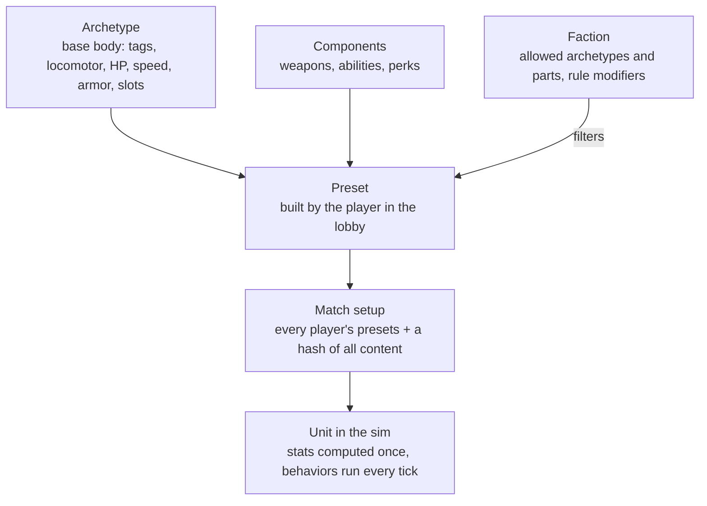
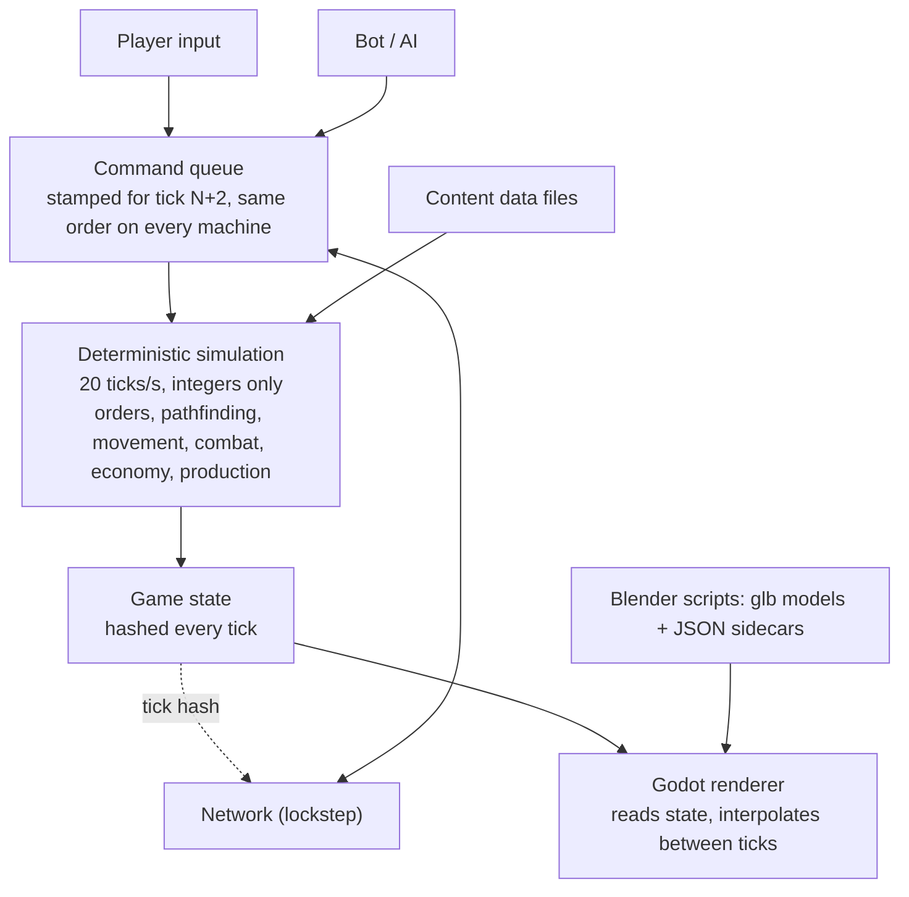

# RTS Game Design System

Updated October 16, 2026

The first playable game is a Resistance-vs-Resistance 1v1 skirmish on one 96×96 map against a tunable test bot. It runs on a deterministic simulation that the renderer only draws. The renderer is a real-time 3D Godot client; units, buildings and props are 3D models built by scripts and played as they are. Every decision here was agreed step by step, first in the illustrated [Resistance MVP walkthrough](resistance-mvp.html) (download and open it in a browser; it predates the move from pre-rendered sprites to real-time 3D, so its illustrations show the earlier sprite look) and since then in the project's decision log. Setting: the real world today, with fictional countries, groups and leaders.

The game is a Generals-style modern RTS: tilted perspective camera, trackpad-first C&C controls (left-click selects, moves and attacks; pinch or scroll zooms), garrisonable buildings, a rocket fleet that depends on supply.

## Visual spec

Real-time 3D, "real but low poly, like Generals": realistic proportions and materials, smooth shading with hard edges only where real, and just enough exaggeration to read at RTS distance. The bar is polished and carefully crafted, not very low poly. Every asset follows one camera, one light and one scale, so assets from different artists or scripts look like the same game. (The game's art bible, kept with the art, holds the full rules; this section is the engine-facing summary.)

| Rule | Value | Why |
| --- | --- | --- |
| Rendering | Real-time 3D in Godot 4 (.NET), capped at 60 fps with vsync | Models scale with zoom and animation follows sim speed; pre-rendered sprites were tried and rejected (too small, wrong walk cadence) |
| Camera | Perspective, 35° field of view, about 52° down when zoomed out and 34° in a close-up; zoom from 7 m to 120 m | The classic tilted RTS view, close enough to admire a soldier, far enough to see a base |
| Tactical preset | Perspective 35°, distance about 66 m, pitch about 40° below the horizon, yaw about 0.5 rad (about 29°, a diagonal view of a city grid) | One agreed framing for official screenshots and lineups; whether it becomes the default gameplay camera is still open |
| Scale | 1 cell = 2 m; a soldier is about 1.9 m (about 0.95 cell tall); real-world metres everywhere | Keeps models, speeds and ranges honest; the 96×96 map is 192 m square |
| Footprints | Infantry about 0.4 cell, light vehicle 1 cell, heavy vehicle 1.5 cells, buildings snap to cells (2×2 up to 23×6) | Keeps pathing on a cell grid |
| Readability | Head and helmet +15%, weapons +25%, slightly thicker limbs, applied in the model | Roles read at a glance from far away |
| Key light | One sun from the top-left (north-west), 60° up, warm, soft real-time shadows, plus a procedural sky for ambient light | Shadows fall bottom-right on every asset, and stay about as long as the unit is tall |
| Frames | Skinned animations sampled at 30 fps and driven from sim state (speed, firing, reloading) | Feet stay planted; animation never leads the sim |
| Team color | A flat `TEAM` material on real parts (infantry: helmet band and left armband; vehicles: door stripes and roof panel), tinted per player at runtime; 8 player colors | One model serves every player |
| Triangle budgets | Infantry about 8 to 12k, vehicles about 30 to 50k with crew, buildings 40 to 80k per damage stage, 2K baked textures | Polished, but 60 fps with dozens of units on screen |

**Color hierarchy.** Terrain is warm and desaturated. Unit bodies are mid-saturation neutrals (arid multicam, coyote gear, matte black weapons, sun-faded sand paint). Team color is the most saturated element on a unit. Effects (muzzle flash, explosions, tracers) are the brightest thing on screen.

**Silhouette rule.** Each role must be identifiable from its silhouette alone at the strategic zoom: tanks low and wide, artillery a long barrel, anti-air vertical barrels, harvesters a big box, infantry upright. If two units can be confused when shown as black shapes, redesign one.

**Setting rule.** Real-world gear on fictional groups. No real flags, patches, insignia, slogans, logos or any text on assets.

**Rendering boundary.** The simulation never reads the renderer and the renderer never writes the simulation, so drawing can never cause a desync. Hidden units are drawn only when the player can see them; units hidden behind scenery show as a flat team-colored silhouette.

## Art pipeline

Every model is built by a script, so adding a unit takes hours, not weeks and every asset can be rebuilt identically. There are no third-party models, textures or animations.

1. **Build.** A Blender (Python) script builds the model at real-world scale (1 Blender unit = 1 metre; the game maps 1 cell to 2 m): geometry, shared material library (base paint, fabric, metal, rubber, glass, one flat `TEAM` material), rig and animations for characters, named nodes for everything the game must find (weapons, muzzles, wheels, turrets, doors, window firing points).
2. **Bake.** Procedural materials (camo, grime, wear, ambient occlusion) are baked to base-colour textures (2K for bodies, vehicles and building stages; smaller for weapons and props). No directional shadow is baked in.
3. **Export.** One glTF binary (`.glb`) per asset plus a JSON sidecar: units, up axis, facing, the animations (frames, loop flag, ground speed, event frames), weapon and muzzle nodes, named nodes, notes (footprints, fire points, tube order). Units face -Z, origin on the ground.
4. **Verify.** A script re-imports the glb in a fresh Blender and checks animations, `TEAM`, named nodes and baked poses; a style checker validates every export against a machine-readable style file (palette, budgets, naming rules, banned content).
5. **Import.** The Godot client loads the glb and sidecar at runtime (no import step) and reads values from the sidecar: it never hard-codes art values. Stand-in procedural shapes keep the game playable while art is missing.

Contract rules that keep the pipeline safe: unique node names; a flat material named exactly `TEAM`; visibility that changes during an animation is keyed bone scale, every animation keys every visibility bone and no track is constant (Godot strips unchanging tracks).

File naming: `art/export/<asset>.glb` and `<asset>.json`, snake_case.

Animations for infantry (idle, aim idle, walk, run, shoot, reload, hit, three deaths, plant, launch, plus launcher and worker animations) are authored in the same scripts and shared by every class. Crewed vehicles carry their crew (gunner, driver) and wrecks (`body_destroyed`) in the same file.

## MVP: map, economy and base

One hand-made 96×96 map, bases in opposite corners, won by destroying every enemy structure and defense.

| Topic | Decision |
| --- | --- |
| Map | 96×96 cells, fog of war (unexplored dark, explored-but-unseen grey), one central oil field |
| Gold mines | 2 visible per base + 4 hidden; the map marks possible spots and the match seed picks which hold gold |
| Gold | Workers mine and carry each load back to the HQ; mines slowly run dry |
| Oil | A derrick on an oil spot plus a refinery within range of it; slower and costlier than gold, pays more over time |
| Starting cash | A grant at match start |
| Builders | Only workers build structures, for now |
| Power | None |
| Starting defenses | Pre-placed anti-infantry and anti-armor emplacements at each base; exact set to be decided |
| Win | Destroy every enemy structure and defense, starting defenses included (Phase 1, before structures exist: a player with no soldiers left, on foot or driving, is defeated) |
| Neutral buildings | Garrisonable city blocks stand on the map (see [Buildings](#buildings-garrisons-and-destruction)) |

| Structure | Does | Requires |
| --- | --- | --- |
| HQ | Trains workers, receives gold | Start |
| Barracks | Trains the four infantry classes | HQ |
| Vehicle yard | Builds the six vehicles | Barracks |
| Supply depot | Rearms launchers and drone kits out of a finite stock (1000 supply); faster reload nearby; the only place a rocket truck reloads; refilled by cargo trucks | HQ |
| Tunnel entrance | A node in the tunnel network | Barracks |
| Derrick + refinery | Oil income | Supply depot |

## Combat rules

Damage dealt = weapon damage × the warhead-vs-armor multiplier below, so every unit has a clear counter. "—" means the weapon can't target that kind of unit. No heavy armor in the mirror match.

| Warhead ↓ / Armor → | Infantry | Light vehicle | Building | Drone | Medium vehicle | Armored vehicle | Parked aircraft |
| --- | --- | --- | --- | --- | --- | --- | --- |
| Bullet | 100% | 40% | 10% | 15% | 40% | 20% | 60% |
| Sniper round | 150% | 20% | 5% | 15% | 20% | 10% | 30% |
| Rocket (AT missile, launchers) | 40% | 120% | 80% | — | 120% | 120% | 120% |
| Rocket truck rocket | 67% | 133% | 80% | — | 133% | 35% | 133% |
| Explosive (traps, FPV drones) | 100% | 100% | 60% | — | 100% | 100% | 120% |
| Heavy rocket | 100% | 100% | 200% | — | 100% | 120% | 120% |
| Heavy missile (twin missile) | 100% | 100% | 220% | — | 100% | 100% | 120% |
| Ballistic (tactical missile) | 100% | 100% | 220% | — | 100% | 170% | 120% |
| ATGM (Kornet) | 15% | 100% | 45% | — | 55% | 100% | 100% |
| Mortar bomb | 100% | 45% | 30% | — | 45% | 10% | 80% |
| Drone charge | 100% | 100% | 100% (20% of max HP) | — | 100% | 100% | 100% |
| Air strike (Watcher missile) | 100% | 60% | 120% | — | 60% | 25% | 100% |
| AP mine blast | 100% | 10% | 5% | — | 10% | 2% | 40% |
| AT mine blast | 100% | 100% | 30% | — | 100% | 25% | 100% |
| AA missile | — | — | — | 100% | — | — | — |

Medium vehicle is the rocket launchers' class (light, medium and heavy rocket trucks, the
heavy rocket truck and the twin missile truck); every warhead but the ATGM treats it like a
light vehicle. The technical and the cargo truck stay light vehicles. Armored vehicle is the
infantry carrier's class (2026-10-18): tuned with its 1200 HP so that no weapon's whole first
salvo kills it, even with every round a direct hit, except the tactical ballistic missile and a
full 12-rocket heavy salvo (see "Infantry carrier" below). Parked aircraft (2026-10-19, airfield
M3b) is the armor of an aircraft on the ground at an airfield (its aircraft block's `groundArmor`):
a thin airframe full of fuel, a little softer than a light vehicle; it is never an attack target
there and only splash reaches it. In the air the same aircraft keeps its drone armor.

- Rockets and explosives deal splash; launcher rockets fly with travel time and scatter, so they can miss moving targets.
- Traps (booby traps and the assault soldier's mines) are hidden from the enemy, fire once when an enemy ground unit comes close, and ignore drones. Only enemy snipers, scout drones and observation posts reveal them (2026-10-18; engineers no longer do); once revealed, any unit can shoot them, which clears them without a blast. The full rules are under "Traps" below.
- **Rockets and missiles collide.** They fly along their aim line and go off at the first unit, structure or rock they touch (full damage to what they hit plus splash around the point), or on the ground at the aim point if nothing is in the way. Friends count; the shooter and anyone inside a vehicle don't. Launcher rockets fly an arc and only collide in the last 2 cells; one coming down over a structure's footprint hits its roof.
- **Leading targets.** Rockets and missiles aim where a moving ground target will be after the flight time, so a target driving straight is hit and one that turns or stops can still dodge. Attack orders are always obeyed; automatic targeting has per-armor engagement limits (the AT missile auto-engages infantry only close up and prefers vehicles and structures).
- **Weapon modes.** Each unit has a weapon mode: `auto` (any weapon, the best for the target) or `primaryOnly` (only its first weapon). Anti-armor soldiers default to `primaryOnly` (RPG only: he keeps to his launcher and never switches to a sidearm); the player toggles RPG-only vs RPG + rifle in the command card.
- **Attack ground.** A force-fire order: units walk into range of a cell and fire at it until given another order. Splash hits whoever stands there, friends included.
- **Range anchors.** The RPG reaches 9 cells; a technical's heavy MG 6 cells. Small arms show thin, short muzzle flashes and thin white tracers in per-weapon bursts.
- All values are integers in the sim (percent as 0–100), never floats. Starting values for tuning (they live in the content data files); traps per soldier is set in playtests.

### Unit AI (2026-10-19)

What units do without orders, after Zero Hour's player rules (its open-sourced code: `AIStates`,
`AIGuard`, `AIGuardRetaliate`, `ActiveBody`, `SquishCollide`). Numbers live in the `unitAi` content
block (`content/mvp/unit_ai.json`); archetypes set `stance`, `pursue`, `leash`, `retaliateMax`,
`autoFireDeployed`, `crusher` and `crushable`. Code: `Sim/Systems/UnitAiSystem.cs`, `OrderSystem.cs`,
`CrushSystem.cs`.

| Stance | Fires on its own at | Moves on its own |
| --- | --- | --- |
| **Guard** (default) | spotted enemies in weapon reach | to retaliate (it and idle friends nearby), on the leash, then walks back |
| **Aggressive** | the same, and goes after spotted enemies within vision x 1.33 | chases on the leash, then walks back |
| **Hold ground** (the old Guard) | spotted enemies in reach | never |
| **Return fire** | only the enemy that last hurt it, in reach | never |
| **Hold fire** | nothing (orders only) | never |

- **Retaliation.** An enemy's shot or blast hurting a unit in Guard or Aggressive (even fatally)
  calls it and its idle friends within 8 cells: each that pursues and can hit the shooter goes after
  it. Not for flying shooters, shooters beyond 20 cells, units with an order (attack-move and Guard
  count as idle), units in a building or vehicle, or archetypes that don't pursue (launchers, the
  mortar, air defence, engineer, worker: `pursue: false` or a deploy or air vision). A shooter in a
  building makes them go for the building. One call per victim per second (a salvo calls once).
- **Leash.** The chase starts from where the unit stood (its guard point; on a Guard order, the
  post). It closes to weapon reach like an attack and ends when the target dies or hides in a
  vehicle or building, gets farther than vision x 2.2 from the point, or after 15 s. A shooter it
  can't see: it heads for where the shot came from (an attack-move: it stops for targets in reach),
  while that is within the leash. Then it engages anything else spotted within vision x 1.8 of the
  point, or walks back, scanning that circle every second, and idles. Stop, any order, or a stance
  that doesn't move ends it.
- **Attack-move** (A + click on the ground). A group move; each unit fires at spotted enemies in
  reach on the way (no chase), fixed weapons stop for them and carry on, turrets fire on the move;
  it retaliates on the way and ends on arrival. An attack target lost in the fog becomes an
  attack-move to where it was last seen.
- **Guard order** (Option+G on a cell or one of your units). Each unit keeps to its post (a group:
  its formation slot; a guarded unit: within 3 cells, the circle moving with it), engages the best
  spotted enemy within vision x 1.8 of it every half second, chases on the leash and walks back.
  It lasts until another order.
- **Scatter** (Option+S). Each selected unit moves straight away from the group's centre by
  4 x its radius, at least 2 cells (one on the centre goes the way it faces).
- **What units pick.** The enemy that hurt it within 15 s, then threats (they can hit it) before
  harmless units, then targets a weapon engages freely before restricted ones (`autoRange`), then
  the weapon's priority list, nearest, lowest ID. It keeps its target, but drops a harmless one for
  its attacker. Structures that can't fight are left to orders; armed ones and enemy-held
  buildings are picked. Only spotted enemies, always.
- **Launchers.** A set-up mortar fires on its own (it never sets up by itself); the heavy MRL,
  heavy rocket truck, twin missile, tactical missile, rocket jeep and drone truck fire on orders
  only; light and medium rocket trucks fire on their own in reach but never chase.
- **Crushing.** A vehicle rolling forward kills enemy infantry it drives into (touching, heading
  toward it): trucks, launchers and the carrier crush; the dirt bike doesn't. Friends, passengers,
  garrisons and vehicles are never crushed. The AI doesn't chase infantry to crush them.
- **Carrier passengers** don't fire from inside (a closed carrier).
- **The computer opponent** (`SkirmishAi`) puts its fighters in Aggressive, on Guard posts round
  its base, and sends its waves by attack-move.
- **Determinism and cost.** Integer distances only, no random draws, ID order and ID tie-breaks;
  radius queries go through the spatial index. Scans of the guard and Aggressive circles (and the
  rescan after a chase) run every 10 ticks phased by unit ID (`(tick + id) % 10`). Vision by
  distance is staggered too: a viewer looks around every 4 ticks (`(tick + id) % 4`,
  `World.VisionTicks`) or as soon as it enters another cell, and what it saw stays spotted until it
  looks again, so spotting and losing sight lag by at most 3 ticks (0.15 s). A unit without a
  target searches its reach when it has just looked around (or on that phase); a unit whose target
  just became invalid searches at once, and a valid target is still checked every tick. A chase's first route waits up to a second, staggered by ID, so a
  fight that sets off many chases spreads their path searches.

### Traps (2026-10-18)

The assault soldier lays two mines (kits `ap_mine_kit` and `at_mine_kit`: 1.5 s to lay one, up to
1.5 cells away; 4 and 2 charges, a depot refills them; at most 8 and 4 of one soldier's on the
map, laying another lifts his oldest). Numbers are in `content/mvp` (`ap_mine_charge`,
`at_mine_charge`, warheads `ap_blast` and `at_blast`); the code is `Sim/Systems/TriggerSystem.cs`.

| | Anti-personnel mine (`ap_mine`, PMN-2 type) | Anti-tank mine (`at_mine`, TM-62 type) |
| --- | --- | --- |
| Set off by (contact) | any enemy ground unit within 0.6 cell (1.2 m) | an enemy vehicle within 1.2 cells (2.4 m: under its hull); soldiers walk over it |
| Blast | 3 cells (6 m), 120 at the centre falling to 30 at the edge | 1.5 cells (3 m), 80 falling to 40 |
| Against soldiers | killed within about 2 cells, wounded out to 3 | hurt or killed close by |
| Against vehicles | a scratch (10% light and medium, 2% armoured) | the vehicle that set it off is destroyed outright, whatever its armour; no other vehicle is ever killed by it (left at 1 HP at worst) |

- **Trigger zone smaller than the blast** for both, so a soldier next to a mine is safe from
  setting it off but not from its blast.
- **On demand.** Its owner can set off any of his traps at once (`Detonate`). An anti-tank mine set
  off on demand destroys the nearest enemy vehicle within its trigger zone, if any.
- **Auto off.** Its owner can turn a trap's going off on its own off and on again, on the trap itself
  (`SetAutoDetonate`; the soldier who laid it has no such switch). A trap set to on-demand ignores
  enemies stepping on it, but still goes off on demand and in a chain.
- **Chains and stacking.** A trap that goes off lights every other trap (either side's) whose centre
  lies within its blast radius; a lit trap goes off `chainTicks` later (2 ticks, 0.1 s), and lights
  the traps in its own blast in turn. So traps laid within each other's blast form one bigger trap:
  stepping into any mine's trigger zone sets off the whole field link by link, the blast covers the
  union of their blasts, and damage adds up where blasts overlap (a soldier 2.2 cells from two mines
  survives one, not both). A trap blast never hurts traps: they chain instead. An anti-tank mine's
  small blast (1.5 cells) chains only what lies right next to it; two chained anti-tank mines can
  destroy two vehicles, one each.
- **Order within a tick.** Lit fuses count down first (all of them, then the due traps go off in ID
  order, so a fuse lit this tick is counted from the next), then contact checks in ID order.
- **Detection.** A detector reveals a hidden enemy within its `detect` radius for good: the sniper
  5 cells, the scout drone 25 cells (around the point under it), the observation post 10 cells.
  With fog of war the trap's cell must also be in sight of the detector's side that tick, so a ridge
  hides a mine from a sniper but not from the drone above.

## Resistance faction

The Resistance wins on numbers, cheap drones, fast light vehicles, a rocket fleet that has to be resupplied, and tunnels. It has no planes. A faction is a set of art and preset rules on the same engine; the second faction, the Sentinel (below), came as data plus one new behavior (the watcher system).

**Infantry.** Trained one soldier at a time. Each soldier carries two things at once, a primary and a secondary. Before the match a player saves up to 3 presets per class; each preset is a pair of picks from that class's list.

| Class | Role | Loadout (MVP) |
| --- | --- | --- |
| Assault | Light frontline, lays mines | Primary: rifle, SMG or LMG; secondary to be decided; always both mine kits (anti-personnel and anti-tank) |
| Engineer | Utility | Kit: booby traps, FPV drones (2) or repair; no anti-armor role for now |
| Anti-armor | Kills vehicles and drones | Pairs such as AT missile + booby trap, or AA missile + short-range rifle |
| Sniper | Long range, sees far, reveals traps (5 cells) | Sniper rifle + short-range gun |
| Mortar | Indirect fire, 8 to 30 cells, over ridges and woods | One light mortar (fixed, no loadout) |
| Worker | Builds everything, mines gold | No loadout |

Skills such as medic, spotter and heavy anti-tank come with later archetypes.

**Vehicles and crew.** Vehicles leave the yard empty. Any of your soldiers can drive one, every driver is equal, and without a driver a vehicle can't move or fire. When a vehicle is destroyed, the driver survives by a chance drawn from the match seed. No capturing enemy vehicles.

| Vehicle | Role |
| --- | --- |
| Dirt bike | Fastest scout and raider, light weapon |
| Technical | Crewed armed pickup: a permanent MG gunner plus a driver; fast (about 3.5 cells/s) |
| Light rocket truck | Short-range salvos, \~6 cells |
| Medium rocket launcher | Medium-range salvos, \~12 cells |
| Heavy rocket launcher ("Rocket truck") | Area bombardment, 15 to 60 cells, slow, needs a spotter; see below |
| Cargo truck | Carries 400 supply to a depot and unloads it in 3 s (full or empty) |
| Infantry carrier | Armoured 6x6 troop truck: a driver plus 15 infantry, who can't fire out; 2.8 cells/s; survives any single strike but the ballistic missile and a full heavy rocket salvo |

**Spotters and fog of war (2026-10-18, the owner's calls).** Launchers "need a spotter" below. Without fog of war (`MatchSetup.Fog` off, the default and the golden replay) the player's attack order is enough: an ordered attack fires at any target the player sees on screen, and only units picking targets on their own need a friendly unit to see the target. With fog on, "sees on screen" means "spotted by your side", so ordered attacks need a spotter again.

**Fog of war (2026-10-18, `MatchSetup.Fog`, simcore `Sim/Fog.cs`).** Each player sees only what its units see. Enemy units nobody on its side spots are invisible to it: not drawn, not selectable, not targetable, not commandable. Unexplored ground is dark; explored but unseen ground is grey, with last-seen ghosts of enemy buildings (client memory). Line of sight: ridges and woods block ground units' vision (eyes 1.7 m for soldiers and 2.5 m for vehicles, structures and garrisons from the roof; you see about 2 cells into dense forest, 4 into a grove, 8 into scrub; tuned in the "vision" block of `content/terrain/rules.json`). Air units (drones, the coming scout drone) see their whole vision disc over ridges and woods, and air units are spotted by distance (the sky is never hidden) or by an air defence unit's radar (`airVision`). Shells and blasts hit what is there, seen or not. Each player has a visible/explored grid per cell (`World.FogOf`), which the renderer and the future minimap draw from. A simple skirmish AI (`Bots/SkirmishAi`) plays any player slot honestly: it knows only what its side spots.

**Observation post (2026-10-18).** Built by workers; a low camouflaged bunker that stays its builder's (`garrison.owned`), holds 3 soldiers who fire out and come out of its ruin with at most 40% HP. It sees 16 cells, plus 5% for every metre it stands above the mean ground within 32 cells, up to +60% (`highGround`). With a sniper inside it launches the scout drone (it carries `scout_station_launch`, usable only while a sniper is in: `garrison.launcherTags`; one drone aloft at a time). Tagged `stealth`: the enemy's minimap shows it only while spotted.

**Rocket truck (heavy launcher).** A truck with a 30-tube launcher. It must **deploy** (about 2.5 s, stabiliser jacks down) before firing and **stow** (about 2 s) before driving. It fires only on orders (no automatic targeting), between a 15-cell minimum and a 60-cell maximum range, and needs a spotter: some friendly unit must see the target. A salvo **ripples 30 rockets, one every 0.5 s**, scattered about 3.5 cells; Stop ends a salvo at once. **Reload only at a supply depot**: never during a salvo, starting 1 s after the last shot, then one rocket every 2 s while it stands in the depot's supply radius. Splash falls off from the centre to the edge, so a full salvo on a clustered group kills about half the infantry and badly damages vehicles. Blasts are bigger area ground blasts that leave 3 s of ground fire and a large burnt-ground mark.

**Twin missile truck.** Two heavy missiles side by side, fired 6 s apart, from 45 to 100 cells on a high arc. It deploys in about 6 s and stows in about 5 s, fires only on orders and needs a spotter. Very high damage: 2 missiles bring down a civilian block. A small circle (3 cells) where a missile lands kills everything; a big circle around it (out to 9 cells) takes 30% of that, which still kills infantry. After firing it must go back to a depot and reload stowed, one missile every 10 s for 150 supply each. Numbers are content data for tuning.

**Infantry carrier (2026-10-18).** A long-nose 6x6 troop truck: a driver seat plus 15 passenger seats for any infantry (workers too; only soldiers drive). Infantry ordered to enter it walk to it and climb in, the first into an empty driver seat. Riders can't be seen, hit or fire out: no fire ports, unlike a garrisoned building. Unload one chosen rider (out behind the truck) or all of them (the driver stays at the wheel). Speed 2.8 cells/s, between the cargo truck (2.2) and the technical (3.5): faster than any launcher, slower than the raiders. It is armoured: 1200 HP in its own armor class, so the worst first strike of every other weapon falls short even if every round hits (twin missiles 2 x 550 = 1100, rocket jeep 2 x 540 = 1080, the rocket truck's 30 rockets 30 x 39 = 1170, one heavy rocket 432). The tactical ballistic missile has its own warhead (the heavy missile's table plus 170% against armour): 1241 inside its inner ring destroys it (an outer-ring landing, 30%, does not), and a full 12-rocket heavy salvo destroys it. When it is destroyed, the driver and then each rider roll the vehicle crew's survival chance (50%) and survivors lose 40% of max HP, the same rule as any driver; while it stands, riders take no damage at all (unlike a building's occupants). Numbers are content data for tuning.

**Tactical missile truck.** One ballistic missile, from 60 to 160 cells: it aims for 10 s standing still while the erector rises, and moving cancels the aim. The missile is very fast (1.8x the twin missile) and comes down from a high apex, so it should be hard to intercept once interceptors exist. It hits about 1.3x as hard as a twin missile, with rings 10% bigger: a brick block falls in one hit. After firing it must go back to a depot and reload stowed, which takes 60 s for 250 supply. It is the slowest launcher on the road. Numbers are content data for tuning.

**Suicide drones.** These are one-way attack drones fired at a point on the ground, fixed at launch. Each one leaves its rail with a booster, climbs to 30 m above the map's highest ground, cruises there slowly (12 cells/s, up to 600 cells) and dives onto the point. A mountain in its climb stops it; in the dive, the first wall, vehicle or soldier on its path sets it off. It kills infantry and wrecks most vehicles in a 4-cell blast, and each drone takes 20% of a building's max HP, so 5 bring any building down. The drone launcher truck carries 2 drones and fires one at each of up to two designated points (G, then Shift+G), reloading at a depot (30 s, 150 supply each). An engineer can set up a drone station in 2 s: it holds one drone that its owner fires remotely, even after the engineer leaves or dies, and its empty rail goes 20 s later. Numbers are content data for tuning.

**Rocket jeep.** A fast light 4x4 (the technical's speed, faster than every other launcher;
170 HP, medium vehicle, 800) with two short-range heavy rockets: a shoot-and-scoot raider. It
deploys in 3 s and stows in 2 s, fires only on orders and needs a spotter: 2 rockets 3 s apart
from 20 to 50 cells, 450 damage with the heavy rocket warhead (900 to buildings: 2 hits bring
down a brick block, 3 a panel block), a 4-cell splash falling from 100% to 20%, 3 cells of
scatter. It reloads only at a depot and only stowed: one rocket every 6 s for 80 supply.

**Kornet team (guided missile).** A two-man guided anti-tank missile team: slow on foot
(0.8x the anti-armor soldier), 55 HP, 500. It aims for 1 s, standing still, before every shot,
then guides the missile (about 20 cells/s, range 28.8 cells) onto its target: the missile turns
toward it each tick (a limited, integer turn rate), so it hits vehicles that drive away or
across. Guidance lasts up to 36 cells of flight (range + 25%); it ends when the target dies or
gets farther than that from the operator, or when the operator moves or gets another order
(SACLOS: he must keep still); the missile then flies straight on for 3 cells and hits the
ground. It hits only its target, never infantry in the way. A hit takes about 70% of a
technical (126 of 180), about 30% of a launcher (69: never a one-shot), barely hurts infantry
(18), and a building takes what an RPG hit does (56). It reloads in 5 s once it stops guiding,
then aims again. On its own it picks vehicles first, then buildings, then infantry. Engine:
weapon `aimTicks`, `guided` (`maxFlight`, `turnRate` in degrees per second, `requiresOperatorStill`,
`dropDistance`) and `priority` (armor classes in order).

**Mortar soldier (2026-10-18).** One soldier carrying a light mortar (tube, bipod, round base
plate) and a pack of 10 bombs: indirect fire for infantry (`mortar`, weapon `mortar_tube`, warhead
`mortar_bomb`). The owner's calls: attack ground (G) at any point in range, **into the fog too**: he
needs no spotter to fire at a point, only to see the target and the results, and to attack a unit
(an attack order on a unit needs it spotted, like every ordered attack under fog). Firing at a point
keeps going until he is stopped, re-ordered or out of bombs. Numbers (content data, for tuning):

- **Range 8 to 30 cells.** Half the rocket truck's 60; about the Kornet's 28.8, 2.5x the sniper's
  12, half the rocket jeep's 50: it out-ranges every other infantry weapon. Inside 8 cells he never
  fires (a point there is refused; he does not set up or walk away); beyond 30 he walks closer first.
- **Indirect fire.** The round flies a high arc whose apex is 45% of the distance (weapon `arc`),
  so it needs no line of fire and comes down over ridges and woods that stop a rocket truck's lower
  arc; a ridge right at the target can still catch it. 8 cells/s: 3.75 s of flight at full range.
- **Set-up and rate of fire.** 5 s to set up (deploy) before the first round, 3 s to pack up before
  he can walk; then 1 s to lay the tube before every round (`aimTicks`, standing still) and 3 s
  between rounds: **one round every 4 s** (15 a minute), the first 6 s after the order. He fires only
  on orders, like the launchers.
- **Scatter grows with range** (weapon `scatterNear`): 0.8 cell per axis at 8 cells, rising linearly
  to 3 cells at 30 (about a tenth of the distance), so close work is accurate and far work is area fire.
- **Damage.** 90 a bomb, a 2.5-cell splash falling from 100% at the centre to 20% at its edge. The
  `mortar_bomb` warhead: 100% to infantry (a direct hit kills any soldier; within about a cell a
  rifleman dies, within 1.5 a sniper or worker), 45% to light and medium vehicles (40 a hit: a
  technical takes five, a rocket truck six), 10% to armour (9 of the carrier's 1200), 30% to buildings.
- **Ammo.** 10 bombs; only a supply depot refills them: one every 2 s for 10 supply (like a rocket
  truck's rocket), starting 5 s after the last round, which is longer than the 4 s between rounds, so
  a mortar firing beside a depot still runs dry and pauses (a full refill: 25 s, 100 supply).
- **In buildings: only from an observation post** (the owner, 2026-10-18). Inside any other building he
  holds fire (orders to fire are refused); in an observation post he sets up inside, whatever the
  ground (the post is a prepared position), and fires from it with the post's +1 cell of range.
  Data: the post's garrison lists `deployTags: ["mortar"]`; any unit that must set up to fire
  (`deployTicks`) fires from inside only where its garrison lists one of its tags.
- **The soldier.** 50 HP, 6 cells of sight, the slowest soldier (1.3 cells/s against the Kornet
  team's 1.4 and the rifleman's 1.9: the load), cost 400.

Damage compared (direct hits; "a round" is the mean of many at the given scatter, on flat ground):

| Weapon | Range (cells) | A shot: soldier / technical | Rate | Mean on a lone soldier / technical a shot | A minute |
| --- | --- | --- | --- | --- | --- |
| Rifle (one soldier) | 5 | 12 / 4 | 0.75 s | 12 / 4 (instant, always hits) | 960 / 320 |
| RPG | 9 | 28 / 84 | 3.5 s | about the same (aimed, leads) | 480 / 1440 |
| Mortar at 10 cells | 8-30 | 90 / 40 | 4 s, 10 a load | 68 / 34 | 1020 / 500 |
| Mortar at 30 cells | | | | 23 / 11 | 340 / 160 |
| Rocket jeep | 20-50 | 450 / 450 | 2 rockets 3 s apart, then the depot | 240 / 245 | a pair a depot trip |
| Rocket truck | 15-60 | 75 / 150 (splash centre 9 / 18) | 30 in 15 s, then the depot (60 s) | 3 / 11 | a salvo: 94 / 336 |

On a group of six soldiers packed in 3 x 2 cells, a mortar round does about 340 at 10 cells and 135
at 30 (a 30-rocket salvo about 560 in 15 s): over its 10 bombs (40 s) it wipes out a group that stays
put, and anyone who moves off between rounds escapes most of it. Against vehicles it is a nuisance.
Balance against its reach: it needs spotters to see, 6 s before the first round and 3.75 s of flight,
a slow rate, wide scatter far out, a short magazine and the depot.

**Rocket fleet and supply.** Launchers carry a few salvos (count set in playtests) and go quiet when empty. Only supply depots rearm them; units in a depot's supply radius reload faster. Launchers need someone to see the target. A selected depot shows its supply radius as a soft green ring (about 40% opacity) and carries a floating 3D ammo emblem; a selected rocket truck shows its side's depot radii, where it reloads.

**Depot stock and cargo trucks.** A depot is not unlimited: it holds 1000 supply, starts full and never refills by itself. Every salvo or charge it hands out costs 1; launchers that only a depot reloads pay per rocket: the rocket truck 10 (1%, a full 30-rocket reload is 30%), the heavy rocket truck 40 (4%, a full 12 is 48%). When the stock is below a rocket's cost the launcher waits at the depot. Cargo trucks refill depots (trucks no longer rearm units themselves): a cargo truck is either full (400 supply, 40% of a depot) or empty; sent onto a friendly depot (or stopping in its radius) it unloads in 3 s, standing still, and the whole load goes in at once. If the depot has less than 400 free, the truck waits beside it until there is room, so nothing is wasted; driving off or losing the depot cancels the unload and the truck stays full. Empty trucks stay empty for now; supply routes come later. All numbers are content data for tuning.

**Drones.** An engineer kit, not a built unit: 2 FPV drones per engineer. Pick a target and the drone flies there on its own and explodes. It can be shot down in flight: the AA missile is the hard counter, and rifles and MGs hit drones only weakly. Spent drones restock at a supply depot.

**Tunnels** (owner's spec, 2026-10-18; `Sim/Systems/TunnelSystem.cs`, `TunnelGround.cs`, tests `TunnelTests`). Workers build three entrances (no cost yet): a **large tunnel** (7x7 cells, every ground unit, 40 slots, 1 unit a second through its door, 1500 HP, visible like a building, 40 s on ground of at most 10%), a **medium tunnel** (5x5, infantry and light and medium vehicles, 20 slots, 1 per 1.5 s, 1000 HP, 25 s) and an **infantry hatch** (2x2, infantry, 8 slots, 1 per 2 s, 500 HP, 10 s); entrances keep 12 cells apart. Units carry a size (1 infantry, 2 light and medium vehicles, 3 heavy: the 30-tube launcher, the heavy rocket, missile and ballistic trucks) and slots (1, 3 for the technical, jeep and bike, 5 medium, 8 heavy; a carrier 5 + 1 a rider); aircraft never go in. A side's finished entrances link within 60 cells and a connected network shares the sum of its capacities: over it nobody new goes in (overflow never kills). Units travel 3 cells a second, link by link; vehicles only through entrances of size 2 or more, so a medium entrance is a junction a heavy truck passes but can't come out of and a hatch never carries vehicles; a unit comes out only where the entrance is at least its size. Going in and coming out take the door's throughput, longest-waiting first; a blocked door pauses (idle friends step aside). Underground units are off the map (`Unit.Inside` = `World.Underground`): never seen, hit, ordered or spotting; commands `TunnelGo` (to an entrance, out there or waiting below) and `TunnelEvacuate` (everyone out by the nearest entrance they may use). **Destruction is two-stage:** a destroyed entrance becomes rubble with its own HP (half the entrance's): it keeps its capacity and still joins the network, but nobody passes in or out; units heading out there wait below. Destroying the rubble removes the node: units at it move to the nearest linked entrance they may pass, or die; that gives the **survival table** per connected section: with a large entrance left everyone lives and may come out; with medium entrances only heavy vehicles live but are trapped until a large entrance links up again; with hatches only vehicles are destroyed (their crews and riders are infantry below and live on); with nothing left everyone below is lost. Units coming out of an entrance as it falls lose 40% of their HP. **Stealth:** medium entrances and hatches are hidden from the enemy until a detector (sniper, scout drone, observation post) reaches their footprint; any unit passing a door shows the entrance for 10 s to enemies that see it there (fog: not through fog). **Ground:** placing an entrance reshapes the terrain in its frame: footprint and apron flat at their mean height, the earth at the mound height behind the headwall (dropping to the floor inside it, so the portal's recess stands over flat ground), wing-wall tops on the outer columns, easing back to the land; when the land within 8 cells behind rises 15% or more it is built into the hillside (a taller mound and the hillside look), facing downhill by default. Once the rubble (or a cancelled or destroyed site) is gone the ground returns over 30 s. AI use of tunnels: later.

**Guardrails.** Hidden things such as traps are hidden only on screen: in lockstep every machine simulates them, so a hacked client could reveal them, as in every lockstep RTS.

## Sentinel faction

The second faction (2026-10-19; content `content/mvp/{archetypes,components,factions}/sentinel.json`, lobby `content/setups/sentinel.json`, `Sim/Systems/WatcherSystem.cs`, tests `WatcherTests`). **Sentinel** is the regular army of a fictional country with modern real-world gear (no real flags, insignia or text). Where the Resistance has numbers, tunnels and cheap drones, the Sentinel has an expensive, precise strike drone that air defence must answer. The full design and its tuning reasons live in the game repo's `docs/watcher-design.md`.

**Roster.** To be playable now it fields the shared basics (the same archetypes as the Resistance: riflemen with the assault soldier's mines, anti-armour and air defence soldiers, workers, the technical, the cargo truck, the air defence vehicle, the supply depot and the garage), and its own units so far: the **Watcher** strike drone and the **Overseer** surveillance drone, each with its own **control station** (one drone type per station). Presets: Rifleman, Gunner, Raider, Tank hunter, Drone hunter. Planes, heavy armour and its own art are to come.

**The Watcher** (`watcher_drone`, an MQ-9-type drone). It flies like the scout drone (a `flight` block): 150 m up, 8 cells/s, orbiting the point it is sent to 25 cells out, 20 minutes of endurance, seeing 35 cells round the point under it. It carries **2 missiles**, fired only on an attack order at an enemy ground unit it sees within 35 cells of the point under it (it circles over a target out of reach, then goes back to its task: since E3 its orbit point stays where it was). The hit is rolled once at launch: **100%** on a target that stood still last tick, **80%** on one that moved; a miss lands 4 to 7 cells off, behind a moving target. A hit destroys soldiers and vehicles outright, except vehicles tagged `heavy` (the 30-tube rocket truck, the heavy rocket, twin missile and ballistic trucks, the infantry carrier), which a second roll destroys 80% of the time and otherwise leaves at 25% HP; a building takes 600 through the `air_strike` warhead (720); then the splash. Only air defence reaches it: the air defence vehicle at best 40% a missile, the AA soldier 10% (the `watcher` interception class), between the FPV drone (easy) and the scout drone (hardest).

**The control stations: one drone type per station** (2026-10-19). The **Watcher control station** (`watcher_station`, 12 x 8 cells, 1200 HP, 45 s to build, 1500) holds one Watcher and nothing else (`watcher_launch`, its only launch ability), one aloft at a time; the **Overseer control station** (`overseer_station`, the same footprint, HP, build time and cost as night defaults) holds one Overseer the same way (`overseer_launch`). Every station archetype carries exactly one launch ability (`ContentTests.EveryStationLaunchesOneDroneType`); a launch order naming the other kind's ability does nothing. Both are in the Sentinel faction's list and its lobby's starting army. For the Watcher: Launched at a point, the drone climbs and orbits there; short of endurance (never because it is empty: see "Flight rules" below) it flies home, circles down and is recovered only once low over the apron; after a 30 s turnaround the station relaunches it to the orbit it left with a full tank and the missiles and HP it came home with (both missiles and full HP after a Rearm order). A Watcher shot down is replaced only beside a supply depot (60 s, 800 supply). With its station gone the drone orbits until it runs dry.

**The Overseer** (`overseer_drone`, a Heron Mk II-type surveillance drone at 0.85 scale; the game repo's `docs/overseer-design.md`; tests `OverseerTests`). **Unarmed**: it watches and spots. Content only, on the Watcher's flight model (a `flight` block): **250 m** up (the Watcher 150), **6 cells/s** (8), orbiting 30 cells out (25), **40 minutes** of endurance (20), seeing **50 cells** round the point under it (35; over ridges and woods like any air unit). 150 HP. Its own Overseer control station launches it (`overseer_launch`, that station's only launch: one aloft at a time); it comes home short of endurance, is recovered low over the apron, refuelled for 30 s and relaunched to where it orbited (with the HP it came home with; a Rearm order repairs it); one lost is replaced only beside a supply depot (45 s, 600 supply). The station remembers which drone came home (`Unit.RelaunchArchetype`, hashed with the pending relaunch) and relaunches that kind (generic: with one drone type per station it is always the station's own); a second drone home while one relaunch waits stays in the station for its next order. Its `aircraft` block is class S like the Watcher's (span 14.1 m, length 6.8 m, 30 cells to land, 20 to take off, slower approach and takeoff speeds), so it holds, lands, parks, refuels and sorties at an airfield exactly like the Watcher (M2). *Air defence* engages it as the `overseer` interception class, with a **hit rule** instead of the kill model (`intercept.hits`, generic per class: a flat hit chance and the share of max HP a hit takes; 100 or more kills; a projectile target is always killed by a hit): the AA soldier's missile hits **45%** and takes **55%** (82 of 150: two hits bring it down; `AirBurstKind.Hit` reports a hit it survives), the air defence vehicle's hits **65%** and kills. Its height does the rest: at 250 m (125 cells) the soldier's 140-cell slant range reaches it only within about **63 cells** of the point under it (the vehicle's 220 cells: about 180). Rifles, guns and every other weapon cannot reach it (no flying unit is a target for them). The Watcher's and the attack drones' outcomes are unchanged (no hit rule for their classes).

**The bulldozer** (`bulldozer`, a D7-type tracked dozer; placeholder numbers): the Sentinel's builder vehicle, a worker on tracks. It carries the worker's builder at the worker's rate with a cell more reach (`dozer_build`: a vehicle keeps a cell clear of a footprint), so it builds everything a worker builds, the airfield pieces included, and repairs what builders repair (M3a: damaged and fallen airfield pieces). No crew, no weapons; light armour, 300 HP, speed 20 (worker 18, cargo truck 22); from the vehicle garage (20 s, 400).

**Airfield (M1, 2026-10-19; the game repo's `docs/airfield-design.md`).** The Sentinel builds a compact **forward airfield**, piece by piece on a grid (content: `airfields.json`, `archetypes/airfield.json`). Workers build the **facility** (10 x 10 cells, 2000 HP, 45 s), which founds it and reserves the first block (3 runway segments and the first row) against every player's buildings; it needs flat-enough ground (within 4 m of one pad height) and 30 cells of approach corridor on the map beyond each runway end. With the facility standing, **rows** (28 x 10: a loading shelter, an 8-cell lane slice and an open stand; 20 s) grow the field: a row touches the field and has the row below it, its lane mouth over the parallel taxiway. The first row also lays the first 3 **runway segments** (20 x 24: runway 10, grass 6 with a connector, taxiway 8) on its one bar (65 s); segments extend either end. A finished row spawns its **loading station** (shelter: 1000 HP, rearm and repair 2x, only while the facility stands) and its **open stand** (1x). Rows, segments and stands are pavement (ground units drive across), never targets and never damaged. The field turns in quarter turns with the facility. Aircraft carry a generic `aircraft` block (the Watcher: class S, span 14.1 m, length 7.9 m after the 0.7 scale, 36 cells to land, 24 to take off); the forward airfield serves classes S and M, and a test fixture's class-M jet proves nothing is Watcher-specific. The weapons' runway effects (craters and wear) are data already. Not yet: landing, taxi and takeoff (M2), service, targeting rules beyond "only the facility and shelters are targets", rubble, repair and craters (M3).

**Airfield (M2: landing, taxi, takeoff, 2026-10-19).** An aircraft (a flying archetype with a flight block and a runway `aircraft` block) whose home is an airfield keeps its ID and HP there; nothing in the rules is specific to the Watcher. *Home:* the nearest of the owner's airfields (to its hold point; ties by ID) whose type serves the aircraft's class, whose runway has an open stretch of finished segments at least its `minLandRun` long holding a connector (and its `minTakeoffRun` from the westmost connector to the east end), and with a station free; with none, its ground control station exactly as before; with neither, the nearest such airfield anyway (it holds there until a station frees, re-checking every second), else it orbits on until it runs dry. It heads home at bingo fuel (the flight to the hold point, the approach and its `holdReserve` of 60 s) or when already homing (sent by ReturnToBase or Rearm; since E2 never because it is empty). Joining, it reserves a station (a loading station when it needs rearm or repair, else an open stand; then the shortest taxi from its landing exit, then the station ID) and joins the airfield's landing queue (request tick, then ID). *Holding:* it orbits 25 cells round a hold point 25 cells beyond the runway's east end, at 40 m plus 15 m per queue place (4 places, then shared). *The runway lock:* one aircraft at a time, from its clearance to land until it turns off onto its exit connector, or from its line-up until 2 s after wheels-up. Each tick the airfield system (airfields in ID order) clears the head of the landing queue once it is at the hold point, otherwise the longest-waiting aircraft at the line-up. *Contra-flow:* landings come from the east end toward the facility, takeoffs leave from the westmost connector away from it. *Final:* the join flies to the tangent point of a turn circle (1.5 x its approach turn radius) tangent to the extended centre line at an entry point (the fix plus twice the larger of 10 cells and that radius), rounds it, and rolls out there inbound; then it steers at a carrot 10 cells ahead on the centre line, slowing to its approach speed and down to the fix height (30 cells out, 15 m for the Watcher). At the fix it must be within 2 cells of the line, one facing step of the heading and at the fix height, else it goes around (the lock is freed, it rejoins the queue at its head). From the fix it glides straight at a point half the flare short of the touchdown point and rounds off over the flare into a level touchdown 8 cells in from the threshold (height and slope continuous; it never climbs), slowing to its touchdown speed. *On the ground* it follows a path of map points with every corner rounded (a quadratic curve of 8 pieces within 2 cells of the corner): the roll-out down the centre line (slowing at its roll-out deceleration to taxi speed) to the first connector ahead of where it reaches taxi speed, the taxi graph's shortest way (Dijkstra, ties by node index, never along the runway's centre line) to its row's lane node, then its station's park-in path to the stop mark; taxi speed, turn speed through corners over 30 degrees, braking ahead of them at its brake; from a standstill it first turns on the spot. An inbound aircraft waits at its lane mouth while another leaves that lane (pushing back, or taxiing out and short of the mouth), at most 10 s. *Parked:* fuel does not burn on the ground (roll-out to takeoff roll); M2 refuels at its 1x (`refuelTicks` for a full tank; no rearm, no repair, no station rates yet). With a full tank (and, after a Rearm order, its rearm and repair: M3b, E2) and `sortie`, it leaves on its own unless Stop held it; a Move or Attack order sends it off at once, serviced or not (a Move order also sets where it goes back to). It pushes back out of a nose-in station (its facing held), taxis to the holding point beside the line-up connector, waits for the runway, lines up, rolls to its takeoff speed (at its takeoff acceleration) and climbs out straight ahead at its flight block's climb rate, speeding up to cruise; then it flies free again, back to where it orbited or on to its order. With no airfield that serves it, a Watcher still lands at and is recovered by its ground control station. State: `Unit.AirOps` (phase, airfield, station, speed, path) and the airfield's `RunwayLock`, `Landings` and `Takeoffs`, hashed only while present; `World.FlightPhaseOf`, `World.AirfieldEvents` (cleared, go-around, touchdown, runway vacated, parked, departed, lined up, wheels-up) for renderers. Tests: `AirfieldFlightTests` (a made-up class-M jet with a 70-cell landing run lands only on a 4-segment runway).

**Airfield (M3a: craters, rubble, 2026-10-19).** *Craters and wear.* A blast whose point lies on the runway strip of a finished segment (a projectile reaching its point or something on the runway, an air strike, a drone strike, an instant splash hit) applies its weapon's `runway` field: missiles, drone strikes and heavy rockets dig a **small crater** (radius 1.5 cells, 15 s for one worker), the ballistic missile a **large** one (3 cells, 30 s); light rockets add **wear** to the 2 x 2 cell patch they land in (the 30-tube rocket 4, plus a quarter to each of the 4 neighbours). A patch at 20 becomes a small crater and it and its 8 neighbours start over; wear never heals on its own. Grass, taxiways and rows never crater. An airfield keeps at most 16 open craters: past that a new one enlarges the nearest to a large crater. Each crater closes the runway for its diameter plus 2 cells either side; the rest are **open stretches** (`Airfield.OpenStretches()`, `LongestOpenStretch(min)`: the longest one at least that long and holding a connector, or none). Tuned against the engine's own scatter: one full 30-rocket salvo at the middle of a 60-cell runway makes 1 or 2 craters (at least 45 of 50 seeds in the tests) and leaves no 36 cells for the Watcher; 5 stray rockets never crater, though their wear shows. Shots now pass over pavement (rows, segments, stands) instead of bursting on it. *Two-stage destruction.* At 0 HP the facility and the loading shelters become **rubble** at 50% of max HP (one HP bar; `Unit.Rubble`): rubble stops working (no rows or segments without a standing facility; a rubble station takes no aircraft) and can be hit again; at 0 again it is **gone**, and `Build` puts a new site on its own slot (`AirfieldFacilityCell`, `AirfieldStationCell`), rebuilt from scratch. A shelter falling on its parked aircraft takes 40% of the aircraft's max HP; parked aircraft take splash like ground units. *Repair* (`CommandKind.Repair = 27`, `OrderKind.Repair`): builders (the worker; the bulldozer later) repair an own repairable piece, standing or rubble, to full (one builder: the whole bar in half the build time; helpers 100/50/0), and rubble at full HP stands again; on a runway segment each builder takes the open crater nearest to it, walks to its edge and fills it (left as a repaired patch for the client), then the worn patch nearest to it (2 wear a second). Everything is integer and hashed only when present (craters, wear, rubble, repair progress); the golden replay is unchanged. Next (M3b): service rates, the facility-down rule, targeting and aircraft reactions to closed stretches (divert, go-around, stop).

**Airfield (M3b: service, recall, parked aircraft, crater reactions, 2026-10-19).** *Service.* A parked aircraft takes its station's service each tick, all integer with remainders: fuel at the station's refuel percent of the aircraft's 1x (`refuelTicks` for a full tank; 1x at both kinds), one round every `rearmTicksPerRound` x 100 / rearm percent ticks (the lowest stock short first), HP at `repairHpPerSecond` x the repair percent. The loading shelter rearms and repairs at 2x, the open stand at 1x: the Watcher loads a missile in 7.5 s or 15 s (both in 15 s or 30 s, the stand matching its ground control station's 30 s turnaround), repairs 20 or 10 HP/s and fills its tank in 20 s anywhere. A loading station (`needsFacility`) gives nothing at all (no fuel either) while its airfield's facility is rubble or gone; the stands keep their 1x (`World.StationWorks`). *Serviced* means full fuel, ammunition and HP (HP only where the aircraft and the station repair); serviced, a sortie aircraft leaves unless held. (Since E2 only a stop made on a Rearm order rearms and repairs; an automatic refuel stop and a recall refuel only: "Flight rules" below.) An aircraft at a shelter whose facility falls waits there unserviced (no relocation to a free stand) until the facility stands again or it is ordered off. Choosing a station it prefers a working one of the kind it wants (a loading station when it needs rearm or repair), then a working one of the other kind, then one that does not work. *Fallen stations.* A parked aircraft whose station falls (rubble, or gone) takes the M3a collapse damage, gets nothing more and stays put until ordered off (by its slot's way out even when the station is gone); it never sorties by itself from there. Reservations on a station that no longer stands are dropped: holding, the aircraft leaves the landing queue and reserves another (queued again once it has one); on final it reserves another (else it rolls out and stops off the runway past its exit); taxiing in it reroutes from the nearest taxi node to another free station, else it stops at its lane mouth (or where it is, past it) and waits there parked, taxiing to a station as soon as one frees. *ReturnToBase* (`CommandKind.ReturnToBase = 28`): an aircraft in free flight turns for home now: to the airfield of `Target` (any own piece) when it can take it, else its best home as in M2 (an airfield, else its ground control station). Recalled to an airfield it stays parked once refuelled (held, as Stop does; not rearmed since E2) until its next order; the ground control station relaunches as always (with the stocks it came home with). Climbing out it turns for home once it flies free; holding, a target airfield that can take it moves it there; on final or on the ground the order is ignored. *Parked aircraft.* On the ground (roll-out to takeoff roll, parked included: `World.Grounded`) an aircraft has its aircraft block's `groundArmor`, the new `parked_aircraft` class (the Watcher and the Overseer): every ground warhead's splash hurts it (bullets 60%, rockets and missiles 100-133%, the mortar 80%; see "Combat rules"); in the air it keeps its drone armor (`World.ArmorOf`). It is never an attack target, taxiing included (no weapon may be aimed at it; projectiles do not collide with it); only splash and a falling shelter reach it. Air defence ignores it: it is no air target on the ground, and a missile already chasing it loses it on touchdown. It sees `groundVision` (6 cells) from `groundEye` (2.5 m) with line of sight like a ground viewer, and is spotted on the fog grid like a ground unit (not by air-defence radar). *Craters.* An aircraft on final keeps the stretch it was cleared for; a crater cutting it sends it around (it lands on what is left if that is still long enough). Rolling (the roll-out to its exit turn, or the takeoff roll to where it would leave the ground) toward an open crater, it brakes for the crater's near edge: it stops short when v^2 / 2 brake fits in the distance (the Watcher's brake is 1 cell/s^2), else it runs to the edge and loses the type's `craterHitDamage` (50%) of its max HP there (events `CraterStop`, `CraterHit`). Either way it gives the runway lock back at once and taxis off by the nearest connector no crater separates it from: a landing aircraft on to its station, a departing one back to the holding point to wait for the runway. Holding with no usable stretch, every second it **diverts** (event `Diverted`): to another of the owner's airfields with a usable stretch and a free station (the nearest), else to its ground control station if that stands; with neither it holds on, re-checking every second, until the runway is repaired or it runs dry; an aircraft heading home with neither picks its own airfield with the closed runway and holds there. Parked and taxiing aircraft keep their stations; takeoffs wait at the holding point while the runway is closed for them. State: `AirOps` gains the service remainders, the cleared stretch and `Recall`, hashed only while present; content: the `parked_aircraft` armor class, `aircraft.groundArmor`, the type's `craterHitDamage` (the golden replay was re-recorded for the content hash only). `World.ServiceOf` (rates now, the next round's progress, serviced) is for the aircraft card. Tests: `AirfieldServiceTests`. *Placement on hills:* a new row, segment or rebuilt piece is not refused for steep cells that lie in the pad blend of a piece of its own airfield (the blend easing the ground onto the airfield's one pad height, which the new piece flattens to as well); its relief limit still applies, and ground steep on its own still refuses it (`AirfieldTests.ASiblingsPadBlendDoesNotMakeTheNextSlotTooSteep`).

**Flight rules (E2, 2026-10-19; the owner's rules for every aircraft, the Watcher and the Overseer included; tests `AirRulesTests`).** (1) *Home on its own only to refuel:* bingo fuel is the only automatic trip home (to the nearest airfield that serves it, else its ground control station, as in M2); an aircraft never goes home because it is out of ammunition (`homeWhenEmpty` is retired: still accepted in content, ignored by the engine, set by nothing). An empty Watcher orbits on (its card shows no ammunition) until it is ordered to rearm or reaches bingo. An automatic refuel stop **refuels only** (no rearm, no repair: decision D11, night default), takes an open stand (the loading shelters stay free) and leaves once the tank is full, back to where it orbited. (2) *Rearm only on command:* **Rearm** (`CommandKind.Rearm = 29`, the listed aircraft and an optional `Target`, any piece of the player's airfield) sends it home as ReturnToBase does (that airfield when it can take it, else its best home; a loading station preferred), where it is refuelled, rearmed and repaired, and then it **resumes its previous task** (flies back to where it orbited: decision D10, night default). Already landing or parked it takes the full service where it is (ending a recall's hold); leaving (pushing back to climbing out) it comes back once it flies free (`AirOps.Recall`, `AirOps.RecallReason`). **ReturnToBase** refuels only and holds it parked until its next order. At a ground control station the drone recovered without a Rearm order keeps its stocks and HP for its relaunch (`Unit.KeptStocks`, hashed while held; also given to a manual launch of the same kind); after a Rearm order it goes up rearmed and repaired. Why it is homing is `Unit.HomeReason` (`Refuel`, `Rearm`, `Recall`; hashed while homing); `World.ServiceOf` reports rearm and repair rates of 0 on a refuel stop or recall, and serviced once the tank is full. (3) *No target picking of its own:* combat and unit AI skip flying units, so the Watcher strikes only on an attack order; the one automatic mode, **Guard** (with a target filter), comes with the mission layer (E3). The known limit noted here in E2 (a drone at bingo flying straight away from a near station barely turned and could run dry) is fixed by E3's flight controller (below).

**Mission layer and edges (E3, 2026-10-19; the plan's air-combat model, sections 2.2, 2.5, 2.6; `Sim/AirMission.cs`, `Sim/Systems/MissionSystem.cs`, tests `AirMissionTests`).** Every aircraft flies three layers: the *mission* (what it does) picks a point to steer at, the *flight controller* (pure functions) turns that into a turn demand, edge avoidance first, and the *kinematics* of its kind move it (drones: the velocity turned at most its turn rate a tick, as before). **Tasks.** *Orbit* is a Move order (no mission: it circles `OrbitAt`; Move ends any mission, Stop ends it and orbits where it is). **AirTask** (`CommandKind.AirTask = 30`; fields `task`, `cell`, `cell2`, `queue`, `filter`, `on`) gives a mission (`Unit.AirMission`, hashed while present): *Patrol* a route (one waypoint: an orbit; two: a racetrack; 3 to 8: a closed loop; Shift+click, `queue`, appends a waypoint to the route of the same task; a waypoint is reached within the turn radius plus 2 cells); *Guard* over an area (`cell` to `cell2`: a racetrack along its long axis) or over a route, with a target **filter** (aircraft, drones, vehicles, infantry, structures; 0 takes the archetype's `mission.guard`, the Watcher: vehicles and structures, a night default); *Search* an area (lawnmower lanes along its long axis, 1.6 x its sight apart, each flown at a carrot a turn radius ahead on the lane so it settles on the line after each turn; done, it orbits the area's centre, or with `on` starts over; progress in half lanes); *Roam and spot* over an area (seeded waypoints, `Rand.Hash(seed, unit, leg)`, each in a sector of the area's 8 x 8 not flown over since the memory last filled: unpredictable, covering). Search and Roam without `cell2` take a square two sights across each way round `cell`. **The owner's rules.** Only **Guard** picks targets: twice a second (staggered by ID) a Guard aircraft with its strike weapon loaded and reloaded looks for the nearest spotted enemy (not neutral) of the filter's kinds its weapon can hit, inside the area plus the archetype's `mission.huntLeash` (the Watcher: 30 cells) or within the leash of its route (one waypoint: of its orbit), and attacks it as an attack order would; a target that dies, hides or leaves the zone is dropped and it guards on; out of ammunition it guards and spots on and never goes home for it. Patrol, Search and Roam only spot. A **strike** (an attack order) runs on top of any task and the task resumes after; a refuel trip, a Rearm visit or a recall keeps the mission (at an airfield on the unit; at a ground control station `Unit.KeptMission` carries it to the relaunch), and back in free flight it rejoins at the nearest waypoint (a search at the start of its lane, a roam with a fresh waypoint). An AirTask given while homing or at the airfield waits for its return (parked: it leaves at once, as a Move does). **Edges: never bump.** `flight.edgeMargin` (the Watcher 40 cells, the Overseer 30, the scout drone 25); the loader refuses a margin under twice the turn radius (speed / turn rate) plus a second of travel. The controller predicts the position a second ahead; when that point is outside the map less the margin on a side the aircraft flies toward, it turns at its full rate toward the map's centre (the side by the cross product; exactly zero: right). Orbit centres, waypoints, areas and lanes are kept inside the map less the margin and the orbit radius (`World.OrbitCentreOf` gives the centre actually flown, for drawing; `OrbitAt` keeps the point ordered). Homing (to a station in the band, or holding at an airfield whose orbit reaches over an edge) the band narrows to one turn radius plus a second, widened to include the point it flies to but never past that; edge avoidance also runs while holding and on the final's join (leg 0), not on the final proper. The step keeps the exact velocity (a clamp by the map's edge used to zero it and leave a drone stuck facing off the map); the clamp stays as a last resort and is counted (`AirEdgeClamps`, diagnostic): random orders for 10,000 ticks on 96- and 160-cell maps never trigger it. **Turning home.** An aim behind the beam and beyond twice the turn radius turns the aircraft at its full rate toward the aim's side (the drone law alone turns at cos(half the angle) of its rate, so with home dead astern it barely turned); closer in the drone law is kept (its wide swing brings it back over its station to be recovered). Deliberate changes to existing flights: orbits near an edge sit further in; a strike no longer moves the orbit to the target; far aims behind the beam are turned to faster. **Status.** `World.AirStatusOf(u)` (read-only, for the sidebar and the mission UI): the activity (Orbiting, Patrolling, Guarding, Engaging, Searching, Roaming, Striking, Returning, Rearm en route, Recalled, Holding, Landing, Taxiing, Refuelling, Rearming, Repairing, Ready, Held, Departing; a station holding its drone: Docked), the mission it resumes, the flight phase, the reason, progress (search, tank, stocks, HP, turnaround), the landing queue place, fuel percent, rounds carried, no-ammo and the target. Not yet: Strike on a ground point (AttackGround) for drones, and airfield placement that checks the landing pattern (the holding orbit reaches 50 cells beyond the runway's east end and the join about 65, against the 30-cell corridor check; refusing such fields broke 30 airfield test placements, so it is left for E9 with the class-M `corridorNeed`). Perf: `SimRun -bench-air 100`.

**Fixed-wing flight (E4, 2026-10-20; the plan's air-combat model, section 2.4; `Sim/Systems/FixedWingSystem.cs`, `Sim/FixedWing.cs`, tests `FixedWingTests`).** The third layer gets a second kinematics kind: a flight block with `kind: "fixedWing"` and a `fixedWing` envelope flies by energy instead of the drone law; the mission layer, the flight controller's aims, edge avoidance, Guard, strikes, bingo and the airfield are the same code. Drones (no `kind`, or `"drone"`) keep their law byte for byte (their tests and the golden replay are unchanged; content without a fixed wing hashes as before). **The envelope** (content, compiled to `FixedWingSpec`; speeds in raw a second, the unit of `AirOps.Speed`, so accelerations are exact integers): cruise is the archetype's speed; `attack` is what full dry power (military) holds level and is flown on a strike order; `dash` is the afterburner's level speed and the most it ever flies; `minSpeed` is the stall; `cornerSpeed` and `cornerRadius` give its g limit aG = corner^2 / radius. *Turn:* the lateral acceleration available is a(S) = min(aG, aG x (S / corner)^2), so below corner speed the radius stays the corner radius, at corner speed the turn rate a / S peaks, and faster the radius S^2 / a grows with S^2; the velocity changes by at most a(S) / 20 a tick (independent of speed, unlike the drone law). The controller's demand: edge avoidance first (a full turn toward the map's centre, slowing toward corner speed for its tightest turn); an aim behind the beam beyond twice the turn radius: a full turn to its side; behind and closer: the drone law's lazy turn (it swings wide and comes back instead of circling the point); ahead: a pure lateral turn onto the aim's bearing (all its g while the bearing is off by more than a tick's turn). *Speed:* a tick changes S by (thrust(throttle) - Drag x (S / dash)^2 - Bleed x (a used / aG)^2 - Gravity x sin(climb angle)) / 20, kept within [minimum, dash]; each throttle's thrust is the drag at its equilibrium speed (idle: the minimum; cruise; military: attack; afterburner: dash, `accel` being the afterburner's thrust) and the bleed is set so military holds a level turn of `sustainedRadius` at cruise (the loader refuses a sustained turn tighter than the max-g turn at cruise). *Throttle* (`Idle`, `Cruise`, `Military`, `Afterburner`; hashed): the lowest setting whose thrust beats that resistance plus half the gap to the wanted speed a second; the afterburner only when it wants more than attack speed (a dash: `FixedWingState.Boost`, the hook for E6's evasion and E7's egress) or below halfway from its minimum to its corner speed (stall recovery). It wants cruise, attack speed on a strike order, corner speed in an edge turn. *Height:* toward its flight height (its `ingressHeight` on a strike order) over the higher of the ground under it and `lookAhead` ticks of its velocity ahead (terrain following), plus `separation` x (ID mod 5) so wingmen never overlap; it climbs at most the flight's `climbRate` (scaled by S / cruise below cruise; not at all at its minimum speed: the stall), sinks at most `diveRate`, never below `floor`. A climb costs speed and a dive gives some through the gravity term. *Fuel:* the throttle burns `burn.idle/cruise/military/afterburner` percent of nominal (100 = one unit of lifetime a tick) into an accumulator and the lifetime system takes whole units off the lifetime (the fuel), so bingo (still worked out at cruise burn: an aircraft on afterburner reaches it sooner), service and the fuel bar work unchanged; at its airfield (`AirOps`) it burns one a tick as before. **State** (`Unit.Wing`, a `FixedWingState`, hashed only while present: free flight of a fixed wing): speed, exact velocity (raw a second; `Unit.Vel` is a tick of it with the remainder carried), throttle, signed lateral acceleration, load factor (thousandths of g, sqrt(1 + (lateral / 9.81 m/s^2)^2)), boost, the fuel accumulator. Joining its airfield it hands its speed to `AirOps.Speed` and drops the state; off the climb-out it starts afresh from its last step. **Airfield:** the M2 phases fly a fixed wing exactly as before, at the drone-law rate of its max-g turn at cruise (the loader derives `turnRate` for a fixed wing and refuses one given); a test class-M fixed wing on a 4-segment runway comes home at bingo, holds, lands, parks, refuels, takes off and resumes its patrol on its envelope. E9 adds the overhead pattern, the afterburner takeoff rule, a climb-out within the envelope and the corridor need. **Edges:** the loader requires `edgeMargin` of at least twice the max-g turn radius at cruise plus a second of cruise (refused otherwise) and an `orbitRadius` no tighter than that turn; above cruise speed the controller's look-ahead adds the distance it needs to slow to cruise at idle. Random orders with dashes for 10,000 ticks on 96- and 160-cell maps (5 seeds) never bring a fixed wing within a tick of the edge and never trigger the clamp. **Test aircraft:** `content/fixtures/fixed_wing_test.json` (`test_fixed_wing`, not game content: tests and the air bench add it to the Sentinel's list) carries the plan's multirole numbers: cruise 20 cells/s, attack 23, dash 28, minimum 8.5, corner 15 cells/s with an 8-cell turn (14.2 cells at cruise, 27.9 at dash), sustained 18 cells at cruise (the plan's 12 is tighter than its max-g turn: a night decision, owner to confirm), climb 28 m/s, dive 40 m/s, 60 m up (30 m on a strike, floor 10 m), 3.5 minutes of fuel, burn 60 / 100 / 140 / 300 %, edge margin 50 cells; with these numbers a max-g turn at cruise on military power bleeds about 0.4 cells/s^2 (a wider `sustainedRadius` bleeds more). The real jets (`multirole_jet`, the air superiority fighter) come as content in E8. For renderers: `World.ThrottleOf(u)` (a fixed wing's own; at an airfield by phase; drones cruise). Perf: `SimRun -bench-air 100` also runs 100 test fixed wings in the same mission mix (their flight about 0.13 ms p99 of a tick).

**Air classes and signatures (E5, 2026-10-20; the plan's air-combat model, sections 2.8 and 2.11; `content/mvp/air_classes.json`, `Sim/Systems/AirDefenseSystem.cs`, tests `AirClassTests`).** *Classes are content.* The air classes are a content list (`airClasses`: `ballistic` and `drone` carried by projectiles, `scout`, `watcher`, `overseer`, `fpv`, `multirole` and `fighter` by flying units); a class's value is its position in the list (the engine's `InterceptClass` names are aliases for the MVP order, so a new class goes at the end), and the loader checks that a weapon's `interceptible` names a projectile class and a flight's an aircraft class. Everything about a class lives on the interceptor that engages it: the classes it engages, and per class its best shot (`killBest`, which scales its whole range of chances: the scout drone 5% for the AA soldier, 20% for the air defence vehicle, the Watcher 10% and 40%, as before), the target speed above which its chance falls (`speedRefs`: the jets are judged against their attack speed, 23 to 24 cells/s, not a drone's 12, so a jet at cruise is not penalised and one on afterburner is), the share of a flying unit's HP a successful roll takes (`hitDamage`: an AA soldier's hit takes 60% of a jet, which flies on hurt and can limp home; unlisted, a hit kills) and the Overseer's flat hit rule (`hits`), plus its `seeker` (`ir` for the AA soldier, `radar` for the air defence vehicle: what flares and chaff will decoy, E6). The jets' numbers, before their own signature: the AA soldier 35% at best (a hit takes 60%), the air defence vehicle 70% (a hit kills); the FPV drone class 70% and 85% (it becomes an air target when it flies as one, E6). The drones' outcomes are unchanged (their suites pass as they were). *Signatures.* A flying archetype may carry `signature` (`detect`, `lock`, `kill`, percents of a normal target; 100 each without one): a sensor detects it at its air vision x detect / 100 (the air defence radar's fog spotting too), a lock on it takes the weapon's lock time x lock / 100 (and the tracking bonus counts from that lock), and every kill or hit chance against it is multiplied by kill / 100. The air superiority jet's 50 / 200 / 60 (E8) means an AA soldier sees it at 75 cells instead of 150, needs 3 s to lock instead of 1.5 and hits it at most 21% instead of 35%: harder to lock and shoot down, not invisible. *Team cueing.* Each tick air defence runs, every unit with an air vision (alive, built, not inside; a flying aircraft's radar looks from its height) is a sensor for its player: an air target any of his sensors detects is tracked for his side (`World.AirTracked(player, id)`; scratch rebuilt each tick, nothing hashed), and a shooter may pick and start its lock on a tracked target within its own weapon's range even when it does not detect it itself (the lock time is still its own). With normal targets nothing changes (the soldiers' and the vehicle's air vision already reaches past their missiles); against a low signature an allied radar cues soldiers who could not see it alone. *Who can target whom* (section 2.11, the rows that exist): no ground weapon reaches a flying unit (rifles, guns, rockets, the Watcher's air-to-ground missile); the AA soldier and the air defence vehicle engage every class but ballistic. *Countermeasures (data shape).* A flying archetype may list `countermeasures` (`kind` flare or chaff, `salvos` per sortie, `vs` seeker, `pk` percent of the missile's chance left, `window` ticks to go, `perMissile`, `rearmTicks`); the loader checks them and the content hash covers them; dispensing, the per-sortie stock and its refill on a Rearm are E6. Golden: content hash only.

**Jets (E8, 2026-10-20; the plan's sections 3 and 5; content `archetypes/sentinel.json`, `components/sentinel.json`, `warheads.json`, the facility's `production` in `archetypes/airfield.json`; `Sim/Systems/ProductionSystem.cs`; tests `JetTests`).** Two real jets fly on the fixed-wing model (E4) under the mission layer (E3), with no `drone` tag (Guard's filters count them as aircraft) and their own air classes (E5). The **multirole fighter** (`multirole_jet`, an F-16 type, the art's id; 1.0 scale, 15.1 m long, 10 m span): 280 HP, cruise 20 cells/s, attack 23, dash 28, stall 8.5, corner 15 cells/s with an 8-cell max-g turn (14.2 at cruise), an 18-cell sustained turn at cruise, climb 28 m/s, 60 m up (30 on a strike, floor 10), 3.5 minutes of fuel, edge margin 50 cells, 40 cells of ground sight and a 110-cell air radar; class `multirole` (a normal signature); Guard default vehicles, structures and drones. The **air superiority fighter** (`fighter_jet`, an F-22 type, the art's id; 0.9 scale, 17 m long, 12.2 m span): 320 HP, cruise 21, attack 24, dash 30, stall 9, corner 16 cells/s with a 9-cell turn (15.5 at cruise), a 20-cell sustained turn at cruise (the plan's 14 is tighter than its max-g turn: the E4 rule, a night decision), climb 30 m/s, 70 m up (35 on a strike), 4 minutes of fuel, edge margin 55, 45 cells of sight and a 160-cell radar; class `fighter` with the signature 50 / 200 / 60 (decision D7); Guard default aircraft and drones. Both are class M (65 / 45 and 70 / 50 cells to land / take off: 4 runway segments), service at 1x a full tank in 25 s, a round in 5 s (the multirole) or 3.5 s (the fighter: a full Rearm at a loading shelter about 35 s), 12 HP/s; in the air the new `aircraft` armor class, on the ground `parked_aircraft`. **Loadouts** (content): both carry 2 IR missiles (`aam_ir`: 40 cells, 55 cells/s, a 0.5 s lock, a 30-degree cone, seeker `ir`) and a gun (90-damage bursts through the new `air_gun` warhead, 9 cells, one a second, `airGun`: a 10-degree cone and per-class burst chances, drones 85 down to the fighter's 25; the fighter 10 bursts, the multirole 8); the fighter adds 6 radar missiles (`aam_radar`: 110 cells, 60 cells/s, a 1 s lock, a 60-degree cone, seeker `radar`) and 2 guided glide bombs (`glide_bombs`: 350 through the new `bomb` warhead, 3-cell splash, `delivery` level from 70 m, guided 95 / 75%, a miss 3 to 5 cells off); the multirole's bombs slot has two presets (decision D18; the Sentinel lobby's "Multirole 500 lb" and "Multirole 2000 lb"): 4 x 500 lb (700, two rings 2 / 5 cells, a small runway crater) or 2 x 2,000 lb (1,300, 3 / 8 cells, a large crater), both delivered in a 35-degree dive from a 16-cell initial point (scatter 1.0 cell in a dive, 1.5 level, 3.0 tossed). The bombs' damage gives the client's airstrike tier: T2, T4, T6. The `bomb` warhead doubles against buildings (60% against armour, 120% against parked aircraft), `air_gun` takes 400% of a drone (one burst kills any drone) and 100% of a jet (about four bursts), and `crash` (a wreck's impact, E10) is in content. Countermeasures (data): the multirole 8 flare and 6 chaff salvos, the fighter 4 and 4. Every jet weapon is `noResupply`: only a station's rearm refills it. **What they did not do yet at E8:** they fired nothing (air-to-air came with E6, below; with no strike weapon an attack order on a ground target still only flies them over it). bombs and strafing are E7; the overhead pattern and the afterburner takeoff are E9; shoot-downs, wrecks and the ejection are E10. **Built by the airfield facility** (decision D9): the facility's `production` (`tags: ["jet"]`, one bay, two orders, `intoStation`) builds a jet in its build time (45 s, 2,000; 50 s, 2,400) and parks it in a free station of its airfield (an open stand first, then a loading shelter), full of fuel and stocks, held until its first order (a Move or an AirTask sends it off through the normal taxi and takeoff); with no free station the finished jet waits in the facility and parks as soon as one frees (so stations limit the number of jets). A facility in rubble builds nothing; it builds only jets of the classes its airfield serves, and the garage never builds jets. From there they fly every mission, go home at bingo (refuel only, an open stand) and on a Rearm order (rearmed and repaired at a loading shelter) and resume their task. **The pilot** (`pilot`, content only): a weak soldier (45 HP, speed 18, 5 cells of sight, crushable, a compact rifle: 8 damage, 4 cells, 0.6 s), tags infantry, soldier and pilot, cost 0, never trained (no factory builds infantry); the ejection that spawns him is E10. Golden: content hash only.

**Air-to-air (E6, 2026-10-20; the plan's air-combat model, sections 2.8 to 2.11; `Sim/Systems/AirCombatSystem.cs`, `AirDefenseSystem.cs`, `FixedWingSystem.cs`; tests `AirToAirTests`, `JetTests`).** Aircraft become shooters as well as targets. The air defence system runs every flying unit with an air weapon (an `intercept` missile or an `airGun`) after combat and before the projectiles, so a missile fired this tick flies this tick; all integer, every roll a `Rand.Hash` of the seed, the tick, the shooter and the target (no generator state), units by ID. **Who engages** (the owner's rules): only an aircraft flying free (not at its airfield, not on a trip home) engages. On **Guard** with Aircraft or Drones in its filter it picks targets itself: the nearest enemy air target of those kinds (one-way attack drones, the FPV drone, scout, strike and surveillance drones count as drones; jets as aircraft) inside the area plus its leash, that one of its weapons with ammunition can engage, and that it detects (its radar: its `airVision` slant from its height, x the target's signature detect) or its side tracks (E5's team cueing); it keeps its target while it may, prefers one no friendly missile flies at and no friendly lower ID tracks, and looks again twice a second (staggered by ID, like Guard's ground hunt). On an **attack order** at an air unit (a Strike; the command accepts an aircraft or the FPV drone as a target when one of its air weapons engages it) it engages only that unit until it is down, landed, out of its weapons' reach or the aircraft goes home, then its task resumes. Patrol, Search, Roam, Orbit and Rearm never fire. **Steering:** engaging, the mission layer's aim is a lead pursuit (the target's position plus its velocity times the time to close at its own speed, at most 1 s) at the target's height (never below its floor); closing in for the gun (within four gun ranges, the target ahead) it slows to the target's speed plus 3 cells/s, so passes, overshoots and re-attacks come out of the flight model. **The gun** (`airGun`): within the weapon's range (slant) and its cone of the shooter's 3D velocity, no lock, reloaded: one burst (a round), hit chance = hitBase(class) x the crossing term (crossHalf over crossHalf plus the line of sight's turn rate relative to the shooter) x the range term (rangeFar percent left at full range) x the signature's kill percent, one roll; a hit deals the weapon's damage through its warhead (`air_gun`: any drone dies to a burst, a jet takes about four). Never decoyed. **Missiles** (`intercept` from an aircraft): tracking counts while the target is within the widest launch cone (`boresight`) of the missiles it could use; it fires the shortest-ranged missile whose range (and minimum range) covers the target, once locked (`lockTicks` x the signature's lock percent), within that missile's cone, reloaded, and with no friendly missile already in flight at the target. The missile leaves from the aircraft's position and height toward the lead point and is the air defence's (lead pursuit capped by its turn rate, max flight, the 3D proximity fuse, the kill model of E5 x the signature's kill), its launch crossing rate measured relative to the shooter; its speed is its own (the jet's speed is not added: a fraction of the missile's). One reload serves all an aircraft's air weapons (a release a second). The gun is tried first, then the missiles. **Countermeasures** (automatic self-protection, every mode, every flying aircraft): a hostile guided missile homing on it whose seeker a dispenser decoys (`vs`: flares against `ir`, chaff against `radar`), within that dispenser's `window` ticks to go (range over closing speed), gets one salvo (at most `perMissile` a missile; several missiles one salvo each while salvos last): a salvo off the stock and the missile's kill chance at the fuse x `pk` percent (the flare's 55: the chance falls by 45%). The stock (`Unit.Salvos`, per dispenser, hashed) is per sortie: full when the aircraft is built, spent salvo by salvo, refilled only on a Rearm order (after the ammunition, at the station's rearm rate, `rearmTicks` a salvo at 1x; an automatic refuel stop does not refill it; Serviced and the loading-shelter choice count it). Guns are never decoyed; an empty dispenser gives no protection. **Evasion** (archetype `evade`: `breakG`, `warn`, `maxTicks`; a fixed wing in free flight): a hostile guided missile homing on it within `warn` ticks to go starts a break (once per missile): for at most `maxTicks` the aim is the beam (square to the missile's line of sight, the side nearer its heading), pulled at `breakG` percent of its g, a dive toward its floor, the afterburner (`FixedWingState.Boost`, E4's hook); edge avoidance still comes first; the break ends early when the missile is gone. No random number: the missile's turn-rate cap and lead law and the fuse see the real geometry, so a well-timed break makes a missile overshoot (in the tests an AA soldier's Igla at a multirole that breaks self-destructs; the same shot at one that does not reaches its fuse). Both jets: break at 100% g, warned 3 s out, at most 2.5 s (the plan's numbers). State: `FixedWingState.Evade` (ticks left) and `EvadeFrom` (the missile), hashed when set. **The FPV drone** is an air target (archetype `airBody`: class `fpv`, 8 m over the ground under it, its step toward its goal): the AA soldier (70% at best), the air defence vehicle (85%) and the jets (missiles 90%, gun 85) engage it; bullets reach it as before (15%). **Kill attribution:** `Unit.KilledBy` (`Gun`, `Missile`, `Fuel` when it ran dry in the air, else `Blast`; `Crash` is reserved for E9 / E10) and `World.AirLosses` (each aircraft lost in the tick: cause, killer, where, height, whether it was on the ground): the hook for the owner's ejection rule (E10: only a gun kill makes the pilot eject). **Who can target whom, as built:** ground weapons still never reach a flying unit; the AA soldier and the air defence vehicle engage every class but ballistic (now the FPV drone too); a jet's radar and IR missiles engage one-way drones, the FPV drone, scout, Watcher, Overseer and jets; its gun the same in its cone; the Watcher's missile only the ground. **Events for renderers** (cleared each tick, in order): `World.AirLaunches` (missile, shooter, target, seeker), `World.GunBursts` (shooter, target, hit, killed, chance, roll, both positions and heights), `World.Countermeasures` (aircraft, flare or chaff, the missile, salvos left), `World.AirLosses`, plus E5's `AirBursts` (now with jets as shooters); `AirStatusOf` shows Engaging while an aircraft tracks an air target. **Air defence against jets** is E5's kill model unchanged; what changes the outcome is the jets' flares, chaff and breaks (an AA soldier's shot at a jet that breaks may now miss outright). Perf: `SimRun -bench-air 100` adds a `dogfight` workload (100 real jets, half each side, all on Guard over the ground army: missiles, guns, flares, chaff, breaks, about 30 jets lost in 400 ticks): tick p99 about 1.1 ms against 1.8 ms for the same ground world without aircraft (air defence 0.6 ms p99). E5's air-defence checks compare squared distances (exactly the old results, fewer square roots). Golden: content hash only (the jets' `evade` and the FPV drone's `airBody`; the golden match has no aircraft, AA or FPV drone).

**Not yet:** the skirmish AI does not use the Watcher or the Overseer (it plays Resistance).

## Terrain (data foundation)

Elevation, roads and forest are a map's terrain (`Sim/TerrainMap.cs`); a map without one is flat
and plays and hashes exactly as before (`World.Ground` is null and nothing is added to the
hash). Everything is integer and compact, with no per-cell objects:

- **Heights** per cell corner, (W+1) x (H+1) values in the sim's fixed point (1024 per cell = 2 m),
  2 bytes each. `HeightAt(pos)` is bilinear between the cell's four corners, rounded to the
  nearest raw unit (halves up); off the map it takes the nearest edge.
- **Grade** of a cell: the largest corner height difference over its width, in percent.
- **Movement classes** (`content/terrain/rules.json`, `TerrainRules`): foot, wheeled, heavy
  wheeled (radius 1 cell and up: the trucks) and tracked. Each sets where Gentle, Steep and Cliff
  begin (10 / 25 / 45 % to start), speed percent up and down per slope class, path cost per
  slope class (flat open ground 10, 0 = impassable: wheeled vehicles can't climb Steep, nobody
  climbs a Cliff), the extra cost of a climbing step, road cost (wheeled 50%), and forest cost,
  speed and blocking per density (heavy wheeled and tracked can't enter dense forest).
- **Layers:** a flags byte per cell (forest density 0-3: none, scrub, grove, dense; road;
  building pad), the grade byte, and one cost byte per cell per movement class, built when the map
  loads and rebuilt per cell when a pad is flattened or the forest changes. 1,500 x 1,500 cells
  with 4 classes take 18 MB and load in about 80 ms (`SimRun -terrain-bench 1500`). The cost
  grids are what the pathfinding milestone (HPA* over 32 x 32 sectors, a road highway layer,
  flow fields) reads; `StepCost` adds the climbing penalty for a directed step.
- **Map files:** a JSON file with the size, a 16-bit greyscale PNG heightmap of the corners
  (pixel 0 = `minHeight`, 65535 = `maxHeight`, metres, default -16 to 48), an optional 8-bit
  forest density PNG (pixel / 64 = density), road polylines and rectangles, forest rectangles,
  and flatten pads (height in tenths of a metre). The game repo's `tools/terrain/make_heightmap.py`
  generates them.
- **Not yet:** movement speed, A*, projectiles, sight and deploy rules on terrain come with the
  terrain physics phase; the current pathfinder does not read the cost grids yet.

## Buildings, garrisons and destruction

Neutral city blocks stand on the map and can be garrisoned. Each is one model with five visual stages (intact plus four destruction levels, the last is rubble) and window firing points, built from a modular kit.

| Block | Footprint | HP | Capacity |
| --- | --- | --- | --- |
| Panel block (5 floors, concrete panel) | 23 × 6 cells | 2400 | 10 |
| Brick block (4 floors, hip roof) | 14 × 7 cells | 1600 | 6 |

- **Neutral until occupied.** A building belongs to whoever is inside and turns neutral when empty; nobody enters one held by the enemy. Infantry (workers too) walk to the nearest door and go in while there is room; "Exit" lets a soldier out at the door nearest the clicked cell, "Evacuate" empties the building.
- **Damage stages** follow HP: stage 0 above 80%, then 60%, then 35%, then above 0, and rubble at 0 HP. Capacity per stage is 100 / 100 / 75 / 50 percent; the excess is thrown out, losing a share of max HP. The rubble keeps blocking pathing.
- **Firing from inside.** Occupants fire from the surviving window firing points with their own weapons, with +2 cells of range and +4 of vision measured from the building's edge nearest the target. They can't move and aren't targetable (attacks target the building). Buildings don't block line of sight yet.
- **Bullets barely scratch buildings** (building armor); explosive warheads (rockets, explosives: the RPG and the rocket truck) hurt the building and every occupant takes **25% of what the hit would do to him**. This is by design: explosives are the counter to garrisons, even though they can empty a garrison before the building's damage stages matter, so capacity ejection and collapse survivors will be rare in real fights.
- **Collapse.** At 0 HP each occupant survives with a 50% roll (the match generator, in ID order) at 30% HP and is put out at the doors.
- **Camera.** Buildings stay solid. Units hidden behind a building show as a flat team-colored silhouette (only units the player can actually see); a building fades under the pointer only while placing something or when the player holds a key.
- **Presentation.** Dust, debris and smoke at each stage change; stages 2 to 4 smoulder (a little fire in stage 3 and in ruins); occupancy shows as pips above the roof in the holder's team color. An enemy-held building shows only "held by enemy" and its stage.

## Roads, props and terrain

A city asphalt kit (straight, cross, T, corner, end and two crater pieces; an 8 m two-lane carriageway between 2 m raised sidewalks) lays streets between buildings, with decorative props (streetlights, poles, burnt cars, concrete barriers, sandbags) and craters. Roads are **cosmetic for now**: they have no footprint in the sim, units walk over them and blast marks paint them. Terrain is a warm sand ground with gravel, rock blocks on blocked cells and scattered shrubs and stones for scale. A supply depot is a sandbag-and-gabion compound under a camouflage net with stacked crates; it has a destroyed variant.

## Effects direction

Effects follow a Generals reference and are the brightest thing on screen.

- **Explosions** are short and sharp (over in about half a second), red-orange with flame tongues; yellow-white only at the core, never washed out. MRL blasts are bigger area ground blasts.
- **Smoke** is thin, see-through gray-brown and reads as one coherent thing: never thick black blobs and never visible circles (a ray-marched volume today).
- **Lasting damage is on the ground**: burnt-ground decals, not dark low smoke. Burning wrecks burn for 20 s from the centre in multiple shades, then smoulder.
- **Area of effect** shows as a barely visible dome and ground ring (about 1%).
- Planned: simulated flipbooks (fire and smoke baked from a physical simulation to animated textures) replace the procedural effects.

## Content model

Every unit, from infantry to planes, workers and buildings, is assembled from parts instead of written as its own class. Adding content means adding data; adding a new mechanic means one new behavior.



### Building blocks

| Block | What it is | Defined by |
| --- | --- | --- |
| Archetype | A base body: tags, locomotor, HP, speed, armor, slots | Data file |
| Component | A part that plugs into a slot: weapon, ability or perk, with a cost and requirements | Data file |
| Preset | An archetype plus chosen components, named by the player | Lobby, saved with the match |
| Faction | Allowed archetypes and components, plus rule modifiers | Data file |
| Behavior | The code that makes one kind of component work each tick | C# system |

An archetype, a base body:

```json
{ "id": "anti_armor", "tags": ["infantry"], "locomotor": "foot",
  "hp": 55, "speed": 9, "armor": "infantry",
  "slots": { "primary": 1, "secondary": 1 } }
```

A component that plugs into a slot:

```json
{ "id": "aa_missile", "slot": "primary",
  "requires": { "tags": ["infantry"] },
  "effects": [{ "type": "weapon", "warhead": "aa_missile",
                "range": 70, "reloadTicks": 80, "targets": ["air"] }] }
```

A player's preset, built in the lobby:

```json
{ "name": "Drone hunter", "archetype": "anti_armor",
  "components": ["aa_missile", "short_rifle"] }
```

### Behaviors

New content is data only. A brand-new mechanic is one new behavior plus data.

| Behavior | Covers |
| --- | --- |
| Weapon | Guns, rockets, anti-air; which layers it can hit is data (`targets: ["air"]`) |
| Aura | Heal, repair, speed and armor buffs |
| Placer | Booby traps, mines, sensors: spawns a hidden entity |
| Trigger | A trap firing when an enemy comes in range |
| Builder | Workers raising construction sites |
| BuildAssist | Engineers speeding up construction and unlocking better building variants |
| Repair | Fixing vehicles and buildings |
| Locomotor | Foot, wheeled, tracked, hover, flying; flyers skip ground pathfinding |

### Rules that keep it deterministic

- **Stats are computed, never stored ad hoc:** base stats, then modifiers from preset, faction, auras and upgrades, in a fixed order, as integer percents.
- **Definitions load once at match start,** sorted by ID into indexed arrays; no dictionaries inside the tick.
- **The content set and every player's presets are hashed into the match setup.** Machines with different data refuse to start instead of desyncing later; mods come for free.
- **Tags and requirements, not type checks:** code asks "has tag infantry?", never "is this an Assault?".
- **Systems run in a fixed order:** commands, orders, abilities and placement, movement per layer, combat, construction, auras and effects, cleanup.

## Architecture



Players, the AI and the network all reach the sim through one command queue, so replays and multiplayer reuse the same path. The renderer only reads state, so drawing can never cause a desync.

## Build order

Units first: Phase 1 gets you looking at real units and playing a battle against a simple, tunable bot before any base or economy exists. The deterministic sim core is done: the golden replay passes on Linux, macOS and Windows. Status as of October 16, 2026 is marked **(done)**, **(in progress)** or **(not started)** below.

**Phase 1: units you can see and play.** Two armies spawn; no base, no economy; win by wiping out the other army.

1. **Content model for units (done).** Classes, two-slot loadouts, vehicles and kits as data; redo the sample content for this roster.
   - Done when: the Resistance units run from data files and the golden replay passes on every OS.
2. **Art pipeline and Godot shell (done).** Soldiers and vehicles built by Blender scripts, exported as glb models with JSON sidecars and drawn by Godot in real time from the sim. (This replaced an earlier plan of pre-rendered 8-direction sprites.)
   - Done when: you watch soldiers walk and shoot as real-time 3D models.
3. **Controls and group movement (in progress).** Select, move, attack, control groups; units stop overlapping.
   - Controls are done (trackpad-first, command card, control groups). Pathfinding and group movement are known-weak and are next on the roadmap.
   - Done when: you command a squad through a gap without jamming.
4. **The full unit roster (in progress).** Four classes and loadouts, vehicles with crew, light, medium and heavy launchers, cargo trucks, drones, traps.
   - The sim runs the whole roster, garrisonable buildings and the supply depot from data. Models exist for the five infantry classes, the technical, the rocket truck, two city blocks, the road kit, the supply depot and the ammo emblem; the dirt bike, light and medium rocket trucks, cargo truck, drones and traps still draw as stand-ins.
   - Done when: every MVP unit works in a battle.
5. **Tunable test bot (not started).** A simple bot that fights you, plus headless bot-vs-bot battles with every tuning value in data files.
   - Done when: you play a battle against it, change a number, and see the result change.

**Phase 2: base and economy.**

6. **Structures and workers.** The six structures, training queues, starting defenses, win condition.
   - Done when: you build a full base from the HQ and win by razing the enemy's.
7. **Gold and oil.** Mining, carrying, depletion, derricks and refineries, supply radius.
   - Done when: a match runs on its own economy.

**Phase 3: map systems.**

8. **Fog of war.** Vision, hidden mines, trap detection.
   - Done when: a hidden mine appears only after a unit sees it.
   - Shipped 2026-10-18: per-player fog with line of sight over terrain and woods (`MatchSetup.Fog`), the skirmish AI; forest concealment of units standing in woods is still to come (`docs/vision-plan.md` in the game repo).
9. **Tunnels.** Network, travel time, collapse. Done 2026-10-18 (see "Tunnels" above).
   - Done when: killing a central entrance collapses the isolated ones.
10. **Balance runs.** Test bots with fixed strategies, 100-match batches.
    - Done when: win rates per strategy are reported. This is the MVP; LAN 1v1 comes next.

**Roadmap from here** (agreed October 16, 2026): finish buildings, roads and the supply depot with its emblem; movement and pathfinding; audio (royalty-free sound bundles); the visual-effects flipbook bake and wiring; fog of war; base and economy; the game UI (minimap, sidebar, cursors, click markers, unit voices); the first real map; tunnels; test bots and balance; LAN 1v1.

**Not in the MVP:** the second faction's planes and heavy armor (the Sentinel exists with the Watcher only), scout drones and drone vehicles, medic/spotter/heavy AT skills, hidden supply caches, buildable defenses and upgrades, player-controlled gunner seats and vehicle capture (the technical's gunner is part of the vehicle), ammo through tunnels, LAN (first milestone after the MVP) and online play, an opponent AI with difficulty levels, campaign, more maps and 2v2. Scavenging is dropped.

## Open questions

Decided: real-time 3D in Godot 4 with a C# sim library (pre-rendered sprites were tried and dropped); simcore is open source (MIT) and the game's art stays in a private repo; online play is not a launch goal before LAN works.

- [ ] Exact starting defense set per base
- [ ] Secondary slot choices for Assault and Engineer
- [ ] Salvos and rockets per launcher (playtests)
- [ ] Traps per soldier (playtests)
- [ ] Working title (the second faction is the Sentinel: a regular army; its full roster is open)
- [ ] Team size and who owns art vs code
- [ ] Whether the tactical camera preset becomes the default gameplay camera
- [ ] Whether roads get a footprint in the sim (they are cosmetic for now)
- [ ] Line of sight: buildings do not block it yet
