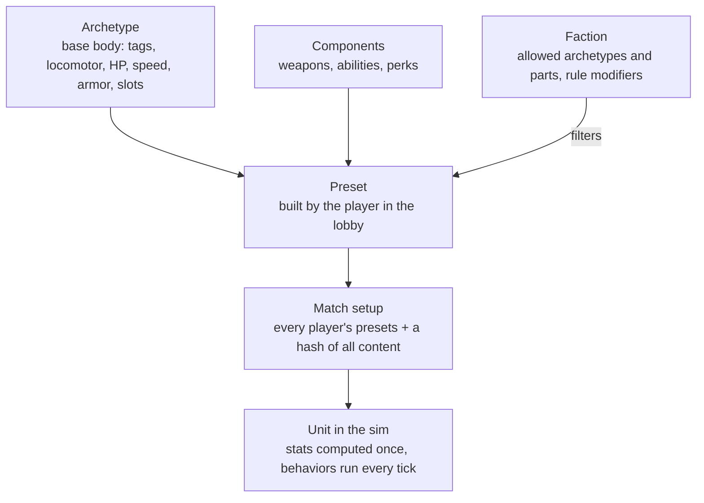
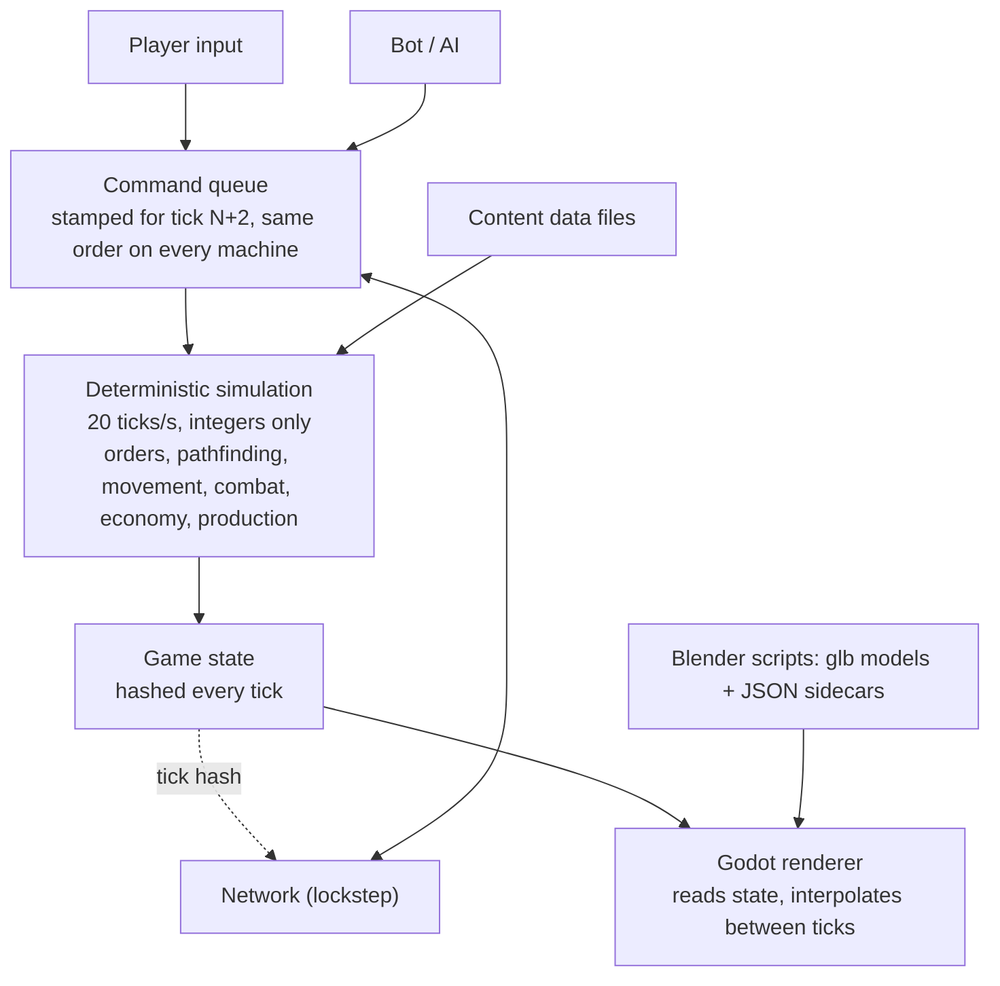

# RTS Game Design System

Updated October 16, 2026

The first playable game is a Resistance-vs-Resistance 1v1 skirmish on one 96×96 map against a tunable test bot. It runs on a deterministic simulation that the renderer only draws. The renderer is a real-time 3D Godot client; units, buildings and props are 3D models built by scripts and played as they are. Every decision here was agreed step by step, first in the illustrated [Resistance MVP walkthrough](resistance-mvp.html) (download and open it in a browser; it predates the move from pre-rendered sprites to real-time 3D, so its illustrations show the earlier sprite look) and since then in the project's decision log. Setting: the real world today, with fictional countries, groups and leaders.

The game is a Generals-style modern RTS: tilted perspective camera, trackpad-first C&C controls (left-click selects, moves and attacks; pinch or scroll zooms), garrisonable buildings, a rocket fleet that depends on supply.

## Visual spec

Real-time 3D, "real but low poly, like Generals": realistic proportions and materials, smooth shading with hard edges only where real, and just enough exaggeration to read at RTS distance. The bar is polished and carefully crafted, not very low poly. Every asset follows one camera, one light and one scale, so assets from different artists or scripts look like the same game. (The game's art bible, kept with the art, holds the full rules; this section is the engine-facing summary.)

| Rule | Value | Why |
| --- | --- | --- |
| Rendering | Real-time 3D in Godot 4 (.NET), capped at 60 fps with vsync | Models scale with zoom and animation follows sim speed; pre-rendered sprites were tried and rejected (too small, wrong walk cadence) |
| Camera | Perspective, 35° field of view, about 52° down when zoomed out and 34° in a close-up; zoom from 7 m to 120 m | The classic tilted RTS view, close enough to admire a soldier, far enough to see a base |
| Tactical preset | Perspective 35°, distance about 66 m, pitch about 40° below the horizon, yaw about 0.5 rad (about 29°, a diagonal view of a city grid) | One agreed framing for official screenshots and lineups; whether it becomes the default gameplay camera is still open |
| Scale | 1 cell = 2 m; a soldier is about 1.9 m (about 0.95 cell tall); real-world metres everywhere | Keeps models, speeds and ranges honest; the 96×96 map is 192 m square |
| Footprints | Infantry about 0.4 cell, light vehicle 1 cell, heavy vehicle 1.5 cells, buildings snap to cells (2×2 up to 23×6) | Keeps pathing on a cell grid |
| Readability | Head and helmet +15%, weapons +25%, slightly thicker limbs, applied in the model | Roles read at a glance from far away |
| Key light | One sun from the top-left (north-west), 60° up, warm, soft real-time shadows, plus a procedural sky for ambient light | Shadows fall bottom-right on every asset, and stay about as long as the unit is tall |
| Frames | Skinned animations sampled at 30 fps and driven from sim state (speed, firing, reloading) | Feet stay planted; animation never leads the sim |
| Team color | A flat `TEAM` material on real parts (infantry: helmet band and left armband; vehicles: door stripes and roof panel), tinted per player at runtime; 8 player colors | One model serves every player |
| Triangle budgets | Infantry about 8 to 12k, vehicles about 30 to 50k with crew, buildings 40 to 80k per damage stage, 2K baked textures | Polished, but 60 fps with dozens of units on screen |

**Color hierarchy.** Terrain is warm and desaturated. Unit bodies are mid-saturation neutrals (arid multicam, coyote gear, matte black weapons, sun-faded sand paint). Team color is the most saturated element on a unit. Effects (muzzle flash, explosions, tracers) are the brightest thing on screen.

**Silhouette rule.** Each role must be identifiable from its silhouette alone at the strategic zoom: tanks low and wide, artillery a long barrel, anti-air vertical barrels, harvesters a big box, infantry upright. If two units can be confused when shown as black shapes, redesign one.

**Setting rule.** Real-world gear on fictional groups. No real flags, patches, insignia, slogans, logos or any text on assets.

**Rendering boundary.** The simulation never reads the renderer and the renderer never writes the simulation, so drawing can never cause a desync. Hidden units are drawn only when the player can see them; units hidden behind scenery show as a flat team-colored silhouette.

## Art pipeline

Every model is built by a script, so adding a unit takes hours, not weeks and every asset can be rebuilt identically. There are no third-party models, textures or animations.

1. **Build.** A Blender (Python) script builds the model at real-world scale (1 Blender unit = 1 metre; the game maps 1 cell to 2 m): geometry, shared material library (base paint, fabric, metal, rubber, glass, one flat `TEAM` material), rig and animations for characters, named nodes for everything the game must find (weapons, muzzles, wheels, turrets, doors, window firing points).
2. **Bake.** Procedural materials (camo, grime, wear, ambient occlusion) are baked to base-colour textures (2K for bodies, vehicles and building stages; smaller for weapons and props). No directional shadow is baked in.
3. **Export.** One glTF binary (`.glb`) per asset plus a JSON sidecar: units, up axis, facing, the animations (frames, loop flag, ground speed, event frames), weapon and muzzle nodes, named nodes, notes (footprints, fire points, tube order). Units face -Z, origin on the ground.
4. **Verify.** A script re-imports the glb in a fresh Blender and checks animations, `TEAM`, named nodes and baked poses; a style checker validates every export against a machine-readable style file (palette, budgets, naming rules, banned content).
5. **Import.** The Godot client loads the glb and sidecar at runtime (no import step) and reads values from the sidecar: it never hard-codes art values. Stand-in procedural shapes keep the game playable while art is missing.

Contract rules that keep the pipeline safe: unique node names; a flat material named exactly `TEAM`; visibility that changes during an animation is keyed bone scale, every animation keys every visibility bone and no track is constant (Godot strips unchanging tracks).

File naming: `art/export/<asset>.glb` and `<asset>.json`, snake_case.

Animations for infantry (idle, aim idle, walk, run, shoot, reload, hit, three deaths, plant, launch, plus launcher and worker animations) are authored in the same scripts and shared by every class. Crewed vehicles carry their crew (gunner, driver) and wrecks (`body_destroyed`) in the same file.

## MVP: map, economy and base

One hand-made 96×96 map, bases in opposite corners, won by destroying every enemy structure and defense.

| Topic | Decision |
| --- | --- |
| Map | 96×96 cells, fog of war (unexplored dark, explored-but-unseen grey), one central oil field |
| Gold mines | 2 visible per base + 4 hidden; the map marks possible spots and the match seed picks which hold gold |
| Gold | Workers mine and carry each load back to the HQ; mines slowly run dry |
| Oil | A derrick on an oil spot plus a refinery within range of it; slower and costlier than gold, pays more over time |
| Starting cash | A grant at match start |
| Builders | Only workers build structures, for now |
| Power | None |
| Starting defenses | Pre-placed anti-infantry and anti-armor emplacements at each base; exact set to be decided |
| Win | Destroy every enemy structure and defense, starting defenses included (Phase 1, before structures exist: a player with no soldiers left, on foot or driving, is defeated) |
| Neutral buildings | Garrisonable city blocks stand on the map (see [Buildings](#buildings-garrisons-and-destruction)) |

| Structure | Does | Requires |
| --- | --- | --- |
| HQ | Trains workers, receives gold | Start |
| Barracks | Trains the four infantry classes | HQ |
| Vehicle yard | Builds the six vehicles | Barracks |
| Supply depot | Rearms launchers and drone kits out of a finite stock (1000 supply); faster reload nearby; the only place a rocket truck reloads; refilled by cargo trucks | HQ |
| Tunnel entrance | A node in the tunnel network | Barracks |
| Derrick + refinery | Oil income | Supply depot |

## Combat rules

Damage dealt = weapon damage × the warhead-vs-armor multiplier below, so every unit has a clear counter. "—" means the weapon can't target that kind of unit. No heavy armor in the mirror match.

| Warhead ↓ / Armor → | Infantry | Light vehicle | Building | Drone |
| --- | --- | --- | --- | --- |
| Bullet | 100% | 40% | 10% | 15% |
| Sniper round | 150% | 20% | 5% | 15% |
| Rocket (AT missile, launchers) | 40% | 120% | 80% | — |
| Explosive (traps, FPV drones) | 100% | 100% | 60% | — |
| AA missile | — | — | — | 100% |

- Rockets and explosives deal splash; launcher rockets fly with travel time and scatter, so they can miss moving targets.
- Booby traps are hidden from the enemy, fire once when an enemy ground unit comes close, and ignore drones. Enemy snipers and engineers reveal traps near them; once revealed, any unit can shoot them.
- **Rockets and missiles collide.** They fly along their aim line and go off at the first unit, structure or rock they touch (full damage to what they hit plus splash around the point), or on the ground at the aim point if nothing is in the way. Friends count; the shooter and anyone inside a vehicle don't. Launcher rockets fly an arc and only collide in the last 2 cells; one coming down over a structure's footprint hits its roof.
- **Leading targets.** Rockets and missiles aim where a moving ground target will be after the flight time, so a target driving straight is hit and one that turns or stops can still dodge. Attack orders are always obeyed; automatic targeting has per-armor engagement limits (the AT missile auto-engages infantry only close up and prefers vehicles and structures).
- **Weapon modes.** Each unit has a weapon mode: `auto` (any weapon, the best for the target) or `primaryOnly` (only its first weapon). Anti-armor soldiers default to `primaryOnly` (RPG only: he keeps to his launcher and never switches to a sidearm); the player toggles RPG-only vs RPG + rifle in the command card.
- **Attack ground.** A force-fire order: units walk into range of a cell and fire at it until given another order. Splash hits whoever stands there, friends included.
- **Range anchors.** The RPG reaches 9 cells; a technical's heavy MG 6 cells. Small arms show thin, short muzzle flashes and thin white tracers in per-weapon bursts.
- All values are integers in the sim (percent as 0–100), never floats. Starting values for tuning (they live in the content data files); traps per soldier is set in playtests.

## Resistance faction

The Resistance wins on numbers, cheap drones, fast light vehicles, a rocket fleet that has to be resupplied, and tunnels. It has no planes. It is the only faction until the MVP is done; a faction is a set of art and preset rules on the same engine, so the second faction comes later as data.

**Infantry.** Trained one soldier at a time. Each soldier carries two things at once, a primary and a secondary. Before the match a player saves up to 3 presets per class; each preset is a pair of picks from that class's list.

| Class | Role | Loadout (MVP) |
| --- | --- | --- |
| Assault | Light frontline | Primary: rifle, SMG or LMG; secondary to be decided |
| Engineer | Utility | Kit: booby traps, FPV drones (2) or repair; no anti-armor role for now |
| Anti-armor | Kills vehicles and drones | Pairs such as AT missile + booby trap, or AA missile + short-range rifle |
| Sniper | Long range, sees far, reveals traps | Sniper rifle + short-range gun |
| Worker | Builds everything, mines gold | No loadout |

Skills such as medic, spotter and heavy anti-tank come with later archetypes.

**Vehicles and crew.** Vehicles leave the yard empty. Any of your soldiers can drive one, every driver is equal, and without a driver a vehicle can't move or fire. When a vehicle is destroyed, the driver survives by a chance drawn from the match seed. No capturing enemy vehicles.

| Vehicle | Role |
| --- | --- |
| Dirt bike | Fastest scout and raider, light weapon |
| Technical | Crewed armed pickup: a permanent MG gunner plus a driver; fast (about 3.5 cells/s) |
| Light rocket truck | Short-range salvos, \~6 cells |
| Medium rocket launcher | Medium-range salvos, \~12 cells |
| Heavy rocket launcher ("Rocket truck") | Area bombardment, 15 to 60 cells, slow, needs a spotter; see below |
| Cargo truck | Carries 400 supply to a depot and unloads it in 3 s (full or empty) |

**Rocket truck (heavy launcher).** A truck with a 30-tube launcher. It must **deploy** (about 2.5 s, stabiliser jacks down) before firing and **stow** (about 2 s) before driving. It fires only on orders (no automatic targeting), between a 15-cell minimum and a 60-cell maximum range, and needs a spotter: some friendly unit must see the target. A salvo **ripples 30 rockets, one every 0.5 s**, scattered about 3.5 cells; Stop ends a salvo at once. **Reload only at a supply depot**: never during a salvo, starting 1 s after the last shot, then one rocket every 2 s while it stands in the depot's supply radius. Splash falls off from the centre to the edge, so a full salvo on a clustered group kills about half the infantry and badly damages vehicles. Blasts are bigger area ground blasts that leave 3 s of ground fire and a large burnt-ground mark.

**Twin missile truck.** Two heavy missiles side by side, fired 6 s apart, from 45 to 100 cells on a high arc. It deploys in about 6 s and stows in about 5 s, fires only on orders and needs a spotter. Very high damage: 2 missiles bring down a civilian block. A small circle (3 cells) where a missile lands kills everything; a big circle around it (out to 9 cells) takes 30% of that, which still kills infantry. After firing it must go back to a depot and reload stowed, one missile every 10 s for 150 supply each. Numbers are content data for tuning.

**Rocket fleet and supply.** Launchers carry a few salvos (count set in playtests) and go quiet when empty. Only supply depots rearm them; units in a depot's supply radius reload faster. Launchers need someone to see the target. A selected depot shows its supply radius as a soft green ring (about 40% opacity) and carries a floating 3D ammo emblem; a selected rocket truck shows its side's depot radii, where it reloads.

**Depot stock and cargo trucks.** A depot is not unlimited: it holds 1000 supply, starts full and never refills by itself. Every salvo or charge it hands out costs 1; launchers that only a depot reloads pay per rocket: the rocket truck 10 (1%, a full 30-rocket reload is 30%), the heavy rocket truck 40 (4%, a full 12 is 48%). When the stock is below a rocket's cost the launcher waits at the depot. Cargo trucks refill depots (trucks no longer rearm units themselves): a cargo truck is either full (400 supply, 40% of a depot) or empty; sent onto a friendly depot (or stopping in its radius) it unloads in 3 s, standing still, and the whole load goes in at once. If the depot has less than 400 free, the truck waits beside it until there is room, so nothing is wasted; driving off or losing the depot cancels the unload and the truck stays full. Empty trucks stay empty for now; supply routes come later. All numbers are content data for tuning.

**Drones.** An engineer kit, not a built unit: 2 FPV drones per engineer. Pick a target and the drone flies there on its own and explodes. It can be shot down in flight: the AA missile is the hard counter, and rifles and MGs hit drones only weakly. Spent drones restock at a supply depot.

**Tunnels.** Workers build entrances. Each entrance links to every other entrance within \~15 cells, and units travel along links with travel time. There is no root: any linked group works on its own. An entrance left with no links collapses instantly, and units travelling through it pop out, damaged, at the nearest working entrance.

**Guardrails.** Hidden things such as traps are hidden only on screen: in lockstep every machine simulates them, so a hacked client could reveal them, as in every lockstep RTS.

## Buildings, garrisons and destruction

Neutral city blocks stand on the map and can be garrisoned. Each is one model with five visual stages (intact plus four destruction levels, the last is rubble) and window firing points, built from a modular kit.

| Block | Footprint | HP | Capacity |
| --- | --- | --- | --- |
| Panel block (5 floors, concrete panel) | 23 × 6 cells | 2400 | 10 |
| Brick block (4 floors, hip roof) | 14 × 7 cells | 1600 | 6 |

- **Neutral until occupied.** A building belongs to whoever is inside and turns neutral when empty; nobody enters one held by the enemy. Infantry (workers too) walk to the nearest door and go in while there is room; "Exit" lets a soldier out at the door nearest the clicked cell, "Evacuate" empties the building.
- **Damage stages** follow HP: stage 0 above 80%, then 60%, then 35%, then above 0, and rubble at 0 HP. Capacity per stage is 100 / 100 / 75 / 50 percent; the excess is thrown out, losing a share of max HP. The rubble keeps blocking pathing.
- **Firing from inside.** Occupants fire from the surviving window firing points with their own weapons, with +2 cells of range and +4 of vision measured from the building's edge nearest the target. They can't move and aren't targetable (attacks target the building). Buildings don't block line of sight yet.
- **Bullets barely scratch buildings** (building armor); explosive warheads (rockets, explosives: the RPG and the rocket truck) hurt the building and every occupant takes **25% of what the hit would do to him**. This is by design: explosives are the counter to garrisons, even though they can empty a garrison before the building's damage stages matter, so capacity ejection and collapse survivors will be rare in real fights.
- **Collapse.** At 0 HP each occupant survives with a 50% roll (the match generator, in ID order) at 30% HP and is put out at the doors.
- **Camera.** Buildings stay solid. Units hidden behind a building show as a flat team-colored silhouette (only units the player can actually see); a building fades under the pointer only while placing something or when the player holds a key.
- **Presentation.** Dust, debris and smoke at each stage change; stages 2 to 4 smoulder (a little fire in stage 3 and in ruins); occupancy shows as pips above the roof in the holder's team color. An enemy-held building shows only "held by enemy" and its stage.

## Roads, props and terrain

A city asphalt kit (straight, cross, T, corner, end and two crater pieces; an 8 m two-lane carriageway between 2 m raised sidewalks) lays streets between buildings, with decorative props (streetlights, poles, burnt cars, concrete barriers, sandbags) and craters. Roads are **cosmetic for now**: they have no footprint in the sim, units walk over them and blast marks paint them. Terrain is a warm sand ground with gravel, rock blocks on blocked cells and scattered shrubs and stones for scale. A supply depot is a sandbag-and-gabion compound under a camouflage net with stacked crates; it has a destroyed variant.

## Effects direction

Effects follow a Generals reference and are the brightest thing on screen.

- **Explosions** are short and sharp (over in about half a second), red-orange with flame tongues; yellow-white only at the core, never washed out. MRL blasts are bigger area ground blasts.
- **Smoke** is thin, see-through gray-brown and reads as one coherent thing: never thick black blobs and never visible circles (a ray-marched volume today).
- **Lasting damage is on the ground**: burnt-ground decals, not dark low smoke. Burning wrecks burn for 20 s from the centre in multiple shades, then smoulder.
- **Area of effect** shows as a barely visible dome and ground ring (about 1%).
- Planned: simulated flipbooks (fire and smoke baked from a physical simulation to animated textures) replace the procedural effects.

## Content model

Every unit, from infantry to planes, workers and buildings, is assembled from parts instead of written as its own class. Adding content means adding data; adding a new mechanic means one new behavior.



### Building blocks

| Block | What it is | Defined by |
| --- | --- | --- |
| Archetype | A base body: tags, locomotor, HP, speed, armor, slots | Data file |
| Component | A part that plugs into a slot: weapon, ability or perk, with a cost and requirements | Data file |
| Preset | An archetype plus chosen components, named by the player | Lobby, saved with the match |
| Faction | Allowed archetypes and components, plus rule modifiers | Data file |
| Behavior | The code that makes one kind of component work each tick | C# system |

An archetype, a base body:

```json
{ "id": "anti_armor", "tags": ["infantry"], "locomotor": "foot",
  "hp": 55, "speed": 9, "armor": "infantry",
  "slots": { "primary": 1, "secondary": 1 } }
```

A component that plugs into a slot:

```json
{ "id": "aa_missile", "slot": "primary",
  "requires": { "tags": ["infantry"] },
  "effects": [{ "type": "weapon", "warhead": "aa_missile",
                "range": 70, "reloadTicks": 80, "targets": ["air"] }] }
```

A player's preset, built in the lobby:

```json
{ "name": "Drone hunter", "archetype": "anti_armor",
  "components": ["aa_missile", "short_rifle"] }
```

### Behaviors

New content is data only. A brand-new mechanic is one new behavior plus data.

| Behavior | Covers |
| --- | --- |
| Weapon | Guns, rockets, anti-air; which layers it can hit is data (`targets: ["air"]`) |
| Aura | Heal, repair, speed and armor buffs |
| Placer | Booby traps, mines, sensors: spawns a hidden entity |
| Trigger | A trap firing when an enemy comes in range |
| Builder | Workers raising construction sites |
| BuildAssist | Engineers speeding up construction and unlocking better building variants |
| Repair | Fixing vehicles and buildings |
| Locomotor | Foot, wheeled, tracked, hover, flying; flyers skip ground pathfinding |

### Rules that keep it deterministic

- **Stats are computed, never stored ad hoc:** base stats, then modifiers from preset, faction, auras and upgrades, in a fixed order, as integer percents.
- **Definitions load once at match start,** sorted by ID into indexed arrays; no dictionaries inside the tick.
- **The content set and every player's presets are hashed into the match setup.** Machines with different data refuse to start instead of desyncing later; mods come for free.
- **Tags and requirements, not type checks:** code asks "has tag infantry?", never "is this an Assault?".
- **Systems run in a fixed order:** commands, orders, abilities and placement, movement per layer, combat, construction, auras and effects, cleanup.

## Architecture



Players, the AI and the network all reach the sim through one command queue, so replays and multiplayer reuse the same path. The renderer only reads state, so drawing can never cause a desync.

## Build order

Units first: Phase 1 gets you looking at real units and playing a battle against a simple, tunable bot before any base or economy exists. The deterministic sim core is done: the golden replay passes on Linux, macOS and Windows. Status as of October 16, 2026 is marked **(done)**, **(in progress)** or **(not started)** below.

**Phase 1: units you can see and play.** Two armies spawn; no base, no economy; win by wiping out the other army.

1. **Content model for units (done).** Classes, two-slot loadouts, vehicles and kits as data; redo the sample content for this roster.
   - Done when: the Resistance units run from data files and the golden replay passes on every OS.
2. **Art pipeline and Godot shell (done).** Soldiers and vehicles built by Blender scripts, exported as glb models with JSON sidecars and drawn by Godot in real time from the sim. (This replaced an earlier plan of pre-rendered 8-direction sprites.)
   - Done when: you watch soldiers walk and shoot as real-time 3D models.
3. **Controls and group movement (in progress).** Select, move, attack, control groups; units stop overlapping.
   - Controls are done (trackpad-first, command card, control groups). Pathfinding and group movement are known-weak and are next on the roadmap.
   - Done when: you command a squad through a gap without jamming.
4. **The full unit roster (in progress).** Four classes and loadouts, vehicles with crew, light, medium and heavy launchers, cargo trucks, drones, traps.
   - The sim runs the whole roster, garrisonable buildings and the supply depot from data. Models exist for the five infantry classes, the technical, the rocket truck, two city blocks, the road kit, the supply depot and the ammo emblem; the dirt bike, light and medium rocket trucks, cargo truck, drones and traps still draw as stand-ins.
   - Done when: every MVP unit works in a battle.
5. **Tunable test bot (not started).** A simple bot that fights you, plus headless bot-vs-bot battles with every tuning value in data files.
   - Done when: you play a battle against it, change a number, and see the result change.

**Phase 2: base and economy.**

6. **Structures and workers.** The six structures, training queues, starting defenses, win condition.
   - Done when: you build a full base from the HQ and win by razing the enemy's.
7. **Gold and oil.** Mining, carrying, depletion, derricks and refineries, supply radius.
   - Done when: a match runs on its own economy.

**Phase 3: map systems.**

8. **Fog of war.** Vision, hidden mines, trap detection.
   - Done when: a hidden mine appears only after a unit sees it.
9. **Tunnels.** Network, travel time, collapse.
   - Done when: killing a central entrance collapses the isolated ones.
10. **Balance runs.** Test bots with fixed strategies, 100-match batches.
    - Done when: win rates per strategy are reported. This is the MVP; LAN 1v1 comes next.

**Roadmap from here** (agreed October 16, 2026): finish buildings, roads and the supply depot with its emblem; movement and pathfinding; audio (royalty-free sound bundles); the visual-effects flipbook bake and wiring; fog of war; base and economy; the game UI (minimap, sidebar, cursors, click markers, unit voices); the first real map; tunnels; test bots and balance; LAN 1v1.

**Not in the MVP:** second faction with planes and heavy armor, scout drones and drone vehicles, medic/spotter/heavy AT skills, hidden supply caches, buildable defenses and upgrades, player-controlled gunner seats and vehicle capture (the technical's gunner is part of the vehicle), ammo through tunnels, LAN (first milestone after the MVP) and online play, an opponent AI with difficulty levels, campaign, more maps and 2v2. Scavenging is dropped.

## Open questions

Decided: real-time 3D in Godot 4 with a C# sim library (pre-rendered sprites were tried and dropped); simcore is open source (MIT) and the game's art stays in a private repo; online play is not a launch goal before LAN works.

- [ ] Exact starting defense set per base
- [ ] Secondary slot choices for Assault and Engineer
- [ ] Salvos and rockets per launcher (playtests)
- [ ] Traps per soldier (playtests)
- [ ] Working title, and the second faction's name and identity
- [ ] Team size and who owns art vs code
- [ ] Whether the tactical camera preset becomes the default gameplay camera
- [ ] Whether roads get a footprint in the sim (they are cosmetic for now)
- [ ] Line of sight: buildings do not block it yet
