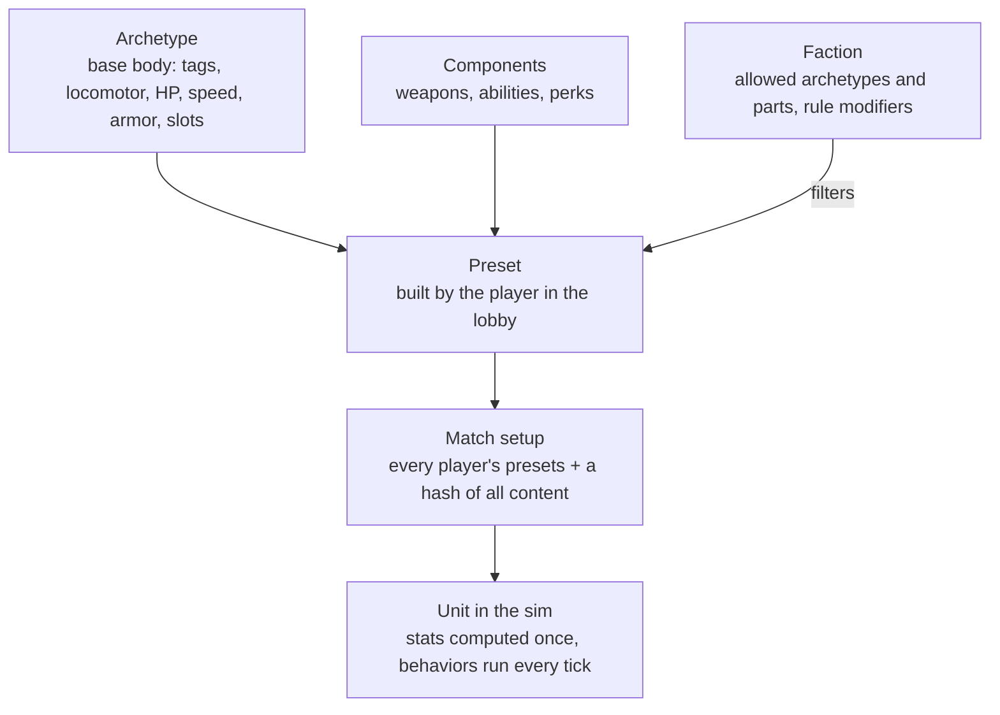
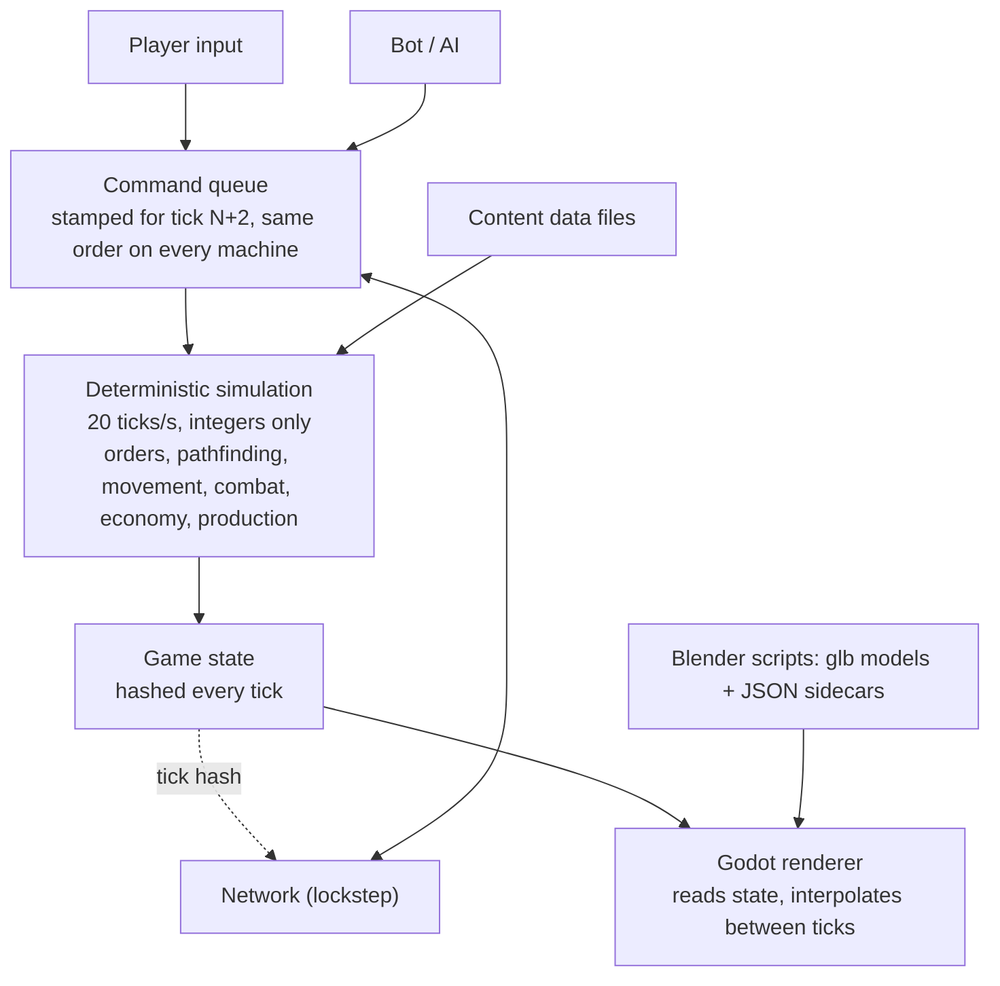

# RTS Game Design System

Updated October 16, 2026

The first playable game is a Resistance-vs-Resistance 1v1 skirmish on one 96×96 map against a tunable test bot. It runs on a deterministic simulation that the renderer only draws. The renderer is a real-time 3D Godot client; units, buildings and props are 3D models built by scripts and played as they are. Every decision here was agreed step by step, first in the illustrated [Resistance MVP walkthrough](resistance-mvp.html) (download and open it in a browser; it predates the move from pre-rendered sprites to real-time 3D, so its illustrations show the earlier sprite look) and since then in the project's decision log. Setting: the real world today, with fictional countries, groups and leaders.

The game is a Generals-style modern RTS: tilted perspective camera, trackpad-first C&C controls (left-click selects, moves and attacks; pinch or scroll zooms), garrisonable buildings, a rocket fleet that depends on supply.

## Visual spec

Real-time 3D, "real but low poly, like Generals": realistic proportions and materials, smooth shading with hard edges only where real, and just enough exaggeration to read at RTS distance. The bar is polished and carefully crafted, not very low poly. Every asset follows one camera, one light and one scale, so assets from different artists or scripts look like the same game. (The game's art bible, kept with the art, holds the full rules; this section is the engine-facing summary.)

| Rule | Value | Why |
| --- | --- | --- |
| Rendering | Real-time 3D in Godot 4 (.NET), capped at 60 fps with vsync | Models scale with zoom and animation follows sim speed; pre-rendered sprites were tried and rejected (too small, wrong walk cadence) |
| Camera | Perspective, 35° field of view, about 52° down when zoomed out and 34° in a close-up; zoom from 7 m to 120 m | The classic tilted RTS view, close enough to admire a soldier, far enough to see a base |
| Tactical preset | Perspective 35°, distance about 66 m, pitch about 40° below the horizon, yaw about 0.5 rad (about 29°, a diagonal view of a city grid) | One agreed framing for official screenshots and lineups; whether it becomes the default gameplay camera is still open |
| Scale | 1 cell = 2 m; a soldier is about 1.9 m (about 0.95 cell tall); real-world metres everywhere | Keeps models, speeds and ranges honest; the 96×96 map is 192 m square |
| Footprints | Infantry about 0.4 cell, light vehicle 1 cell, heavy vehicle 1.5 cells, buildings snap to cells (2×2 up to 23×6) | Keeps pathing on a cell grid |
| Readability | Head and helmet +15%, weapons +25%, slightly thicker limbs, applied in the model | Roles read at a glance from far away |
| Key light | One sun from the top-left (north-west), 60° up, warm, soft real-time shadows, plus a procedural sky for ambient light | Shadows fall bottom-right on every asset, and stay about as long as the unit is tall |
| Frames | Skinned animations sampled at 30 fps and driven from sim state (speed, firing, reloading) | Feet stay planted; animation never leads the sim |
| Team color | A flat `TEAM` material on real parts (infantry: helmet band and left armband; vehicles: door stripes and roof panel), tinted per player at runtime; 8 player colors | One model serves every player |
| Triangle budgets | Infantry about 8 to 12k, vehicles about 30 to 50k with crew, buildings 40 to 80k per damage stage, 2K baked textures | Polished, but 60 fps with dozens of units on screen |

**Color hierarchy.** Terrain is warm and desaturated. Unit bodies are mid-saturation neutrals (arid multicam, coyote gear, matte black weapons, sun-faded sand paint). Team color is the most saturated element on a unit. Effects (muzzle flash, explosions, tracers) are the brightest thing on screen.

**Silhouette rule.** Each role must be identifiable from its silhouette alone at the strategic zoom: tanks low and wide, artillery a long barrel, anti-air vertical barrels, harvesters a big box, infantry upright. If two units can be confused when shown as black shapes, redesign one.

**Setting rule.** Real-world gear on fictional groups. No real flags, patches, insignia, slogans, logos or any text on assets.

**Rendering boundary.** The simulation never reads the renderer and the renderer never writes the simulation, so drawing can never cause a desync. Hidden units are drawn only when the player can see them; units hidden behind scenery show as a flat team-colored silhouette.

## Art pipeline

Every model is built by a script, so adding a unit takes hours, not weeks and every asset can be rebuilt identically. There are no third-party models, textures or animations.

1. **Build.** A Blender (Python) script builds the model at real-world scale (1 Blender unit = 1 metre; the game maps 1 cell to 2 m): geometry, shared material library (base paint, fabric, metal, rubber, glass, one flat `TEAM` material), rig and animations for characters, named nodes for everything the game must find (weapons, muzzles, wheels, turrets, doors, window firing points).
2. **Bake.** Procedural materials (camo, grime, wear, ambient occlusion) are baked to base-colour textures (2K for bodies, vehicles and building stages; smaller for weapons and props). No directional shadow is baked in.
3. **Export.** One glTF binary (`.glb`) per asset plus a JSON sidecar: units, up axis, facing, the animations (frames, loop flag, ground speed, event frames), weapon and muzzle nodes, named nodes, notes (footprints, fire points, tube order). Units face -Z, origin on the ground.
4. **Verify.** A script re-imports the glb in a fresh Blender and checks animations, `TEAM`, named nodes and baked poses; a style checker validates every export against a machine-readable style file (palette, budgets, naming rules, banned content).
5. **Import.** The Godot client loads the glb and sidecar at runtime (no import step) and reads values from the sidecar: it never hard-codes art values. Stand-in procedural shapes keep the game playable while art is missing.

Contract rules that keep the pipeline safe: unique node names; a flat material named exactly `TEAM`; visibility that changes during an animation is keyed bone scale, every animation keys every visibility bone and no track is constant (Godot strips unchanging tracks).

File naming: `art/export/<asset>.glb` and `<asset>.json`, snake_case.

Animations for infantry (idle, aim idle, walk, run, shoot, reload, hit, three deaths, plant, launch, plus launcher and worker animations) are authored in the same scripts and shared by every class. Crewed vehicles carry their crew (gunner, driver) and wrecks (`body_destroyed`) in the same file.

## MVP: map, economy and base

One hand-made 96×96 map, bases in opposite corners, won by destroying every enemy structure and defense.

| Topic | Decision |
| --- | --- |
| Map | 96×96 cells, fog of war (unexplored dark, explored-but-unseen grey), one central oil field |
| Gold mines | 2 visible per base + 4 hidden; the map marks possible spots and the match seed picks which hold gold |
| Gold | Workers mine and carry each load back to the HQ; mines slowly run dry |
| Oil | A derrick on an oil spot plus a refinery within range of it; slower and costlier than gold, pays more over time |
| Starting cash | A grant at match start |
| Builders | Only workers build structures, for now |
| Power | None |
| Starting defenses | Pre-placed anti-infantry and anti-armor emplacements at each base; exact set to be decided |
| Win | Destroy every enemy structure and defense, starting defenses included (Phase 1, before structures exist: a player with no soldiers left, on foot or driving, is defeated) |
| Neutral buildings | Garrisonable city blocks stand on the map (see [Buildings](#buildings-garrisons-and-destruction)) |

| Structure | Does | Requires |
| --- | --- | --- |
| HQ | Trains workers, receives gold | Start |
| Barracks | Trains the four infantry classes | HQ |
| Vehicle yard | Builds the six vehicles | Barracks |
| Supply depot | Rearms launchers and drone kits out of a finite stock (1000 supply); faster reload nearby; the only place a rocket truck reloads; refilled by cargo trucks | HQ |
| Tunnel entrance | A node in the tunnel network | Barracks |
| Derrick + refinery | Oil income | Supply depot |

## Combat rules

Damage dealt = weapon damage × the warhead-vs-armor multiplier below, so every unit has a clear counter. "—" means the weapon can't target that kind of unit. No heavy armor in the mirror match.

| Warhead ↓ / Armor → | Infantry | Light vehicle | Building | Drone | Medium vehicle | Armored vehicle | Parked aircraft |
| --- | --- | --- | --- | --- | --- | --- | --- |
| Bullet | 100% | 40% | 10% | 15% | 40% | 20% | 60% |
| Sniper round | 150% | 20% | 5% | 15% | 20% | 10% | 30% |
| Rocket (AT missile, launchers) | 40% | 120% | 80% | — | 120% | 120% | 120% |
| Rocket truck rocket | 67% | 133% | 80% | — | 133% | 35% | 133% |
| Explosive (traps, FPV drones) | 100% | 100% | 60% | — | 100% | 100% | 120% |
| Heavy rocket | 100% | 100% | 200% | — | 100% | 120% | 120% |
| Heavy missile (twin missile) | 100% | 100% | 220% | — | 100% | 100% | 120% |
| Ballistic (tactical missile) | 100% | 100% | 220% | — | 100% | 170% | 120% |
| ATGM (Kornet) | 15% | 100% | 45% | — | 55% | 100% | 100% |
| Mortar bomb | 100% | 45% | 30% | — | 45% | 10% | 80% |
| Drone charge | 100% | 100% | 100% (20% of max HP) | — | 100% | 100% | 100% |
| Air strike (Watcher missile) | 100% | 60% | 120% | — | 60% | 25% | 100% |
| AP mine blast | 100% | 10% | 5% | — | 10% | 2% | 40% |
| AT mine blast | 100% | 100% | 30% | — | 100% | 25% | 100% |
| AA missile | — | — | — | 100% | — | — | — |

Medium vehicle is the rocket launchers' class (light, medium and heavy rocket trucks, the
heavy rocket truck and the twin missile truck); every warhead but the ATGM treats it like a
light vehicle. The technical and the cargo truck stay light vehicles. Armored vehicle is the
infantry carrier's class (2026-10-18): tuned with its 1200 HP so that no weapon's whole first
salvo kills it, even with every round a direct hit, except the tactical ballistic missile and a
full 12-rocket heavy salvo (see "Infantry carrier" below). Parked aircraft (2026-10-19, airfield
M3b) is the armor of an aircraft on the ground at an airfield (its aircraft block's `groundArmor`):
a thin airframe full of fuel, a little softer than a light vehicle; it is never an attack target
there and only splash reaches it. In the air the same aircraft keeps its drone armor.

- Rockets and explosives deal splash; launcher rockets fly with travel time and scatter, so they can miss moving targets.
- Traps (booby traps and the assault soldier's mines) are hidden from the enemy, fire once when an enemy ground unit comes close, and ignore drones. Only enemy snipers, scout drones and observation posts reveal them (2026-10-18; engineers no longer do); once revealed, any unit can shoot them, which clears them without a blast. The full rules are under "Traps" below.
- **Rockets and missiles collide.** They fly along their aim line and go off at the first unit, structure or rock they touch (full damage to what they hit plus splash around the point), or on the ground at the aim point if nothing is in the way. Friends count; the shooter and anyone inside a vehicle don't. Launcher rockets fly an arc and only collide in the last 2 cells; one coming down over a structure's footprint hits its roof.
- **Leading targets.** Rockets and missiles aim where a moving ground target will be after the flight time, so a target driving straight is hit and one that turns or stops can still dodge. Attack orders are always obeyed; automatic targeting has per-armor engagement limits (the AT missile auto-engages infantry only close up and prefers vehicles and structures).
- **Weapon modes.** Each unit has a weapon mode: `auto` (any weapon, the best for the target) or `primaryOnly` (only its first weapon). Anti-armor soldiers default to `primaryOnly` (RPG only: he keeps to his launcher and never switches to a sidearm); the player toggles RPG-only vs RPG + rifle in the command card.
- **Attack ground.** A force-fire order: units walk into range of a cell and fire at it until given another order. Splash hits whoever stands there, friends included.
- **Range anchors.** The RPG reaches 9 cells; a technical's heavy MG 6 cells. Small arms show thin, short muzzle flashes and thin white tracers in per-weapon bursts.
- All values are integers in the sim (percent as 0–100), never floats. Starting values for tuning (they live in the content data files); traps per soldier is set in playtests.

### Unit AI (2026-10-19)

What units do without orders, after Zero Hour's player rules (its open-sourced code: `AIStates`,
`AIGuard`, `AIGuardRetaliate`, `ActiveBody`, `SquishCollide`). Numbers live in the `unitAi` content
block (`content/mvp/unit_ai.json`); archetypes set `stance`, `pursue`, `leash`, `retaliateMax`,
`autoFireDeployed`, `crusher` and `crushable`. Code: `Sim/Systems/UnitAiSystem.cs`, `OrderSystem.cs`,
`CrushSystem.cs`.

| Stance | Fires on its own at | Moves on its own |
| --- | --- | --- |
| **Guard** (default) | spotted enemies in weapon reach | to retaliate (it and idle friends nearby), on the leash, then walks back |
| **Aggressive** | the same, and goes after spotted enemies within vision x 1.33 | chases on the leash, then walks back |
| **Hold ground** (the old Guard) | spotted enemies in reach | never |
| **Return fire** | only the enemy that last hurt it, in reach | never |
| **Hold fire** | nothing (orders only) | never |

- **Retaliation.** An enemy's shot or blast hurting a unit in Guard or Aggressive (even fatally)
  calls it and its idle friends within 8 cells: each that pursues and can hit the shooter goes after
  it. Not for flying shooters, shooters beyond 20 cells, units with an order (attack-move and Guard
  count as idle), units in a building or vehicle, or archetypes that don't pursue (launchers, the
  mortar, air defence, engineer, worker: `pursue: false` or a deploy or air vision). A shooter in a
  building makes them go for the building. One call per victim per second (a salvo calls once).
- **Leash.** The chase starts from where the unit stood (its guard point; on a Guard order, the
  post). It closes to weapon reach like an attack and ends when the target dies or hides in a
  vehicle or building, gets farther than vision x 2.2 from the point, or after 15 s. A shooter it
  can't see: it heads for where the shot came from (an attack-move: it stops for targets in reach),
  while that is within the leash. Then it engages anything else spotted within vision x 1.8 of the
  point, or walks back, scanning that circle every second, and idles. Stop, any order, or a stance
  that doesn't move ends it.
- **Attack-move** (A + click on the ground). A group move; each unit fires at spotted enemies in
  reach on the way (no chase), fixed weapons stop for them and carry on, turrets fire on the move;
  it retaliates on the way and ends on arrival. An attack target lost in the fog becomes an
  attack-move to where it was last seen.
- **Guard order** (Option+G on a cell or one of your units). Each unit keeps to its post (a group:
  its formation slot; a guarded unit: within 3 cells, the circle moving with it), engages the best
  spotted enemy within vision x 1.8 of it every half second, chases on the leash and walks back.
  It lasts until another order.
- **Scatter** (Option+S). Each selected unit moves straight away from the group's centre by
  4 x its radius, at least 2 cells (one on the centre goes the way it faces).
- **What units pick.** The enemy that hurt it within 15 s, then threats (they can hit it) before
  harmless units, then targets a weapon engages freely before restricted ones (`autoRange`), then
  the weapon's priority list, nearest, lowest ID. It keeps its target, but drops a harmless one for
  its attacker. Structures that can't fight are left to orders; armed ones and enemy-held
  buildings are picked. Only spotted enemies, always.
- **Launchers.** A set-up mortar fires on its own (it never sets up by itself); the heavy MRL,
  heavy rocket truck, twin missile, tactical missile, rocket jeep and drone truck fire on orders
  only; light and medium rocket trucks fire on their own in reach but never chase.
- **Crushing.** A vehicle rolling forward kills enemy infantry it drives into (touching, heading
  toward it): trucks, launchers and the carrier crush; the dirt bike doesn't. Friends, passengers,
  garrisons and vehicles are never crushed. The AI doesn't chase infantry to crush them.
- **Carrier passengers** don't fire from inside (a closed carrier).
- **The computer opponent** (`SkirmishAi`) puts its fighters in Aggressive, on Guard posts round
  its base, and sends its waves by attack-move.
- **Determinism and cost.** Integer distances only, no random draws, ID order and ID tie-breaks;
  radius queries go through the spatial index. Scans of the guard and Aggressive circles (and the
  rescan after a chase) run every 10 ticks phased by unit ID (`(tick + id) % 10`). Vision by
  distance is staggered too: a viewer looks around every 4 ticks (`(tick + id) % 4`,
  `World.VisionTicks`) or as soon as it enters another cell, and what it saw stays spotted until it
  looks again, so spotting and losing sight lag by at most 3 ticks (0.15 s). A unit without a
  target searches its reach when it has just looked around (or on that phase); a unit whose target
  just became invalid searches at once, and a valid target is still checked every tick. A chase's first route waits up to a second, staggered by ID, so a
  fight that sets off many chases spreads their path searches.

### Traps (2026-10-18)

The assault soldier lays two mines (kits `ap_mine_kit` and `at_mine_kit`: 1.5 s to lay one, up to
1.5 cells away; 4 and 2 charges, a depot refills them; at most 8 and 4 of one soldier's on the
map, laying another lifts his oldest). Numbers are in `content/mvp` (`ap_mine_charge`,
`at_mine_charge`, warheads `ap_blast` and `at_blast`); the code is `Sim/Systems/TriggerSystem.cs`.

| | Anti-personnel mine (`ap_mine`, PMN-2 type) | Anti-tank mine (`at_mine`, TM-62 type) |
| --- | --- | --- |
| Set off by (contact) | any enemy ground unit within 0.6 cell (1.2 m) | an enemy vehicle within 1.2 cells (2.4 m: under its hull); soldiers walk over it |
| Blast | 3 cells (6 m), 120 at the centre falling to 30 at the edge | 1.5 cells (3 m), 80 falling to 40 |
| Against soldiers | killed within about 2 cells, wounded out to 3 | hurt or killed close by |
| Against vehicles | a scratch (10% light and medium, 2% armoured) | the vehicle that set it off is destroyed outright, whatever its armour; no other vehicle is ever killed by it (left at 1 HP at worst) |

- **Trigger zone smaller than the blast** for both, so a soldier next to a mine is safe from
  setting it off but not from its blast.
- **On demand.** Its owner can set off any of his traps at once (`Detonate`). An anti-tank mine set
  off on demand destroys the nearest enemy vehicle within its trigger zone, if any.
- **Auto off.** Its owner can turn a trap's going off on its own off and on again, on the trap itself
  (`SetAutoDetonate`; the soldier who laid it has no such switch). A trap set to on-demand ignores
  enemies stepping on it, but still goes off on demand and in a chain.
- **Chains and stacking.** A trap that goes off lights every other trap (either side's) whose centre
  lies within its blast radius; a lit trap goes off `chainTicks` later (2 ticks, 0.1 s), and lights
  the traps in its own blast in turn. So traps laid within each other's blast form one bigger trap:
  stepping into any mine's trigger zone sets off the whole field link by link, the blast covers the
  union of their blasts, and damage adds up where blasts overlap (a soldier 2.2 cells from two mines
  survives one, not both). A trap blast never hurts traps: they chain instead. An anti-tank mine's
  small blast (1.5 cells) chains only what lies right next to it; two chained anti-tank mines can
  destroy two vehicles, one each.
- **Order within a tick.** Lit fuses count down first (all of them, then the due traps go off in ID
  order, so a fuse lit this tick is counted from the next), then contact checks in ID order.
- **Detection.** A detector reveals a hidden enemy within its `detect` radius for good: the sniper
  5 cells, the scout drone 25 cells (around the point under it), the observation post 10 cells.
  With fog of war the trap's cell must also be in sight of the detector's side that tick, so a ridge
  hides a mine from a sniper but not from the drone above.

## Resistance faction

The Resistance wins on numbers, cheap drones, fast light vehicles, a rocket fleet that has to be resupplied, and tunnels. It has no planes. A faction is a set of art and preset rules on the same engine; the second faction, the Sentinel (below), came as data plus one new behavior (the watcher system).

**Infantry.** Trained one soldier at a time. Each soldier carries two things at once, a primary and a secondary. Before the match a player saves up to 3 presets per class; each preset is a pair of picks from that class's list.

| Class | Role | Loadout (MVP) |
| --- | --- | --- |
| Assault | Light frontline, lays mines | Primary: rifle, SMG or LMG; secondary to be decided; always both mine kits (anti-personnel and anti-tank) |
| Engineer | Utility | Kit: booby traps, FPV drones (2) or repair; no anti-armor role for now |
| Anti-armor | Kills vehicles and drones | Pairs such as AT missile + booby trap, or AA missile + short-range rifle |
| Sniper | Long range, sees far, reveals traps (5 cells) | Sniper rifle + short-range gun |
| Mortar | Indirect fire, 8 to 30 cells, over ridges and woods | One light mortar (fixed, no loadout) |
| Worker | Builds everything, mines gold | No loadout |

Skills such as medic, spotter and heavy anti-tank come with later archetypes.

**Vehicles and crew.** Vehicles leave the yard empty. Any of your soldiers can drive one, every driver is equal, and without a driver a vehicle can't move or fire. When a vehicle is destroyed, the driver survives by a chance drawn from the match seed. No capturing enemy vehicles.

| Vehicle | Role |
| --- | --- |
| Dirt bike | Fastest scout and raider, light weapon |
| Technical | Crewed armed pickup: a permanent MG gunner plus a driver; fast (about 3.5 cells/s) |
| Light rocket truck | Short-range salvos, \~6 cells |
| Medium rocket launcher | Medium-range salvos, \~12 cells |
| Heavy rocket launcher ("Rocket truck") | Area bombardment, 15 to 60 cells, slow, needs a spotter; see below |
| Cargo truck | Carries 400 supply to a depot and unloads it in 3 s (full or empty) |
| Infantry carrier | Armoured 6x6 troop truck: a driver plus 15 infantry, who can't fire out; 2.8 cells/s; survives any single strike but the ballistic missile and a full heavy rocket salvo |

**Spotters and fog of war (2026-10-18, the owner's calls).** Launchers "need a spotter" below. Without fog of war (`MatchSetup.Fog` off, the default and the golden replay) the player's attack order is enough: an ordered attack fires at any target the player sees on screen, and only units picking targets on their own need a friendly unit to see the target. With fog on, "sees on screen" means "spotted by your side", so ordered attacks need a spotter again.

**Fog of war (2026-10-18, `MatchSetup.Fog`, simcore `Sim/Fog.cs`).** Each player sees only what its units see. Enemy units nobody on its side spots are invisible to it: not drawn, not selectable, not targetable, not commandable. Unexplored ground is dark; explored but unseen ground is grey, with last-seen ghosts of enemy buildings (client memory). Line of sight: ridges and woods block ground units' vision (eyes 1.7 m for soldiers and 2.5 m for vehicles, structures and garrisons from the roof; you see about 2 cells into dense forest, 4 into a grove, 8 into scrub; tuned in the "vision" block of `content/terrain/rules.json`). Air units (drones, the coming scout drone) see their whole vision disc over ridges and woods, and air units are spotted by distance (the sky is never hidden) or by an air defence unit's radar (`airVision`). Shells and blasts hit what is there, seen or not. Each player has a visible/explored grid per cell (`World.FogOf`), which the renderer and the future minimap draw from. A simple skirmish AI (`Bots/SkirmishAi`) plays any player slot honestly: it knows only what its side spots.

**Observation post (2026-10-18).** Built by workers; a low camouflaged bunker that stays its builder's (`garrison.owned`), holds 3 soldiers who fire out and come out of its ruin with at most 40% HP. It sees 16 cells, plus 5% for every metre it stands above the mean ground within 32 cells, up to +60% (`highGround`). With a sniper inside it launches the scout drone (it carries `scout_station_launch`, usable only while a sniper is in: `garrison.launcherTags`; one drone aloft at a time). Tagged `stealth`: the enemy's minimap shows it only while spotted.

**Rocket truck (heavy launcher).** A truck with a 30-tube launcher. It must **deploy** (about 2.5 s, stabiliser jacks down) before firing and **stow** (about 2 s) before driving. It fires only on orders (no automatic targeting), between a 15-cell minimum and a 60-cell maximum range, and needs a spotter: some friendly unit must see the target. A salvo **ripples 30 rockets, one every 0.5 s**, scattered about 3.5 cells; Stop ends a salvo at once. **Reload only at a supply depot**: never during a salvo, starting 1 s after the last shot, then one rocket every 2 s while it stands in the depot's supply radius. Splash falls off from the centre to the edge, so a full salvo on a clustered group kills about half the infantry and badly damages vehicles. Blasts are bigger area ground blasts that leave 3 s of ground fire and a large burnt-ground mark.

**Twin missile truck.** Two heavy missiles side by side, fired 6 s apart, from 45 to 100 cells on a high arc. It deploys in about 6 s and stows in about 5 s, fires only on orders and needs a spotter. Very high damage: 2 missiles bring down a civilian block. A small circle (3 cells) where a missile lands kills everything; a big circle around it (out to 9 cells) takes 30% of that, which still kills infantry. After firing it must go back to a depot and reload stowed, one missile every 10 s for 150 supply each. Numbers are content data for tuning.

**Infantry carrier (2026-10-18).** A long-nose 6x6 troop truck: a driver seat plus 15 passenger seats for any infantry (workers too; only soldiers drive). Infantry ordered to enter it walk to it and climb in, the first into an empty driver seat. Riders can't be seen, hit or fire out: no fire ports, unlike a garrisoned building. Unload one chosen rider (out behind the truck) or all of them (the driver stays at the wheel). Speed 2.8 cells/s, between the cargo truck (2.2) and the technical (3.5): faster than any launcher, slower than the raiders. It is armoured: 1200 HP in its own armor class, so the worst first strike of every other weapon falls short even if every round hits (twin missiles 2 x 550 = 1100, rocket jeep 2 x 540 = 1080, the rocket truck's 30 rockets 30 x 39 = 1170, one heavy rocket 432). The tactical ballistic missile has its own warhead (the heavy missile's table plus 170% against armour): 1241 inside its inner ring destroys it (an outer-ring landing, 30%, does not), and a full 12-rocket heavy salvo destroys it. When it is destroyed, the driver and then each rider roll the vehicle crew's survival chance (50%) and survivors lose 40% of max HP, the same rule as any driver; while it stands, riders take no damage at all (unlike a building's occupants). Numbers are content data for tuning.

**Tactical missile truck.** One ballistic missile, from 60 to 160 cells: it aims for 10 s standing still while the erector rises, and moving cancels the aim. The missile is very fast (1.8x the twin missile) and comes down from a high apex, so it should be hard to intercept once interceptors exist. It hits about 1.3x as hard as a twin missile, with rings 10% bigger: a brick block falls in one hit. After firing it must go back to a depot and reload stowed, which takes 60 s for 250 supply. It is the slowest launcher on the road. Numbers are content data for tuning.

**Suicide drones.** These are one-way attack drones fired at a point on the ground, fixed at launch. Each one leaves its rail with a booster, climbs to 30 m above the map's highest ground, cruises there slowly (12 cells/s, up to 600 cells) and dives onto the point. A mountain in its climb stops it; in the dive, the first wall, vehicle or soldier on its path sets it off. It kills infantry and wrecks most vehicles in a 4-cell blast, and each drone takes 20% of a building's max HP, so 5 bring any building down. The drone launcher truck carries 2 drones and fires one at each of up to two designated points (G, then Shift+G), reloading at a depot (30 s, 150 supply each). An engineer can set up a drone station in 2 s: it holds one drone that its owner fires remotely, even after the engineer leaves or dies, and its empty rail goes 20 s later. Numbers are content data for tuning.

**Rocket jeep.** A fast light 4x4 (the technical's speed, faster than every other launcher;
170 HP, medium vehicle, 800) with two short-range heavy rockets: a shoot-and-scoot raider. It
deploys in 3 s and stows in 2 s, fires only on orders and needs a spotter: 2 rockets 3 s apart
from 20 to 50 cells, 450 damage with the heavy rocket warhead (900 to buildings: 2 hits bring
down a brick block, 3 a panel block), a 4-cell splash falling from 100% to 20%, 3 cells of
scatter. It reloads only at a depot and only stowed: one rocket every 6 s for 80 supply.

**Kornet team (guided missile).** A two-man guided anti-tank missile team: slow on foot
(0.8x the anti-armor soldier), 55 HP, 500. It aims for 1 s, standing still, before every shot,
then guides the missile (about 20 cells/s, range 28.8 cells) onto its target: the missile turns
toward it each tick (a limited, integer turn rate), so it hits vehicles that drive away or
across. Guidance lasts up to 36 cells of flight (range + 25%); it ends when the target dies or
gets farther than that from the operator, or when the operator moves or gets another order
(SACLOS: he must keep still); the missile then flies straight on for 3 cells and hits the
ground. It hits only its target, never infantry in the way. A hit takes about 70% of a
technical (126 of 180), about 30% of a launcher (69: never a one-shot), barely hurts infantry
(18), and a building takes what an RPG hit does (56). It reloads in 5 s once it stops guiding,
then aims again. On its own it picks vehicles first, then buildings, then infantry. Engine:
weapon `aimTicks`, `guided` (`maxFlight`, `turnRate` in degrees per second, `requiresOperatorStill`,
`dropDistance`) and `priority` (armor classes in order).

**Mortar soldier (2026-10-18).** One soldier carrying a light mortar (tube, bipod, round base
plate) and a pack of 10 bombs: indirect fire for infantry (`mortar`, weapon `mortar_tube`, warhead
`mortar_bomb`). The owner's calls: attack ground (G) at any point in range, **into the fog too**: he
needs no spotter to fire at a point, only to see the target and the results, and to attack a unit
(an attack order on a unit needs it spotted, like every ordered attack under fog). Firing at a point
keeps going until he is stopped, re-ordered or out of bombs. Numbers (content data, for tuning):

- **Range 8 to 30 cells.** Half the rocket truck's 60; about the Kornet's 28.8, 2.5x the sniper's
  12, half the rocket jeep's 50: it out-ranges every other infantry weapon. Inside 8 cells he never
  fires (a point there is refused; he does not set up or walk away); beyond 30 he walks closer first.
- **Indirect fire.** The round flies a high arc whose apex is 45% of the distance (weapon `arc`),
  so it needs no line of fire and comes down over ridges and woods that stop a rocket truck's lower
  arc; a ridge right at the target can still catch it. 8 cells/s: 3.75 s of flight at full range.
- **Set-up and rate of fire.** 5 s to set up (deploy) before the first round, 3 s to pack up before
  he can walk; then 1 s to lay the tube before every round (`aimTicks`, standing still) and 3 s
  between rounds: **one round every 4 s** (15 a minute), the first 6 s after the order. He fires only
  on orders, like the launchers.
- **Scatter grows with range** (weapon `scatterNear`): 0.8 cell per axis at 8 cells, rising linearly
  to 3 cells at 30 (about a tenth of the distance), so close work is accurate and far work is area fire.
- **Damage.** 90 a bomb, a 2.5-cell splash falling from 100% at the centre to 20% at its edge. The
  `mortar_bomb` warhead: 100% to infantry (a direct hit kills any soldier; within about a cell a
  rifleman dies, within 1.5 a sniper or worker), 45% to light and medium vehicles (40 a hit: a
  technical takes five, a rocket truck six), 10% to armour (9 of the carrier's 1200), 30% to buildings.
- **Ammo.** 10 bombs; only a supply depot refills them: one every 2 s for 10 supply (like a rocket
  truck's rocket), starting 5 s after the last round, which is longer than the 4 s between rounds, so
  a mortar firing beside a depot still runs dry and pauses (a full refill: 25 s, 100 supply).
- **In buildings: only from an observation post** (the owner, 2026-10-18). Inside any other building he
  holds fire (orders to fire are refused); in an observation post he sets up inside, whatever the
  ground (the post is a prepared position), and fires from it with the post's +1 cell of range.
  Data: the post's garrison lists `deployTags: ["mortar"]`; any unit that must set up to fire
  (`deployTicks`) fires from inside only where its garrison lists one of its tags.
- **The soldier.** 50 HP, 6 cells of sight, the slowest soldier (1.3 cells/s against the Kornet
  team's 1.4 and the rifleman's 1.9: the load), cost 400.

Damage compared (direct hits; "a round" is the mean of many at the given scatter, on flat ground):

| Weapon | Range (cells) | A shot: soldier / technical | Rate | Mean on a lone soldier / technical a shot | A minute |
| --- | --- | --- | --- | --- | --- |
| Rifle (one soldier) | 5 | 12 / 4 | 0.75 s | 12 / 4 (instant, always hits) | 960 / 320 |
| RPG | 9 | 28 / 84 | 3.5 s | about the same (aimed, leads) | 480 / 1440 |
| Mortar at 10 cells | 8-30 | 90 / 40 | 4 s, 10 a load | 68 / 34 | 1020 / 500 |
| Mortar at 30 cells | | | | 23 / 11 | 340 / 160 |
| Rocket jeep | 20-50 | 450 / 450 | 2 rockets 3 s apart, then the depot | 240 / 245 | a pair a depot trip |
| Rocket truck | 15-60 | 75 / 150 (splash centre 9 / 18) | 30 in 15 s, then the depot (60 s) | 3 / 11 | a salvo: 94 / 336 |

On a group of six soldiers packed in 3 x 2 cells, a mortar round does about 340 at 10 cells and 135
at 30 (a 30-rocket salvo about 560 in 15 s): over its 10 bombs (40 s) it wipes out a group that stays
put, and anyone who moves off between rounds escapes most of it. Against vehicles it is a nuisance.
Balance against its reach: it needs spotters to see, 6 s before the first round and 3.75 s of flight,
a slow rate, wide scatter far out, a short magazine and the depot.

**Rocket fleet and supply.** Launchers carry a few salvos (count set in playtests) and go quiet when empty. Only supply depots rearm them; units in a depot's supply radius reload faster. Launchers need someone to see the target. A selected depot shows its supply radius as a soft green ring (about 40% opacity) and carries a floating 3D ammo emblem; a selected rocket truck shows its side's depot radii, where it reloads.

**Depot stock and cargo trucks.** A depot is not unlimited: it holds 1000 supply, starts full and never refills by itself. Every salvo or charge it hands out costs 1; launchers that only a depot reloads pay per rocket: the rocket truck 10 (1%, a full 30-rocket reload is 30%), the heavy rocket truck 40 (4%, a full 12 is 48%). When the stock is below a rocket's cost the launcher waits at the depot. Cargo trucks refill depots (trucks no longer rearm units themselves): a cargo truck is either full (400 supply, 40% of a depot) or empty; sent onto a friendly depot (or stopping in its radius) it unloads in 3 s, standing still, and the whole load goes in at once. If the depot has less than 400 free, the truck waits beside it until there is room, so nothing is wasted; driving off or losing the depot cancels the unload and the truck stays full. Empty trucks stay empty for now; supply routes come later. All numbers are content data for tuning.

**Drones.** An engineer kit, not a built unit: 2 FPV drones per engineer. Pick a target and the drone flies there on its own and explodes. It can be shot down in flight: the AA missile is the hard counter, and rifles and MGs hit drones only weakly. Spent drones restock at a supply depot.

**Tunnels** (owner's spec, 2026-10-18; `Sim/Systems/TunnelSystem.cs`, `TunnelGround.cs`, tests `TunnelTests`). Workers build three entrances (no cost yet): a **large tunnel** (7x7 cells, every ground unit, 40 slots, 1 unit a second through its door, 1500 HP, visible like a building, 40 s on ground of at most 10%), a **medium tunnel** (5x5, infantry and light and medium vehicles, 20 slots, 1 per 1.5 s, 1000 HP, 25 s) and an **infantry hatch** (2x2, infantry, 8 slots, 1 per 2 s, 500 HP, 10 s); entrances keep 12 cells apart. Units carry a size (1 infantry, 2 light and medium vehicles, 3 heavy: the 30-tube launcher, the heavy rocket, missile and ballistic trucks) and slots (1, 3 for the technical, jeep and bike, 5 medium, 8 heavy; a carrier 5 + 1 a rider); aircraft never go in. A side's finished entrances link within 60 cells and a connected network shares the sum of its capacities: over it nobody new goes in (overflow never kills). Units travel 3 cells a second, link by link; vehicles only through entrances of size 2 or more, so a medium entrance is a junction a heavy truck passes but can't come out of and a hatch never carries vehicles; a unit comes out only where the entrance is at least its size. Going in and coming out take the door's throughput, longest-waiting first; a blocked door pauses (idle friends step aside). Underground units are off the map (`Unit.Inside` = `World.Underground`): never seen, hit, ordered or spotting; commands `TunnelGo` (to an entrance, out there or waiting below) and `TunnelEvacuate` (everyone out by the nearest entrance they may use). **Destruction is two-stage:** a destroyed entrance becomes rubble with its own HP (half the entrance's): it keeps its capacity and still joins the network, but nobody passes in or out; units heading out there wait below. Destroying the rubble removes the node: units at it move to the nearest linked entrance they may pass, or die; that gives the **survival table** per connected section: with a large entrance left everyone lives and may come out; with medium entrances only heavy vehicles live but are trapped until a large entrance links up again; with hatches only vehicles are destroyed (their crews and riders are infantry below and live on); with nothing left everyone below is lost. Units coming out of an entrance as it falls lose 40% of their HP. **Stealth:** medium entrances and hatches are hidden from the enemy until a detector (sniper, scout drone, observation post) reaches their footprint; any unit passing a door shows the entrance for 10 s to enemies that see it there (fog: not through fog). **Ground:** placing an entrance reshapes the terrain in its frame: footprint and apron flat at their mean height, the earth at the mound height behind the headwall (dropping to the floor inside it, so the portal's recess stands over flat ground), wing-wall tops on the outer columns, easing back to the land; when the land within 8 cells behind rises 15% or more it is built into the hillside (a taller mound and the hillside look), facing downhill by default. Once the rubble (or a cancelled or destroyed site) is gone the ground returns over 30 s. AI use of tunnels: later.

**Guardrails.** Hidden things such as traps are hidden only on screen: in lockstep every machine simulates them, so a hacked client could reveal them, as in every lockstep RTS.

## Sentinel faction

The second faction (2026-10-19; content `content/mvp/{archetypes,components,factions}/sentinel.json`, lobby `content/setups/sentinel.json`, `Sim/Systems/WatcherSystem.cs`, tests `WatcherTests`). **Sentinel** is the regular army of a fictional country with modern real-world gear (no real flags, insignia or text). Where the Resistance has numbers, tunnels and cheap drones, the Sentinel has an expensive, precise strike drone that air defence must answer. The full design and its tuning reasons live in the game repo's `docs/watcher-design.md`.

**Roster.** To be playable now it fields the shared basics (the same archetypes as the Resistance: riflemen with the assault soldier's mines, anti-armour and air defence soldiers, workers, the technical, the cargo truck, the air defence vehicle, the supply depot and the garage), and its own units so far: the **Watcher** strike drone and the **Overseer** surveillance drone, each with its own **control station** (one drone type per station). Presets: Rifleman, Gunner, Raider, Tank hunter, Drone hunter. Planes, heavy armour and its own art are to come.

**The Watcher** (`watcher_drone`, an MQ-9-type drone). It flies like the scout drone (a `flight` block): 150 m up, 8 cells/s, orbiting the point it is sent to 25 cells out, 20 minutes of endurance, seeing 35 cells round the point under it. It carries **2 missiles**, fired only on an attack order at an enemy ground unit it sees within 35 cells of the point under it (it circles over a target out of reach, then goes back to its task: since E3 its orbit point stays where it was). The hit is rolled once at launch: **100%** on a target that stood still last tick, **80%** on one that moved; a miss lands 4 to 7 cells off, behind a moving target. A hit destroys soldiers and vehicles outright, except vehicles tagged `heavy` (the 30-tube rocket truck, the heavy rocket, twin missile and ballistic trucks, the infantry carrier), which a second roll destroys 80% of the time and otherwise leaves at 25% HP; a building takes 600 through the `air_strike` warhead (720); then the splash. Only air defence reaches it: the air defence vehicle at best 40% a missile, the AA soldier 10% (the `watcher` interception class), between the FPV drone (easy) and the scout drone (hardest).

**The control stations: one drone type per station** (2026-10-19). The **Watcher control station** (`watcher_station`, 12 x 8 cells, 1200 HP, 45 s to build, 1500) holds one Watcher and nothing else (`watcher_launch`, its only launch ability), one aloft at a time; the **Overseer control station** (`overseer_station`, the same footprint, HP, build time and cost as night defaults) holds one Overseer the same way (`overseer_launch`). Every station archetype carries exactly one launch ability (`ContentTests.EveryStationLaunchesOneDroneType`); a launch order naming the other kind's ability does nothing. Both are in the Sentinel faction's list and its lobby's starting army. For the Watcher: Launched at a point, the drone climbs and orbits there; short of endurance (never because it is empty: see "Air combat", the owner's rules) it flies home, circles down and is recovered only once low over the apron; after a 30 s turnaround the station relaunches it to the orbit it left with a full tank and the missiles and HP it came home with (both missiles and full HP after a Rearm order). A Watcher shot down is replaced only beside a supply depot (60 s, 800 supply). With its station gone the drone orbits until it runs dry.

**The Overseer** (`overseer_drone`, a Heron Mk II-type surveillance drone at 0.85 scale; the game repo's `docs/overseer-design.md`; tests `OverseerTests`). **Unarmed**: it watches and spots. Content only, on the Watcher's flight model (a `flight` block): **250 m** up (the Watcher 150), **6 cells/s** (8), orbiting 30 cells out (25), **40 minutes** of endurance (20), seeing **50 cells** round the point under it (35; over ridges and woods like any air unit). 150 HP. Its own Overseer control station launches it (`overseer_launch`, that station's only launch: one aloft at a time); it comes home short of endurance, is recovered low over the apron, refuelled for 30 s and relaunched to where it orbited (with the HP it came home with; a Rearm order repairs it); one lost is replaced only beside a supply depot (45 s, 600 supply). The station remembers which drone came home (`Unit.RelaunchArchetype`, hashed with the pending relaunch) and relaunches that kind (generic: with one drone type per station it is always the station's own); a second drone home while one relaunch waits stays in the station for its next order. Its `aircraft` block is class S like the Watcher's (span 14.1 m, length 6.8 m, 30 cells to land, 20 to take off, slower approach and takeoff speeds), so it holds, lands, parks, refuels and sorties at an airfield exactly like the Watcher (M2). *Air defence* engages it as the `overseer` interception class, with a **hit rule** instead of the kill model (`intercept.hits`, generic per class: a flat hit chance and the share of max HP a hit takes; 100 or more kills; a projectile target is always killed by a hit): the AA soldier's missile hits **45%** and takes **55%** (82 of 150: two hits bring it down; `AirBurstKind.Hit` reports a hit it survives), the air defence vehicle's hits **65%** and kills. Its height does the rest: at 250 m (125 cells) the soldier's 140-cell slant range reaches it only within about **63 cells** of the point under it (the vehicle's 220 cells: about 180). Rifles, guns and every other weapon cannot reach it (no flying unit is a target for them). The Watcher's and the attack drones' outcomes are unchanged (no hit rule for their classes).

**The bulldozer** (`bulldozer`, a D7-type tracked dozer; placeholder numbers): the Sentinel's builder vehicle, a worker on tracks. It carries the worker's builder at the worker's rate with a cell more reach (`dozer_build`: a vehicle keeps a cell clear of a footprint), so it builds everything a worker builds, the airfield pieces included, and repairs what builders repair (M3a: damaged and fallen airfield pieces). No crew, no weapons; light armour, 300 HP, speed 20 (worker 18, cargo truck 22); from the vehicle garage (20 s, 400).

**Airfield (M1, 2026-10-19; the game repo's `docs/airfield-design.md`).** The Sentinel builds a compact **forward airfield**, piece by piece on a grid (content: `airfields.json`, `archetypes/airfield.json`). Workers build the **facility** (10 x 10 cells, 2000 HP, 45 s), which founds it and reserves the first block (3 runway segments and the first row) against every player's buildings; it needs flat-enough ground (within 4 m of one pad height) and 30 cells of approach corridor on the map beyond each runway end. With the facility standing, **rows** (28 x 10: a loading shelter, an 8-cell lane slice and an open stand; 20 s) grow the field: a row touches the field and has the row below it, its lane mouth over the parallel taxiway. The first row also lays the first 3 **runway segments** (20 x 24: runway 10, grass 6 with a connector, taxiway 8) on its one bar (65 s); segments extend either end. A finished row spawns its **loading station** (shelter: 1000 HP, rearm and repair 2x, only while the facility stands) and its **open stand** (1x). Rows, segments and stands are pavement (ground units drive across), never targets and never damaged. The field turns in quarter turns with the facility. Aircraft carry a generic `aircraft` block (the Watcher: class S, span 14.1 m, length 7.9 m after the 0.7 scale, 36 cells to land, 24 to take off); the forward airfield serves classes S and M, and a test fixture's class-M jet proves nothing is Watcher-specific. The weapons' runway effects (craters and wear) are data already. Not yet: landing, taxi and takeoff (M2), service, targeting rules beyond "only the facility and shelters are targets", rubble, repair and craters (M3).

**Airfield (M2: landing, taxi, takeoff, 2026-10-19).** An aircraft (a flying archetype with a flight block and a runway `aircraft` block) whose home is an airfield keeps its ID and HP there; nothing in the rules is specific to the Watcher. *Home:* the nearest of the owner's airfields (to its hold point; ties by ID) whose type serves the aircraft's class, whose runway has an open stretch of finished segments at least its `minLandRun` long holding a connector (and its `minTakeoffRun` from the westmost connector to the east end), and with a station free; with none, its ground control station exactly as before; with neither, the nearest such airfield anyway (it holds there until a station frees, re-checking every second), else it orbits on until it runs dry. It heads home at bingo fuel (the flight to the hold point, the approach and its `holdReserve` of 60 s) or when already homing (sent by ReturnToBase or Rearm; since E2 never because it is empty). Joining, it reserves a station (a loading station when it needs rearm or repair, else an open stand; then the shortest taxi from its landing exit, then the station ID) and joins the airfield's landing queue (request tick, then ID). *Holding:* it orbits 25 cells round a hold point 25 cells beyond the runway's east end, at 40 m plus 15 m per queue place (4 places, then shared). *The runway lock:* one aircraft at a time, from its clearance to land until it turns off onto its exit connector, or from its line-up until 2 s after wheels-up. Each tick the airfield system (airfields in ID order) clears the head of the landing queue once it is at the hold point, otherwise the longest-waiting aircraft at the line-up. *Contra-flow:* landings come from the east end toward the facility, takeoffs leave from the westmost connector away from it. *Final:* the join flies to the tangent point of a turn circle (1.5 x its approach turn radius) tangent to the extended centre line at an entry point (the fix plus twice the larger of 10 cells and that radius), rounds it, and rolls out there inbound; then it steers at a carrot 10 cells ahead on the centre line, slowing to its approach speed and down to the fix height (30 cells out, 15 m for the Watcher). At the fix it must be within 2 cells of the line, one facing step of the heading and at the fix height, else it goes around (the lock is freed, it rejoins the queue at its head). From the fix it glides straight at a point half the flare short of the touchdown point and rounds off over the flare into a level touchdown 8 cells in from the threshold (height and slope continuous; it never climbs), slowing to its touchdown speed. *On the ground* it follows a path of map points with every corner rounded (a quadratic curve of 8 pieces within 2 cells of the corner): the roll-out down the centre line (slowing at its roll-out deceleration to taxi speed) to the first connector ahead of where it reaches taxi speed, the taxi graph's shortest way (Dijkstra, ties by node index, never along the runway's centre line) to its row's lane node, then its station's park-in path to the stop mark; taxi speed, turn speed through corners over 30 degrees, braking ahead of them at its brake; from a standstill it first turns on the spot. An inbound aircraft waits at its lane mouth while another leaves that lane (pushing back, or taxiing out and short of the mouth), at most 10 s. *Parked:* fuel does not burn on the ground (roll-out to takeoff roll); M2 refuels at its 1x (`refuelTicks` for a full tank; no rearm, no repair, no station rates yet). With a full tank (and, after a Rearm order, its rearm and repair: M3b, E2) and `sortie`, it leaves on its own unless Stop held it; a Move or Attack order sends it off at once, serviced or not (a Move order also sets where it goes back to). It pushes back out of a nose-in station (its facing held), taxis to the holding point beside the line-up connector, waits for the runway, lines up, rolls to its takeoff speed (at its takeoff acceleration) and climbs out straight ahead at its flight block's climb rate, speeding up to cruise; then it flies free again, back to where it orbited or on to its order. With no airfield that serves it, a Watcher still lands at and is recovered by its ground control station. State: `Unit.AirOps` (phase, airfield, station, speed, path) and the airfield's `RunwayLock`, `Landings` and `Takeoffs`, hashed only while present; `World.FlightPhaseOf`, `World.AirfieldEvents` (cleared, go-around, touchdown, runway vacated, parked, departed, lined up, wheels-up) for renderers. Tests: `AirfieldFlightTests` (a made-up class-M jet with a 70-cell landing run lands only on a 4-segment runway).

**Airfield (M3a: craters, rubble, 2026-10-19).** *Craters and wear.* A blast whose point lies on the runway strip of a finished segment (a projectile reaching its point or something on the runway, an air strike, a drone strike, an instant splash hit) applies its weapon's `runway` field: missiles, drone strikes and heavy rockets dig a **small crater** (radius 1.5 cells, 15 s for one worker), the ballistic missile a **large** one (3 cells, 30 s); light rockets add **wear** to the 2 x 2 cell patch they land in (the 30-tube rocket 4, plus a quarter to each of the 4 neighbours). A patch at 20 becomes a small crater and it and its 8 neighbours start over; wear never heals on its own. Grass, taxiways and rows never crater. An airfield keeps at most 16 open craters: past that a new one enlarges the nearest to a large crater. Each crater closes the runway for its diameter plus 2 cells either side; the rest are **open stretches** (`Airfield.OpenStretches()`, `LongestOpenStretch(min)`: the longest one at least that long and holding a connector, or none). Tuned against the engine's own scatter: one full 30-rocket salvo at the middle of a 60-cell runway makes 1 or 2 craters (at least 45 of 50 seeds in the tests) and leaves no 36 cells for the Watcher; 5 stray rockets never crater, though their wear shows. Shots now pass over pavement (rows, segments, stands) instead of bursting on it. *Two-stage destruction.* At 0 HP the facility and the loading shelters become **rubble** at 50% of max HP (one HP bar; `Unit.Rubble`): rubble stops working (no rows or segments without a standing facility; a rubble station takes no aircraft) and can be hit again; at 0 again it is **gone**, and `Build` puts a new site on its own slot (`AirfieldFacilityCell`, `AirfieldStationCell`), rebuilt from scratch. A shelter falling on its parked aircraft takes 40% of the aircraft's max HP; parked aircraft take splash like ground units. *Repair* (`CommandKind.Repair = 27`, `OrderKind.Repair`): builders (the worker; the bulldozer later) repair an own repairable piece, standing or rubble, to full (one builder: the whole bar in half the build time; helpers 100/50/0), and rubble at full HP stands again; on a runway segment each builder takes the open crater nearest to it, walks to its edge and fills it (left as a repaired patch for the client), then the worn patch nearest to it (2 wear a second). Everything is integer and hashed only when present (craters, wear, rubble, repair progress); the golden replay is unchanged. Next (M3b): service rates, the facility-down rule, targeting and aircraft reactions to closed stretches (divert, go-around, stop).

**Airfield (M3b: service, recall, parked aircraft, crater reactions, 2026-10-19).** *Service.* A parked aircraft takes its station's service each tick, all integer with remainders: fuel at the station's refuel percent of the aircraft's 1x (`refuelTicks` for a full tank; 1x at both kinds), one round every `rearmTicksPerRound` x 100 / rearm percent ticks (the lowest stock short first), HP at `repairHpPerSecond` x the repair percent. The loading shelter rearms and repairs at 2x, the open stand at 1x: the Watcher loads a missile in 7.5 s or 15 s (both in 15 s or 30 s, the stand matching its ground control station's 30 s turnaround), repairs 20 or 10 HP/s and fills its tank in 20 s anywhere. A loading station (`needsFacility`) gives nothing at all (no fuel either) while its airfield's facility is rubble or gone; the stands keep their 1x (`World.StationWorks`). *Serviced* means full fuel, ammunition and HP (HP only where the aircraft and the station repair); serviced, a sortie aircraft leaves unless held. (Since E2 only a stop made on a Rearm order rearms and repairs; an automatic refuel stop and a recall refuel only: "Air combat", the owner's rules.) An aircraft at a shelter whose facility falls waits there unserviced (no relocation to a free stand) until the facility stands again or it is ordered off. Choosing a station it prefers a working one of the kind it wants (a loading station when it needs rearm or repair), then a working one of the other kind, then one that does not work. *Fallen stations.* A parked aircraft whose station falls (rubble, or gone) takes the M3a collapse damage, gets nothing more and stays put until ordered off (by its slot's way out even when the station is gone); it never sorties by itself from there. Reservations on a station that no longer stands are dropped: holding, the aircraft leaves the landing queue and reserves another (queued again once it has one); on final it reserves another (else it rolls out and stops off the runway past its exit); taxiing in it reroutes from the nearest taxi node to another free station, else it stops at its lane mouth (or where it is, past it) and waits there parked, taxiing to a station as soon as one frees. *ReturnToBase* (`CommandKind.ReturnToBase = 28`): an aircraft in free flight turns for home now: to the airfield of `Target` (any own piece) when it can take it, else its best home as in M2 (an airfield, else its ground control station). Recalled to an airfield it stays parked once refuelled (held, as Stop does; not rearmed since E2) until its next order; the ground control station relaunches as always (with the stocks it came home with). Climbing out it turns for home once it flies free; holding, a target airfield that can take it moves it there; on final or on the ground the order is ignored. *Parked aircraft.* On the ground (roll-out to takeoff roll, parked included: `World.Grounded`) an aircraft has its aircraft block's `groundArmor`, the new `parked_aircraft` class (the Watcher and the Overseer): every ground warhead's splash hurts it (bullets 60%, rockets and missiles 100-133%, the mortar 80%; see "Combat rules"); in the air it keeps its drone armor (`World.ArmorOf`). It is never an attack target, taxiing included (no weapon may be aimed at it; projectiles do not collide with it); only splash and a falling shelter reach it. Air defence ignores it: it is no air target on the ground, and a missile already chasing it loses it on touchdown. It sees `groundVision` (6 cells) from `groundEye` (2.5 m) with line of sight like a ground viewer, and is spotted on the fog grid like a ground unit (not by air-defence radar). *Craters.* An aircraft on final keeps the stretch it was cleared for; a crater cutting it sends it around (it lands on what is left if that is still long enough). Rolling (the roll-out to its exit turn, or the takeoff roll to where it would leave the ground) toward an open crater, it brakes for the crater's near edge: it stops short when v^2 / 2 brake fits in the distance (the Watcher's brake is 1 cell/s^2), else it runs to the edge and loses the type's `craterHitDamage` (50%) of its max HP there (events `CraterStop`, `CraterHit`). Either way it gives the runway lock back at once and taxis off by the nearest connector no crater separates it from: a landing aircraft on to its station, a departing one back to the holding point to wait for the runway. Holding with no usable stretch, every second it **diverts** (event `Diverted`): to another of the owner's airfields with a usable stretch and a free station (the nearest), else to its ground control station if that stands; with neither it holds on, re-checking every second, until the runway is repaired or it runs dry; an aircraft heading home with neither picks its own airfield with the closed runway and holds there. Parked and taxiing aircraft keep their stations; takeoffs wait at the holding point while the runway is closed for them. State: `AirOps` gains the service remainders, the cleared stretch and `Recall`, hashed only while present; content: the `parked_aircraft` armor class, `aircraft.groundArmor`, the type's `craterHitDamage` (the golden replay was re-recorded for the content hash only). `World.ServiceOf` (rates now, the next round's progress, serviced) is for the aircraft card. Tests: `AirfieldServiceTests`. *Placement on hills:* a new row, segment or rebuilt piece is not refused for steep cells that lie in the pad blend of a piece of its own airfield (the blend easing the ground onto the airfield's one pad height, which the new piece flattens to as well); its relief limit still applies, and ground steep on its own still refuses it (`AirfieldTests.ASiblingsPadBlendDoesNotMakeTheNextSlotTooSteep`).

**Air combat (E2 to E11, 2026-10-19/20).** The owner's flight rules, the mission layer and edges, fixed-wing flight, detection, signatures and cueing, air-to-air, air-to-ground, crash and ejection, the two jets (the multirole and the air superiority fighter, built by the airfield facility) and their airfield operations (the overhead break, the takeoff rule, the home check) are one chapter: "Air combat", below.

**Not yet:** the skirmish AI does not use the Watcher or the Overseer (it plays Resistance).

## Air combat

The air-combat framework every aircraft flies under (the Watcher, the Overseer, the scout drone and the two jets), built in
the night of 2026-10-19/20 as milestones E2 to E11 of the game repo's jets plan (its section 2, "the air-combat model").
This chapter is the as-built reference: the rules, the numbers, the content fields, the balance levers and the hooks for
renderers. The airfield itself (pieces, landing, taxi, service, craters) is "Airfield (M1)" to "(M3b)" under the Sentinel
faction; the unit write-ups (the Watcher, the Overseer) are there too. Decisions the night took on its own are listed
at the end of this chapter ("Decisions to confirm") with the commit that took each.

**Code and tests.** `Sim/AirMission.cs` and `Sim/Systems/MissionSystem.cs` (missions, the flight controller, edges),
`Sim/FixedWing.cs` and `Sim/Systems/FixedWingSystem.cs` (the jets' kinematics), `Sim/Systems/AirDefenseSystem.cs`
(detection, cueing, AA and ground guns), `Sim/Systems/AirCombatSystem.cs` (air-to-air), `Sim/Systems/AirStrikeSystem.cs`
and `Sim/StrikeRun.cs` (air-to-ground), `Sim/Systems/LossSystem.cs` and `Sim/Losses.cs` (wrecks, ejection),
`Sim/Systems/AirfieldFlightSystem.cs` (the pattern, the takeoff rule, the home check). Suites: `AirRulesTests`,
`AirMissionTests`, `FixedWingTests`, `AirClassTests`, `JetTests`, `AirToAirTests`, `AirToGroundTests`, `LossTests`,
`JetAirfieldTests`, plus the airfield and drone suites they leave green. All integer; every roll a `Rand.Hash` of the
seed, the tick and the IDs involved (no generator state); units visited by ID; new state hashed only while present
(`Unit.AirMission`, `Unit.Wing`, `Unit.Strike`, `Unit.Salvos`, `World.Wrecks`, `World.Chutes`), so content without
aircraft hashes and plays as before (the golden match has none).

### The three layers

Every aircraft flies three layers. The **mission** (what it does: the task below) picks a point to steer at; the **flight
controller** (pure functions) turns that into a turn demand, edge avoidance first; the **kinematics** of its kind move
it: a drone (no `flight.kind`, or `"drone"`) turns its velocity by at most its turn rate a tick as it always did, a fixed
wing (`"fixedWing"`, the jets) flies by energy within its envelope. Guard, strikes, bingo, the airfield and edge
avoidance are the same code for both.

### Modes and the owner's rules

| Task | Given by | Picks its own targets | Fires | Notes |
| --- | --- | --- | --- | --- |
| **Orbit** | a Move order (no mission) | no | only on an attack order | circles `OrbitAt`; Move ends any mission, Stop ends it and orbits where it is |
| **Patrol** | AirTask `Patrol` | no | no (it spots) | one waypoint: an orbit; two: a racetrack; 3 to 8: a closed loop; `queue` (Shift) appends; a waypoint is reached within the turn radius plus 2 cells |
| **Guard** | AirTask `Guard` over an area (`cell` to `cell2`: a racetrack along its long axis) or a route, with a `filter` | **yes**: the kinds in its filter inside the area plus `mission.huntLeash` (or within the leash of its route) | yes | the only automatic mode; filter 0 takes the archetype's `mission.guard` (Watcher: vehicles and structures; multirole: vehicles, structures, drones; fighter: aircraft, drones) |
| **Search** | AirTask `Search` | no | no | lawnmower lanes along the long axis, 1.6 x its sight apart; done, it orbits the centre, or with `on` starts over; progress in half lanes |
| **Roam and spot** | AirTask `Roam` | no | no | seeded waypoints (`Rand.Hash(seed, unit, leg)`), each in an 8 x 8 sector not flown over since its memory filled |
| **Strike** | an attack order (a unit) or attack-ground (a point) | only the ordered target | yes | runs on top of the task; the task resumes after |
| **Rearm** | `CommandKind.Rearm` (29) | no | no | home (a loading station preferred), refuel, rearm, repair, then **resumes its task** (D10) |
| **ReturnToBase** | `CommandKind.ReturnToBase` (28) | no | no | home, refuel only, held parked until its next order |
| **Bingo trip** | automatic | no | no | the only automatic trip home: refuel only (D11), an open stand, then resumes |

Search and Roam without `cell2` take a square two sights across round `cell`. In every task (and on the way home) an
aircraft protects itself: flares, chaff and breaks against missiles homing on it.

**The owner's rules (E2, 2026-10-19).** (1) *Home on its own only to refuel:* bingo fuel is the only automatic trip
home (to the nearest airfield that serves it and whose pattern fits, else its ground control station); never because
it is out of ammunition (`homeWhenEmpty` is retired: accepted in content, ignored; 2026-10-21 exceptions: a gunship out of
rounds, decision 141, and a planned bomb pass that empties every stock, decision 143, go home to rearm). An empty aircraft orbits on, its
card showing no ammunition, until it is ordered to rearm or reaches bingo. An automatic refuel stop refuels only (no
rearm, no repair), takes an open stand (the loading shelters stay free) and leaves once the tank is full, back to its
task. At a ground control station a drone recovered without a Rearm order keeps its stocks and HP for its relaunch
(`Unit.KeptStocks`, also given to a manual launch of the same kind). (2) *Rearm only on command:* Rearm sends it home as
ReturnToBase does (that airfield when it can take it, else its best home); already landing or parked it takes the full
service where it is (ending a recall's hold); leaving (pushback to climb-out) it comes back once it flies free
(`AirOps.Recall`, `AirOps.RecallReason`). Why it is homing is `Unit.HomeReason` (`Refuel`, `Rearm`, `Recall`; hashed
while homing); `World.ServiceOf` reports rearm and repair rates of 0 on a refuel stop or recall. (3) *No target picking
of its own except on Guard:* combat and unit AI skip flying units; a strike happens only on an order or a Guard pick.

**Bingo** is the fuel to fly home at cruise burn (so an aircraft on afterburner reaches it sooner) plus the approach,
the hold reserve (`aircraft.holdReserve`: 60 s drones, 30 s jets) and `flight.reserve`. On a strike's run-in an
aircraft at bingo still finishes a release at most 3 s away (`StrikeReleaseDue`), then goes home. After the refuel it
resumes its task. A strike, a refuel trip, a Rearm visit or a recall keeps the mission (at an airfield on the unit; at a
ground control station `Unit.KeptMission` carries it to the relaunch); back in free flight it rejoins at the nearest
waypoint (a search at the start of its lane, a roam with a fresh waypoint). An AirTask given while homing or at the
airfield waits for its return (parked: it leaves at once, as a Move does).

### Flight

**Drones** fly the drone law: the velocity turned at most `flight.turnRate` (permille of the speed) a tick. The
controller's **turning home** rule: an aim behind the beam and beyond twice the turn radius turns it at its full rate
toward the aim's side (the drone law alone barely turned with home dead astern); closer in the old lazy law (its wide
swing brings it back over its station for recovery).

**Fixed wings** (E4; content `flight.kind: "fixedWing"` and a `fixedWing` envelope, compiled to `FixedWingSpec`, speeds
in raw a second so accelerations are exact integers). Cruise is the archetype's speed; `attack` is what full dry power
(military) holds level and is flown on a strike; `dash` is the afterburner's level speed and the most it ever flies;
`minSpeed` is the stall; `cornerSpeed` and `cornerRadius` give its g limit aG = corner^2 / radius. *Turn:* the lateral
acceleration available is a(S) = min(aG, aG x (S / corner)^2): below corner speed the radius stays the corner radius, at
corner speed the turn rate peaks, faster the radius grows with S^2; the velocity changes by at most a(S) / 20 a tick. The
controller: the fly zone first (soft: off the map with its aim behind, a full turn toward the aim; hard: at the fly zone's
edge, a full turn toward the map's centre, slowing toward corner speed); an aim behind the beam beyond two turn radii: a
full turn to its side; behind and closer: the lazy turn; ahead: a pure lateral turn onto the aim's bearing. *Quick turn
(E12, D-TURN1):* a fresh player order (Move, Attack, Attack-ground, AirTask, ReturnToBase, Rearm that changes its order,
task or homing; never Guard's own pick) starts `FixedWingState.QuickTurn` (hashed while set): for up to 2 s a max-g turn
toward the new aim (never the lazy turn) on idle with its speed brakes out (cruise less corner speed a second squared),
never below its corner speed, where its turn is tightest; over once the aim is within 10 degrees of its nose. A 180-degree
reversal from cruise now takes 1.6 s for the multirole and 1.65 s for the fighter (1.95 s before), overshooting 8.8 cells
instead of 10.5; the bank still rolls in at the client's roll rate. *Speed:* a tick changes S by (thrust(throttle) - drag x (S / dash)^2 - bleed x (a used / aG)^2 -
gravity x sin(climb angle)) / 20, within [minimum, dash]; each throttle's thrust is the drag at its equilibrium speed
(idle: the minimum; cruise; military: attack; afterburner: dash, `accel` its thrust) and the bleed is set so military
holds a level turn of `sustainedRadius` at cruise. *Throttle* (`Idle`, `Cruise`, `Military`, `Afterburner`; hashed): the
lowest whose thrust beats the resistance plus half the gap to the wanted speed a second; the afterburner only for a
dash (`FixedWingState.Boost`: evasion, egress) or a stall recovery. It wants cruise, attack speed on a strike, corner
speed at the fly zone's edge or in a quick turn. *Height:* the height planner (E12, below): its flight height (by map size
since E13, D-ALT1; `ingressHeight`
on a strike) plus `separation` x (ID mod 5) for wingmen over the terrain along `lookAhead` ticks of its path (5 s), and
`floor` over any roof there; it climbs at most `climbRate` (scaled by S / cruise; not at all at its minimum speed), descends
at half that following the ground (half its g of vertical acceleration), and a strike, a break or an engagement dives at
`diveRate` with its full g, never below the same profile at its `floor` (diving, plus what it sinks before its g stops
the descent).
*Fuel:* the throttle burns `burn.idle/cruise/military/afterburner` percent of nominal into an accumulator and the
lifetime system takes whole units off the lifetime (the fuel). *State:* `Unit.Wing` (speed, exact velocity, throttle,
lateral acceleration, load factor in thousandths of a real g, boost, evade, quick turn, the fuel accumulator), hashed while it flies
free. The loader refuses a sustained turn tighter than the max-g turn at cruise and derives a fixed wing's `turnRate`.
Test aircraft: `content/fixtures/fixed_wing_test.json` (`test_fixed_wing`, the multirole's numbers; tests and the air
bench only).

**The height planner** (E12; `Sim/FlightHeight.cs`; every aircraft in free flight, drones and jets). Before E12 the height
command was the flight height over the higher of the ground under it and one sample of ground 2 s ahead, chased at the
full climb or dive rate (bang-bang): the far sample swept sideways across the ground in turns and passed narrow features
(a building's pad, a ridge) before the aircraft, so it climbed, sank and climbed again, its vertical speed reversing in
one tick; structures were not seen at all. That was the owner's "bouncing off structures" (measured: crossing a row of
six buildings on 6 m mounds the multirole reversed its vertical speed 16 times, the fighter 20, the Watcher 7, with jumps
of up to 996 raw a tick squared, about 80 g; over the game's review map with towns 80 to 105 reversals per 1,000 ticks for
the jets, 25 to 35 for the drones; a strafing jet 5.4 m below a 16.5 m roof). Now: (1) a clearance grid, per 2 x 2-cell
block the highest terrain corner and, apart, the highest structure top on it, both dilated by a block (scratch, not
state: built when an aircraft first asks, kept current from the terrain's change journal and a diff of the structure list
in ID order; content without aircraft never builds it); (2) a profile along its path (its current turn continued) every 2
cells out to 5 s of travel: its flight height over the terrain there or its clearance over a roof there (jets `floor`,
drones 10 m), less what it can climb by then at three quarters of its climb rate; the highest is what it wants now: it
climbs early and holds over a row, and a jet at 60 m does not hop over a 16 m block; (3) the command tracks that with a
bounded vertical acceleration and the largest vertical speed it can still stop from (integer deadbeat: no overshoot), a
1 m hold band when level, half its climb rate down when following the ground (drones: full climb in 1 s). The terrain floor
stays as a counted last resort (`AirFloorClamps`, 0 in the tests; a drone off its launcher starts under it, and its lift
counts toward `VelZ` only up to its climb rate, so it is not carried on as a climb). After: crossing that row, one reversal (up, then down
after it), climbing from 10 cells before the first mound, vertical acceleration at most half its g (drones 8 m/s^2); on the
review map 15 to 18 reversals per 1,000 ticks for the jets (0 over flat ground with towns), 3 to 6 for the drones, all
smooth; strafing beside a row it stays 5.9 m or more over the roofs. Tests: `FlyZoneTests`.

**The fly zone** (E12, decisions D-FZ1 to D-FZ4; replaces E3's edge margin). Every aircraft may fly past the map's edge up to
`flight.flyZoneMargin` on every side (the fly zone: the map grown by it; 48 cells when content leaves it out, or twice its
turn radius plus a second of travel if that is more; the multirole 50, the fighter 55); ground units never leave the map.
The loader refuses a margin under twice the turn radius plus a second of travel (a fixed wing: its max-g turn at cruise).
Orders, targets, orbit centres, waypoints, areas and lanes stay on the map (`World.OrbitCentreOf`); an orbit, a racetrack
or a turn swings out over the band as it falls. The controller looks a second ahead (a fixed wing above cruise adds the
distance to slow to cruise at idle): *soft*, flying off the map with its aim behind it, a full turn toward the aim (it
prefers to turn over the map rather than the lazy law's wide swing); *hard*, past the fly zone less a turn radius plus a
second of travel on a side it flies toward, a full turn toward the map's centre (a fixed wing pulls to corner speed). No
countdown, no warning: it steers back. The step is clamped to the fly zone only as a last resort, counted
(`AirEdgeClamps`); the map's own clamp is never used for an aircraft (free flight, climb-out, pursuit points). Over the
band it follows the normal rules (D-FZ4): its sight is its own disc clipped to the map (the fog's air viewers keep their
true cell), it is spotted and shot at by slant range as anywhere. `World.FlyZoneMarginOf(u)` and `World.FlyZoneMargin`
(the widest in the content) tell a renderer how far out to draw ground and let the camera go. 10,000 ticks of random
orders (with dashes) for the Watcher, the Overseer, the scout drone and both jets on 96- and 192-cell maps, with fog:
they use the band, never pass the fly zone, the clamp never fires. The airfield's home check still keeps the pattern on
the map (unchanged). `edgeMargin` is retired (accepted, ignored). *Airfield steering (E12):* holding and on the final's join,
an aim behind the beam turns the aircraft at its full rate toward the aim's side (free flight's turning-home rule): a Watcher
that rolled onto the centre line past its join's entry point once flew on low over the runway and far beyond before it came
round (`AirfieldFlightTests.ADroneThatRolledOntoTheFinalPastItsJoinComesRoundAtOnce`).

### Detection, signatures and team cueing

- **Sensors.** `airVision` is a slant distance from the sensor's eye (an air defence weapon's launcher, a soldier's eye,
  a window, a flying aircraft's height): AA soldier 150 cells, air defence vehicle 260, multirole 110, fighter 160; the
  Watcher, the Overseer and the scout drone have none (the Overseer cues nobody: a night decision). A sensor
  detects a target within its air vision x the target's signature `detect` / 100. Under fog the same slant reach spots
  air units for its side (E11: it measured ground distance before, so the Overseer 250 m up was seen out to 150 cells
  of ground distance by a soldier who detects it only within about 83). Air targets are never hidden by ridges or woods.
- **Air classes are content** (`air_classes.json`: `ballistic` and `drone` carried by projectiles; `scout`, `watcher`,
  `overseer`, `fpv`, `multirole`, `fighter`, `attacker` (H2) by units). A class's value is its position (new classes go at the end); the
  interceptor carries everything per class: `killBest`, `speedRefs` (the jets judged against their attack speed, 23 to 24
  cells/s), `hitDamage` (the share of HP a successful roll takes; unlisted: a kill) and the Overseer's flat `hits` rule.
- **Signatures** (archetype `signature`: `detect`, `lock`, `kill` percents; 100 each without one): detection range x
  detect, lock time x lock (the tracking bonus counts from the lock), every kill or hit chance x kill. The fighter's
  50 / 200 / 60 (D7): an AA soldier sees it at 75 cells instead of 150, locks in 3 s instead of 1.5 and hits it at most
  21% instead of 35%.
- **Team cueing.** Each tick air defence runs, every alive, built unit with an air vision (not inside; a flying aircraft
  from its height) is a sensor for its player: what any of them detects is tracked for the side
  (`World.AirTracked(player, id)`; scratch, not hashed). A ground shooter may pick and lock a tracked target **within its
  own weapon's range** without detecting it itself (the lock time is its own); an aircraft on Guard may hunt a tracked
  target inside its zone and fires only within a weapon's range. No sensor gives map-wide awareness: tracking is
  bounded by the sensors' reach, firing by the weapon's.
- **What the air defence vehicle reaches against the jets (E11, the jets demo's question).** Its radar detects the
  multirole out to 260 cells slant and the fighter out to 130; its missile reaches 220 cells (12 minimum; 45 cells/s for
  300 cells of flight, 70% at best against both jets, x0.6 for the fighter, a hit kills; chaff leaves 60% of it). On the
  game's 256-cell review map with the field 85 cells from red's camp, those 220 cells cover everywhere the demo's jets
  fly: that is why two crewed vehicles shot down every jet. By design of the content numbers (set for one-way drones
  at 12 cells/s), not a bug; the levers are under "Decisions to confirm". An uncrewed vehicle never fires (`CanAct`) but
  its radar still counts as a sensor, as an empty vehicle's eyes still see.

### Who can target whom (as built)

| Shooter / target | Ground units | Structures | One-way drones | FPV drone | Scout, Watcher, Overseer | Jets | Parked aircraft |
| --- | --- | --- | --- | --- | --- | --- | --- |
| Rifles, rockets, artillery, missiles (ground weapons) | yes | yes | no | bullets 15% | no | no | blasts only |
| Technical's heavy MG (`airGun` with `ceiling`, D5) | yes | yes | no | bullets 15% | below 40 m | below 40 m | blasts only |
| AA soldier (Igla, IR) | no | no | yes | yes (70%) | scout 5%, Watcher 10%, Overseer hit 45% / 55% HP | 35%, a hit takes 60% | no |
| Air defence vehicle (radar) | no | no | yes | yes (85%) | scout 20%, Watcher 40%, Overseer hit 65% kills | 70%, kills | no |
| Jet radar missile (`aam_radar`) | no | no | yes | yes (90%) | 75 / 85 / 90% | 70% | no |
| Jet IR missile (`aam_ir`) | no | no | yes | yes (90%) | 60 / 75 / 80% | 75% | no |
| Jet gun (`airGun`) | strafing | strafing | yes, in its cone | yes (85) | 70 / 50 / 60 | multirole 30, fighter 25 | splash |
| Jet bombs (`delivery`) | yes | yes (x2) | no | no | no | no | splash (x1.2) |
| Watcher missile | yes | yes | no | no | no | no | no |

The percents are each weapon's best shot per class before the signature and the formula's other terms.

### Air-to-air (E6)

The air defence system runs every flying unit with an air weapon (an `intercept` missile or an `airGun`) after combat
and before the projectiles, so a missile fired this tick flies this tick. **Who engages:** only an aircraft flying free
(not at its airfield, not homing). On Guard with Aircraft or Drones in its filter: the nearest enemy air target of those
kinds (one-way drones, the FPV drone, scout, Watcher and Overseer count as drones; jets as aircraft) inside the area
plus its leash, that a weapon with ammunition can engage and that it detects or its side tracks; it keeps its target
while it may, prefers one no friendly missile flies at and no friendly lower ID tracks, and looks again twice a second
(staggered by ID). On an attack order at an air unit it engages only that one until it is down, landed, out of reach or
it goes home. An air target being engaged comes before a Guard ground pick. **Steering:** a lead pursuit (at most 1 s
ahead) at the target's height (never below its floor); within four gun ranges, the target ahead, it slows to the
target's speed plus 3 cells/s, so passes, overshoots and re-attacks come out of the flight model. E13 (D-PUR1): a pure
pursuit in the last second before gun range, speed brakes closing for the gun, and a break-off before it would fly
through its target (see "Attack runs, elements and pursuit").

**The gun** (`airGun`): within range (slant) and its `cone` of the shooter's 3D velocity, no lock: one burst (a round, the
reload), chance = `hitBase`(class) x crossing (`crossHalf` / (`crossHalf` + the line of sight's turn rate)) x range
(`rangeFar` percent left at full range) x signature kill; a hit deals the damage through `air_gun` (a drone dies to a
burst, a jet takes about four). Never decoyed. **Missiles:** tracking counts while the target is in the widest launch
cone (`boresight`) of its usable missiles; it fires the shortest-ranged missile whose range covers the target, once
locked (`lockTicks` x signature lock), inside that missile's cone, reloaded, with no friendly missile already at the
target. The missile is the air defence's (lead pursuit capped by its turn rate, max flight, a 3D proximity fuse, the kill
model x signature kill x countermeasures), at its own speed (the jet's is not added). One reload serves all an
aircraft's air weapons (a release a second); the gun is tried first.

**Countermeasures** (archetype `countermeasures`: `kind` flare or chaff, `salvos` a sortie, `vs` seeker, `pk`, `window`,
`perMissile`, `rearmTicks`): a hostile guided missile homing on it with a seeker a dispenser decoys, within `window`
ticks to go, gets one salvo (at most `perMissile` a missile): the missile's kill chance x `pk` percent. The stock
(`Unit.Salvos`, hashed) is per sortie, refilled only on a Rearm (at the station's rate, `rearmTicks` a salvo at 1x).
Multirole 8 flares and 6 chaff, fighter 4 and 4. **Evasion** (archetype `evade`: `breakG`, `warn`, `maxTicks`; a fixed wing
in free flight): a missile homing on it within `warn` ticks starts a break, once per missile: for at most `maxTicks` it
turns to the beam at `breakG` percent of its g, dives toward its floor, lights the afterburner; edge avoidance still
comes first. No roll: the missile's turn cap, lead law and fuse see the real geometry, so a well-timed break makes a
missile overshoot. Both jets: 100% g, warned 3 s out, at most 2.5 s (`FixedWingState.Evade`, `EvadeFrom`, hashed when
set). **The FPV drone** is an air target (archetype `airBody`: class `fpv`, 8 m over the ground, its step toward its goal).
**Kill attribution:** `Unit.KilledBy` (`Gun`, `Missile`, `Fuel` when it ran dry in the air, `Crash` from a runway crater,
else `Blast`) and `World.AirLosses`.

### Air-to-ground (E7)

Any aircraft whose weapons carry a `delivery` block (a bomb) or an `airGun` that reaches the ground. **Who attacks:** an
attack order at a ground unit or an attack-ground order at a point (the Watcher fires its missile at a point too:
outcome `Point`); Guard with ground kinds in its filter picks the nearest spotted enemy of them inside its area plus its
leash. A strike ends with the target dead or inside something, out of its side's sight for 10 s while it is within its
sight of where it was last seen (it attacks there meanwhile; E13: the count no longer runs while its runs take it away),
out of every weapon that hits it (after the last pass's break and egress), another order, or a trip home; a player's
order that ends without a hit says why (`World.OrderRefusals`, below). **The weapon of a pass:** the first
bomb with ammunition that can hit the target, else the gun (strafing); a point is bombed, then strafed.

**A pass** (`Unit.Strike`, a `StrikeRun`, hashed while present) is the attack-run state machine (E13, below): *Ingress*
-> *Align* -> *Run* (from the initial point, `ipDistance` before the release point, plus its capture) -> release ->
*Break* -> *Extend* -> *Reposition* -> *Align* again while ordered and armed, or *Egress* after its last pass.
**Profiles** (`delivery.profile`): *level* holds the release height from a pop-up; *dive* climbs to the roll-in
height (release height plus the IP distance up the dive line) and flies down a line at `diveAngle`, releasing only while
diving; *toss* runs in low (three times its floor, 30 m) on the afterburner, pulls up a second before its release distance and releases climbing; a
*guided* bomb (`delivery.guided`) is released level once the target is within its reach and 30 degrees of the nose,
rolls its hit at release (`hitIdle` / `hitMoving`) and glides at the target (hit) or `missNear` to `missFar` beside it.
**The release solution:** each run-in tick it predicts where a bomb released now would land by the bomb's own integer
fall, leads a moving target, and releases when that point is within half a tick's travel of the aim point; past it by
more than the release window (`attackRun.releaseWindow`, 2 cells; plus the profile's scatter off its line) it aborts and
comes round again. E13: a dive follows its line a push-over ahead (the travel while its full g builds the dive's sink rate,
halved) and releases only once sinking at half the dive's slope, so it releases diving near 60 m, not at the roll-in. Scatter (`scatterLevel` /
`scatterDive` / `scatterToss`) is seeded and applied to the release velocity; a `stick` releases its next bomb each
`stickSpacing`. **The bomb** (`Projectile.Bomb`, hashed while present) falls at the delivery's `gravity` (70 m/s^2,
compressed like the speeds), goes off on the ground or the first roof, vehicle or soldier on its way down: a direct hit
through the `bomb` warhead (x2 against buildings), the splash, the runway effect (2,000 lb: a large crater; others small).
A 35-degree dive released at 60 m lands about 19 cells on, a level drop about 26, a toss about 38. **Strafing**
(`airGun.strafeRange` 18 cells, `strafeEvery` 5 ticks): a 12-degree dive line (its floor keeps it at 10 m), each burst a
1-cell splash walking from 2 cells short to 2 long with a half-cell seeded jitter; about 3 bursts a pass. **Airstrike
tiers** for visuals: `World.StrikeTier(damage)`, 1 to 7 (T2 350, T4 700, T6 1,300).

### Attack runs, elements and pursuit (E13)

The owner rated the AI-flown jets 5/10; E13 follows the air-feel research's top ten (`rts-work/air-feel-research.md`).
Code: `Sim/Systems/AirStrikeSystem.cs` (the state machine), `Sim/Systems/ElementSystem.cs` and `Sim/Wingman.cs`
(elements), `Sim/Systems/FixedWingSystem.cs` (pursuit separation); suite `AttackRunTests`.

**The attack-run state machine** (`StrikePhase`; geometry per class in archetype `attackRun`, zeros derived):
- *Ingress*: toward the target at its ingress height until within the run line's length (release distance + IP distance
  + `align`) with the aim within 45 degrees of the nose; inside half an align of the IP it extends away first.
- *Align*: the run line is locked from the aim point through where it is (the entry heading, chosen before the run: the
  turn-in is behind it), turned by (ID mod 5 - 2) x `offset` / 2 degrees so aircraft given the same order never stack;
  it flies a carrot a turn radius (at least a second) down the line, wings level, and climbs or descends to the profile's
  height (a dive's roll-in, a level release height, a strafing line); within the IP plus its capture: the run.
- *Run*: the E7 profile and release solution. Release, last burst or abort: a pass counted, the break.
- *Break*: at least `breakTurn` degrees (60) and `break` of travel (46 cells: 2 s) to its side (the first time toward
  the map's centre, then the same side: passes alternate direction through the target, a figure of eight), the
  afterburner for 2 s, climbing to its flight height.
- *Extend*: straight on for at least `extend` (92 cells: 4 s) plus (ID mod 3) half seconds and until it is a run line
  plus a turn diameter from the target, or until flying on would bring it within a turn diameter plus a second of the fly
  zone's edge (the turn-in then falls in the band beyond the map).
- *Reposition*: a full turn toward the target (the fly zone's rules first) until it is within 8 degrees of the nose: the
  next align (closer in than its release distance plus its capture: out again).
- *Egress*: out of everything that hits the target after a pass, the break and an extend away, then the strike ends
  (its task resumes, or it orbits: the owner's rules; no automatic trip home for ammunition, except a planned pass
  that empties every stock: decision 143).
Measured (`AttackRunTests`, a 320-cell map, 4 x 500 lb at a point mid-map): pass gaps 14.8, 15.2 and 13.9 s (the
research's 12 to 25 s); run lines locked 105 to 143 cells out; the run begins within 0.9 cells of its line; every bomb
released diving at about 57 m, 19 to 20 cells short; then strafing passes until the gun is empty, then the egress.
On a 240-cell map the fly zone's band cuts the extends (gaps 9 to 13 s).

**Elements** (archetype `element`): fixed wings of one kind given a new order or task by the same command (Move, Attack,
Attack-ground, an AirTask) form elements of at most one more than their slots (the jets: 3 slots, so 4; sizes balanced,
5 make 3 + 2), the lowest ID leading; `Unit.Wingman` (lead, slot, the lead's recent path; hashed while present). A
wingman flies the lead's own path (its positions a delay ago, offset `aside`: never a point fixed to the lead's nose,
which would swing it across the lead's turns): the delay is the slot's `back` at cruise speed; it finds its place on that
offset path (the nearest recorded point), steers a second ahead of it and trims its speed by its distance from the slot
(half the gap a second, between halfway to its corner speed and its dash); within 3 cells of its lead it turns away and
slows (the backup). The element holds while both fly free on the same order and task; otherwise the wingman flies its
own order until they match again; a lead lost hands the element to the lowest ID of its wingmen; a new order to one of
them takes it out (a Shift-appended waypoint does not). On Guard the wingman takes its lead's pick. On a strike the delay
is `stagger` x its slot (3 s): it flies the lead's path 3 s behind, begins its own run where its record shows the lead
beginning its run (on a line through where it is: an offset line), releases by its own solution, breaks the lead's way
and takes its slot again. Measured: a pair on a racetrack patrol, slot error mean 6.8 cells (most of it in max-g turns,
where the inside slot is tighter than the wingman can turn), at most 14.6, never nearer its lead than 10.5 cells; a
pair's four bomb runs each 2.9 to 3.3 s apart, breaking the same way.

**Pursuit separation** (archetype `pursuit`, D-PUR1; row 67): a lead pursuit on the approach and a pure pursuit within a
second of its gun's range and inside it; closing for the gun within four gun ranges it slows to the target's speed plus
3 cells/s with its speed brakes out (the quick turn's rate); when their closest approach (both flying on, 3D) would come
within `separation` (6 cells) in the next `breakOff` (2 s) it breaks off: a hard turn away from the target's side while
the target is ahead of its beam, then straight away on the afterburner, `climb` (10 m) above the target, until
`reattack` (30 cells) or `maxTicks` (6 s); then it attacks again. The jets' gun reaches 15 cells (was 9) so a gun pass
fits before the break-off. Measured (5 seeds each, missiles emptied): fighter and multirole against the Watcher, fighter
against the Overseer: closest approach 6.6 to 7.1 cells (was 0.4: it flew through), gun kills 4 of 5 in each.

**The break with flares** (D-BRK1; row 64): a fixed wing with an `evade` block breaking against a missile dispenses at
once (its launch warning, 3 s out, instead of 2 s) and that salvo leaves the dispenser's `breakPk` (flares 30%, chaff
35%) instead of its `pk` (55%, 60%): it turns away as the decoy blooms. Measured in `AirToAirTests`' Igla geometry (four
start points): break and flares 2.9 to 3.2% against flying straight with flares 7.8 to 8.7% (at E13's heights; before:
6.3% against 5.7%, the break was worse).

**Orders are never dropped silently** (D-ORD1): an aircraft refuses or gives up an attack order only with a reason in
`World.OrderRefusals` (`OrderRefusal`: aircraft, player, `OrderRefusalReason`, target, cell; the tick's list, read after
`Step`): `NoAmmo` (every stock empty: it rearms only on a Rearm order), `NoWeaponForTarget` (ammunition, but nothing that
hurts that target: say only its air-to-air missiles), `RefuelTrip` (its automatic trip home: refused while holding or
landing, given up if bingo comes mid-strike), `Homing` (holding or landing on a Rearm or ReturnToBase order),
`TargetLost`, `NotVisible` (a strike drone at a target its side does not see), `Bingo` (D-FUEL1: refused, its fuel will
not take it there, through a pass of 20 s and home with its reserves; or a strike ended by bingo), `TargetDead` (the strike
ended: the target is destroyed), and two notes on orders it took: `Unseen` (flying to the last known cell) and
`Rearming` (D-ORD2). A strike that ends after its last pass says `NoAmmo` (none of its weapons for that kind of target has
ammunition) or `NoWeaponForTarget`. Found in practice: an Attack at a fogged
target was dropped at the command (no unit got the order), a strike that ran out of bombs and gun ended at once, an
Attack while holding or on final was idled, a bingo mid-strike ended it, all without a word. Now an aircraft sent at a
target its side does not see flies to the clicked cell (or the target's last known cell: a structure's ghost), circles
it and strikes once it is seen (by itself or its side); 10 s circling there without seeing it: `TargetLost`. Bombs gone,
it strafes with the gun when that can hurt the target (E7's weapon rule). A player's Attack clears Guard's pick: Guard's
own targeting waits until the order is done. The attack order keeps the target's last known cell (`Order.Cell`).
*D-ORD2:* a jet parked at home (or rolling out, taxiing in) given an Attack or Attack-ground order it has no weapons for,
whose full loadout has one, takes it as an implicit Rearm (still the player's command, so "rearm only on command" holds):
the full service at its station, then it launches and attacks (`Rearming`); any attack order from the ground waits for its
service (a full tank) and ends a Return-to-base hold; Attack-ground from the ground was dropped before (only Attack was
kept). An airborne jet without a weapon for the target refuses (`NoAmmo` / `NoWeaponForTarget`): it does not go home.
Reproduced (a 1,024-cell map, before E13): an Attack at a fogged target was dropped at the command; a jet 120 s aloft
was at bingo and went home at once; one 70 s aloft took the order and turned home at bingo 19 s later, before its run;
a parked jet without bombs ignored Attack and Attack-ground (both idled). After: all taken and flown (hits 9 to 29 s
after the order), a jet at 15% fuel is refused with `Bingo`, the parked one rearms, launches and attacks.
**Endurance and transit speeds by map size** (D-FUEL1, D-SPD1; flight `enduranceByMap`, `speedByMap`): the jets' tank is
their lifetime up to 512-cell maps, rising linearly to 200% at 1,024 cells (7 min for the multirole, `Unit.Tank`; a refuel
fills it); their cruise and attack speeds rise to 135% and their dash to 120% (multirole cruise 20 to 27 cells/s, attack
23 to 31, dash 28 to 33.6; the envelope's thrusts re-derived, `ScoutFlight.On`, `World.FlightOf`), and their fly zone
widens to twice the max-g turn at that cruise plus a second of it (multirole 50 to 78.8 cells, fighter 55 to 84.8;
`World.FlyZoneMarginFor`; `World.FlyZoneMarginOf` stays the content's). A strike's turns and runs (Reposition, Align,
Run, Break) keep the content's attack speed (23 / 24 cells/s) with speed brakes from the faster transit, so runs, turn
radii and their look are as on small maps; its transit (Ingress, Extend, Egress) flies the faster of that and the map's
cruise. Crossing 900 cells of a 1,024-cell map: 32 s (45 s at 20 cells/s before); a strike on red's garage 950 cells from
blue's field in `--demo=bigsky` releases at tick 674 (954 before). The fly-zone fuzz runs on 1,024 cells too.

**Flight heights by map size** (D-ALT1; flight `heightByMap`): the jets cruise and patrol 140 m up (the fighter 168) on
maps up to 512 cells across (the longer side), rising linearly to 280 m (336) at 1,024 cells and on at that slope, never
above 320 m (384); `World.FlightHeightOf(u)`. They run in at their ingress height, 70 m (80): the align comes down to the
profile's height (a dive's 82 m roll-in, a strafing line from the align) and the break and extend climb back to cruise,
all through the height planner. The climb-out climbs to the ingress height (free flight climbs on). Drones keep theirs.
*Balance:* at 140 m (70 cells of slant straight up) an Igla (140-cell range, 150-cell sight) reaches a multirole within
121 cells of ground distance (137 at 60 m); the fighter (detected at half range, 75 cells) is never detected by an AA
soldier at its cruise height, only cued by a radar; at 280 m (a 1,024-cell map) an Igla reaches a cruising jet only
almost overhead. MANPADS now threaten jets mainly in their attack runs (70 m and below), as intended; the heavy MG's 40 m
ceiling only reaches strafing passes; the air defence vehicle (220 cells) is barely affected. *Airborne sensors* (D-ALT1b): a jet's radar
measures its air vision as a level distance (looking down costs it no range), ground sensors keep the slant.

### Losses: crash and ejection (E10)

What a jet leaves when lost in the air is content (archetype `loss`; drones have none and simply disappear).
`Unit.KilledBy` decides: a **gun kill** (a jet's gun or the technical's heavy MG) makes the pilot eject and the empty jet
fall as a wreck; **any other kill** (missile, blast, fuel) sends the wreck down and nobody ejects; destroyed on the ground
it leaves neither; recovered at its station it is no loss.

- **The wreck** (`World.Wrecks`, ID = the aircraft's, hashed while any falls): from the death tick's cleanup with the
  jet's position, height and exact velocity; it falls at `crash.gravity` (40 m/s^2) losing `drag` (10%) of its
  horizontal speed a second, never steering. A missile kill breaks it up with `breakUp` chance (40%): then `breakUpDrag`
  (50%), a steeper fall (`Wreck.BrokenUp`). From 60 to 80 m: about 30 to 37 cells on in under 2 s at about 66 degrees
  (broken up: 22 to 26 cells, 79 degrees). It goes off on the ground or the first ground unit's top on its way down: a
  hit and a splash through the `crash` warhead (D9b: 150 damage, 3 cells, half at the edge; friends too; nobody blamed)
  and a small crater on a runway (`crash.runway`).
- **The ejection** (`World.Chutes`, hashed while any comes down): the seat throws him `seatRise` (40 m) up in `riseTicks`
  (1 s), then `chuteRate` (6 m/s; the main canopy at `chuteTicks`, 2.2 s), drifting along the jet's heading at `drift`
  (1 cell/s) for `driftTicks` (3 s; no map wind). He is **not a unit** while he comes down (untargetable, D8). He lands on
  the nearest cell a soldier can stand on within 16 cells as an idle `eject.unit` (the `pilot`: 45 HP, a compact rifle)
  of the jet's owner; with nowhere to stand he is lost. About 18 s from 60 m.
- **The heavy MG against low aircraft** (D5): a ground weapon whose `airGun` has a `ceiling` (40 m) engages enemy
  aircraft of its classes flying lower than that over its ground, on the AA soldier's stance rules (guarding, standing,
  crewed): turret on the nearest within its sight or range, a burst through the air-to-air gun's roll (jet 50%, fighter
  40% before its signature, drones 30 to 40%; `crossHalf` 3 rad/s; down to half at its 6-cell range), 12 damage (`bullet`
  does 100% to `aircraft`): it finishes hurt jets (about one hit in eight strafing passes); a killing burst ejects the pilot.

### Airfield operations

The M2 and M3b rules (hold, land, taxi, park, service, take off; craters) apply to every aircraft; the air-combat
milestones added:

- **Service rules (E2)** as above: refuel-only automatic stops on an open stand, Rearm's full service at a loading
  shelter, RTB holds. Countermeasure salvos refill only on a Rearm.
- **Production (E8, D9):** the airfield facility's `production` (`tags: ["jet"]`, `bays` 1, `queueMax` 2, `intoStation`)
  builds a jet in its build time and parks it in a free station (an open stand first), full of fuel and stocks, held
  until its first order; with no free station it waits in the facility, so stations limit the number of jets. It builds
  only jets whose class the airfield serves and whose pattern fits the field.
- **The overhead break (E9, D17; both jets; drones stay straight-in):** cleared from the hold, the jet joins its initial
  point (`initialDistance` 40 cells beyond the approach end, on a join circle 5/4 of its tightest turn at cruise), easing
  to `breakSpeed` (14 cells/s) and `patternHeight` (40 m); runs in down the centre line and at midfield **breaks** into a
  level half turn of its pattern radius (5/4 of its tightest turn at break and approach speeds: multirole 10 cells,
  fighter 11.25) away from the rows (over them when only that side fits); the **downwind** leg two radii out (gear
  down), slowing to approach speed; from the **perch** a descending half turn (the **base**) onto a short final a turn
  radius before the fix (`fixDistance` 12 cells, 12 m); then the straight-in's glide, flare and touchdown. The go-around
  check is at the fix; a crater cutting its stretch at any point sends it round. In every air phase at the airfield a
  fixed wing turns within a(S). **Aerobraking:** after touchdown the nose stays up until `aerobrakeSpeed` (6 cells/s).
- **The takeoff rule (E9):** with `speeds.militaryAccel` (1.2 cells/s^2) it rolls on military power when its military roll
  (34 cells) fits in half the open stretch ahead of its line-up connector, else on afterburner (`takeoffAccel` 2.0: a
  20-cell roll; `AirOps.Afterburner`, hashed). On a 4-segment field both jets take off dry. **Climb-out:** straight ahead
  on the takeoff throttle within its envelope, free flight once the runway lock is released (2 s) and it has its corner
  speed: about 20 to 25 cells past the runway's end.
- **The home check: the pattern on the map (E9, E11).** Placement keeps the type's 30-cell corridor beyond each end, so
  every field stays valid; instead each aircraft checks its own need when it picks a home. A jet's `corridorNeed` (60
  cells: the initial point, its join turn and the climb-out) beyond the approach end (the runway's width), one of its two
  join circles and the break, downwind and base box on one side must lie on the map. A drone flying straight in has its
  join's turn circle checked (E11; derived, no content number): the circle (its entry point twice the larger of 10
  cells and its approach turn radius beyond the fix; radius 1.5 approach turn radii) on one side of the centre line must lie on the map with its
  `JoinBand` (the join's edge-avoidance band at approach speed: turn radius plus a second of travel; Watcher 14.6 cells,
  Overseer 11.7) to spare on its far and outer sides: about 79 cells beyond the approach end and 43 to the side for the
  Watcher, 73 and 35 for the Overseer. The join side is picked by the same rule. Before E11 a drone whose circle reached
  into that band circled on its join for good (a sweep of 480 arrivals at fields near the edges: 250 never landed, none
  since). Where a need does not fit at the runway's end but does a whole cell or more in, the aircraft uses a **displaced
  threshold** while its minimum landing run remains; a field that never fits is never its home (with no other home it
  orbits on until it runs dry) and its facility does not build it.
- **Craters:** rolling into a crater that brings it to 0 HP, a jet dies with `KillCause.Crash` (on the ground: no wreck,
  no ejection).

### Main air base and radar (H1)

Milestone H1 of the game repo's `docs/heavy-air-plan.md` (2026-10-21 night; the shared layout contract
`H1-layout.md`, 1 cell = 2 m). Content: `airfields.json` (type `main_air_base`), `archetypes/airbase.json`; code:
`Sim/Systems/AirfieldSystem.cs` (the core), `AirfieldDamageSystem.cs` (target pieces, rubble, rebuilds),
`AirfieldServiceSystem.cs` (service with the command building down), `ProductionSystem.cs` (the hangar's queue),
`VisionSystem.cs` and `AirDefenseSystem.cs` (the radar), `AirBaseSystem.cs` (queries); tests `MainAirBaseTests`.
Every number below is content unless marked (code); the decisions are rows 78 to 94 of "Decisions to confirm".

- **The type.** `main_air_base` serves S to XL. Its pieces: the core `airbase_core`, the facility `airbase_command`
  (the command building), the hangar `airbase_hangar`, the radar `airbase_radar`, the heavy bay `airbase_bay`, the
  runway segment `airbase_runway`, and the forward airfield's row, shelter and stand (shared pieces: a row,
  segment or station archetype may serve several types in the same role). Its grid: segments of 20 cells,
  runway 15 wide, grass 7, taxiway 10 (32 deep), a connector on every 4th segment (`runway.connectorEvery` 4:
  x 10, 90, 170 on the built-in runway, then 250, ... on extensions), 30 cells of corridor beyond each end; one
  column of rows from local (148, 34) (`rows.origin`), at most 12 rows (`rows.max`: the 4 built-in and 8 more);
  holding 40 cells out, 30 round, from 60 m in 20 m steps, 6 places; wear patches of 5 cells, at most 24 craters.
- **The core** (180 x 86 cells, 120 s on one bar, placed by any builder: the bulldozer). It founds the airfield
  (`Airfield.Core` = `Airfield.Id`) and is the pavement under the whole base: never a target, never damaged.
  Placement: quarter turns; its whole footprint free and within 4 m of one pad height; both runway corridors on
  the map; no other ground units where its three buildings will stand (builders excepted); every piece it lays
  in the owner's faction. While it is a site nothing of the base exists. Finished, it lays on their slots, all
  finished: the 9 runway segments, the command building (local (112, 46), 30 x 26), the hangar ((4, 44), 104 x 26)
  with its 4 heavy bays (bay i at x 4 + 26i, 26 x 26), the radar ((112, 74), 12 x 12) and rows 0 to 3 with their
  8 stations (4 shelters, 4 stands). Everything turns with the core's facing like the forward airfield.
- **Heavy bays.** A hangar's bays are rows of the airfield with a negative column (`AirfieldRow.IsBay`, column
  -1 - bay index; their unit is the hangar's), each with one station of kind `heavy` (`airbase_bay`: classes L to
  XL only, `minClass` / `maxClass`). Shelters and stands take S and M only, so a heavy parks only in a heavy bay
  and a jet or drone never does; a forward airfield (classes S and M) never serves L or XL. A bay's lane node is
  on the apron 6 cells in front of its door (joined to the taxiway); the heavy taxis in nose first to the bay's
  centre and leaves by pushback. Bays rearm and repair at 2x and refuel at 1x, like shelters. The heavies taxi at
  5.5 cells/s (3.5 in turns) and push back at 3 (content; decision 142): order to airborne from a bay in about 39 s
  (the attack jet) to 43 s (the gunship, the bomber), was 89 to 99 s (`HeavyBayTests`). `World.HeavyBays`,
  `World.FreeHeavyBays`.
- **Landing at the base** (decision 144). The type's `minTaxi` 5.5 and `minTurn` 3.5 cells/s are floors on every
  aircraft's taxi speeds here (the heavies' speeds: a jet taxis 5.5, not its own 3.5, on the base's wide taxiways, and
  rolls out to its exit at that speed; at a forward airfield it keeps its own), and `breakDistance` 30 cells puts the
  overhead break 30 cells in from the threshold, not at midfield (90 cells in on the built-in runway). The final (the
  join to touchdown) from 37 to 39 s down to about 25 s for the jets, 55 to 40 s for the gunship and the bomber; a
  multirole from touchdown to parked at a row's stand 66 to 41 s (its exit is the x 90 connector, 80 cells down the
  runway, its row 58 cells back); the heavies' bays stay at 27 to 28 s (`HeavyBayTests`). Content (the three fields
  are zero on the forward airfield: its own speeds, the midfield break).
- **Production.** The hangar produces every Sentinel air unit (tags `jet`, `drone`, `aircraft`: the Watcher, the
  Overseer, both jets; the heavies when they come) with a queue like the vehicle garage's (2 at a time, 10
  orders), into a free station (a stand, then a shelter, then a heavy bay; the first that takes the aircraft's
  class and span), held there until its first order, `AirOps.Since` the tick it rolled out there (a renderer opens a
  heavy bay's door for it; decision 145); with none free the finished aircraft waits in its bay. An
  aircraft only heavy bays take is queued only while the base has more free heavy bays (standing, nothing parked
  or bound there) than the hangar has such aircraft queued or building. It produces only while the hangar stands
  and the command building stands (paused, the queue kept).
- **Target pieces.** The command building, the hangar and the radar are ordinary targets with the forward
  airfield's two stages: at 0 HP rubble at 50% of max HP, repairable by builders (one: the whole bar in half the
  build time), hit to 0 again gone, then rebuilt on its slot by `Build` (`World.AirfieldFacilityCell`,
  `AirfieldHangarCell`, `AirfieldRadarCell`; 60, 90 and 30 s). The command building down (rubble or gone): the
  hangar stops producing, the shelters and heavy bays stop rearming and repairing, every station still refuels
  (type `facilityDown: "refuel"`; the forward airfield gives nothing then), aircraft still land; rows and runway
  segments can't be added; the radar is not affected. The hangar is one target: its rubble closes all 4 bays (the
  heavies parked there take the 40% collapse damage and wait, as at a fallen shelter) and stops production; gone,
  its bays go with it and a rebuilt hangar lays them again.
- **Linking.** Any own airfield serves (refuel, rearm, repair) every aircraft whose class it takes: an
  aircraft is never bound to the field that built it (the home choice and Rearm / ReturnToBase targets were
  already per owner). A forward airfield whose facility slot lies within 40 cells (`link`) of the base's apron
  band (local y 32 to 44 along the core) is linked to it (`World.AirfieldLinks`, both ways) and **joins the base's
  taxi graph**: the base's graph holds the linked field's taxiway (as lane mouths), lanes and stops, joined by a
  link edge between the closest pair of their taxiway nodes (`World.AirfieldLinkTaxiways`: its two ends, for the client to draw that joining taxiway). So an aircraft
  of the base (landing there, or built by its hangar) may take a linked field's station (it is counted in the
  base's free stations for the home choice and production), taxis there over the link and back, and lands and
  takes off on the base's runway; the linked station serves it by its own field's rules (a shelter needs the
  forward facility). The join is one way: the forward field's own aircraft taxi only on their own field (they use
  its runway; they may still be sent to the base). A station holds one aircraft whichever field it came by.
- **The radar.** A structure with `groundRadar` and an `airVision` (`airbase_radar`: air 300 cells, ground 80,
  sight 60; the standalone `radar_site`: 200, 60, 40, built by any builder in 30 s, 12 x 12 cells, the same model).
  *Air:* its `airVision` from its top (its height, 8 m), a slant distance scaled by each target's signature
  (detect), as every air sensor: it feeds the side's air tracking (`World.AirTracked`, the team cueing AA and
  jets use) and, under fog, spots air units; a radar structure collects the side's cues even with no air
  defence shooter about. *Ground:* every enemy ground unit within its ground reach (a level distance from its
  centre) is spotted for its side: vehicles anywhere (no ridge or wood hides them; grounded aircraft count as
  vehicles), soldiers only on a cell without forest (woods still hide them); never structures (they need sight)
  or hidden units (traps need detection). *Sight:* its `vision`, the ordinary structure viewer (line of sight from
  its top; a structure's radius counts from its footprint's edge, so 60 cells out from the edge, 66 from the
  centre). As rubble it is off: no sight, no air, no ground reach (any rubble structure but a tunnel entrance now
  sees nothing: the forward facility's rubble too). `World.RadarOf` (on, the three ranges) is for range rings and
  the radar's animation (client only: no sim state).
- **The sandbox.** `SandboxSpawn` of `airbase_core` lays a finished base where asked (facing a quarter turn).

### Ground attack jet (H2)

Milestone H2 of the game repo's `docs/heavy-air-plan.md` (section 1.1, the A-10 type; 2026-10-21 night). Content:
`archetypes/sentinel.json` (`attack_jet`, "Ground attack jet"), `components/sentinel.json` (`heavy_bombs`,
`attack_gun`, `aam_ir_light`), `warheads.json` (`heavy_cannon`), `air_classes.json` (`attacker`, appended at the end);
code: `Sim/Systems/AttackPlanSystem.cs` (the pass plan: fire modes, the queue of aims, lines; generic for any aircraft
with free-fall bombs, so the B-52 type in H4 reuses it), hooks in `AirStrikeSystem.cs` and `CommandSystem.cs`; tests
`AttackJetTests`. The owner's values are marked (owner); everything else is a default (rows 95 to 108 of "Decisions to
confirm").

- **The airframe** (class L: it needs the main air base's runway and parks only in a heavy bay; the hangar builds it in
  60 s (owner, placeholder), 3,000). Derived from the multirole's numbers: cruise 16 cells/s (x 0.8), attack 18 on full
  dry power and **no afterburner** (dash = attack; it takes off on military power), stall 6.5; corner speed 11 cells/s
  with a 4.5-cell max-g turn: 9.5 cells at cruise (the multirole 14.2), military holds 11 cells at cruise; engines 2.5
  cells/s^2 (the multirole 4), climb 18 m/s, dive 30. Low: 100 m up (200 at 1,024 cells, at most 240; the multirole
  140), runs in at 40 m, floor 8 m. Fuel 6 min at cruise (burn 60 / 100 / 130; the multirole 3.5 min), 200% on
  1,024-cell maps; transit speeds 125% there. 700 HP; sight 35 cells, air vision 30 (eyes, no radar). Guard default:
  vehicles, structures, infantry. 12 flares and 2 chaff a sortie, the jets' break. Attack runs scaled to its speed
  (align 54 cells, break 36, extend 72). Span 17.5 m, length 16.3 m; 70 cells to land, 55 to take off; service at
  1x: tank 30 s, a round 5 s, 15 HP/s (a heavy bay: 2x rearm and repair). Loss: the jets' wreck and ejection.
  Out of a heavy bay: airborne about 39 s after an order (taxi 5.5 cells/s, pushback 3; decision 142).
- **Toughness** (the `attacker` class; every interceptor has values for it). AA soldier (Igla): 50% at best (judged
  against 18 cells/s), a hit takes **25%** (owner: **4 hits** bring it down; `FourIglaHitsBringItDown`: 525, 350, 175,
  0 HP). Air defence vehicle: 75% at best, a hit takes 50%. The jets' missiles (`aam_radar`, `aam_ir`): 80% at best, a
  hit **kills** (it is armoured against ground fire, not against a fighter's missiles). The jets' guns: 55% a burst at
  best, 90 damage (about 8 hits). The technical's heavy MG: 50% a burst, 12 damage (58 hits: a scratch); the light IR
  missile of another attack jet 45%, a hit 50%.
- **The bombs** (owner: 8 heavy bombs, tier 6, 1.5x blast): 1,300 damage (`World.StrikeTier` 6, the 2,000 lb look),
  100% within 4.5 cells and 30% out to 12 (the 2,000 lb's 3 / 8), a large runway crater, 2,600 to a building. Released
  from the wing pylons while it passes over the target: a **level** run 40 m up at 18 cells/s; the bombs are high-drag
  (`retard` 80: 4% of their horizontal speed a tick, about 55% a second), so each lands about 11 to 13 cells ahead of
  its release point (a slick bomb from there: about 20), a steep fall just ahead of the jet. Scatter 1 cell.
- **Fire modes** (owner: `single` and `salvo4`; content `delivery.modes`, in order, the first the default):
  `single` (salvo 1: one bomb a pass at each aim point; **the default**) and `salvo4` (salvo 4: a stick of 4 along
  its path, `stickSpacing` 4 cells apart, 12 cells end to end, **centred** on the aim point). Per aircraft:
  `Unit.FireMode` (an index into `World.FireModesOf(u)`), set by `CommandKind.SetFireMode` (32, `index`); it applies
  from the next pass. Measured: salvo4 at a point, impacts 2.7 to 5.5 cells apart (the stick's 4 plus a cell of
  scatter each), centred within 0.6 cells; single mode, one bomb a pass, passes about 14 s apart.
- **Several targets** (owner, section 5: Shift-click points or units; drag a line):
  - *The queue* (`Unit.Aims`, hashed while not empty; at most 8): Shift (`Command.Queue`) on Attack (a ground unit),
    AttackGround or AttackLine given to an aircraft with bombs on a ground strike appends the aim; the first aim is
    its order. A pass bombs its first aim and every queued point or unit within the delivery's `group` (12 cells: a
    stick's length) of it, along the line from it to the farthest of them and at most `groupAside` (3 cells) off it;
    the rest wait, in queue order. After a pass, the aims that got a bomb are done and the next one is its order;
    the last one left goes on as a plain order (the E7 rules: bombs, then the gun, until the target dies or it is
    out); a lost or destroyed aim moves the queue on (`TargetDead` / `TargetLost` still reported). Any other order
    replaces the queue. Measured: points 8 cells apart bombed 9 ticks apart on one pass, a third 80 cells off on the
    next pass 19 s later.
  - *A line* (`CommandKind.AttackLine` 33: `cell` to `cell2`): one pass flown along it in the drag's direction, its
    mode's salvo spread evenly from end to end (salvo4: at 0, 1/3, 2/3 and the whole of it; one bomb: the middle).
    Its order is an attack-ground at the line's start with the line as its aim (the airfield, homing and refusal
    rules of attack-ground apply: parked without bombs it rearms first); bombed, its order is done (it breaks,
    extends and ends without a refusal). Only free-fall bombs take a line (a glide bomb jet does not). Measured: a
    36-cell line, impacts within 1 cell of 0, 12, 24 and 36 cells, from either side of it.
  - *Flying it*: a pass whose line the plan fixes (a line, or aims bombed together: `StrikeRun.Forced`) flies to an
    entry point on the line's extension, a run line plus a turn diameter behind its first drop, kept inside its fly
    zone (`StrikeRun.Entry`), turns in (the reposition turn) and aligns on the line; coming down the line already
    (within a turn radius of it, heading within about 25 degrees) it takes it at once. On its run it follows the line
    (a carrot down it) instead of steering at the aim. An unforced pass (one aim) locks its line as E13's does and lays
    its stick on it. Each run tick the release solution's impact point is checked against the next drop
    (`StrikeRun.Drops`, `DropNext`): released within half a tick's travel of it, at most one bomb a tick; skipped
    once past it by more than the release window or off the line by more than the window, the scatter and (forced)
    `groupAside`. A moving unit's drops follow it, led by the fall time. `StrikeRun.Served` and `ServedHits` tell which
    aims the pass serves and bombed.
- **Air-to-air** (owner: 2 IR missiles and its gun; it fights back but loses to the air superiority fighter): 2
  `aam_ir_light` (the jets' IR missile at 30 cells instead of 40; against jets 40 to 45% at best, a hit takes 60% of
  a jet, 50% of another attack jet: it hurts, never kills outright) and `attack_gun` (a 30 mm type: 12 bursts, 150
  damage through `heavy_cannon`: 100% to light and medium vehicles, 70% to armour, 40% to aircraft; 1.5-cell splash;
  strafing from 20 cells, a burst every 4 ticks; against aircraft its hit chances are a third to a half of the jets'
  gun's). A gun kill on it makes the pilot eject (E10). Measured (`ItFightsBackButLosesToTheAirSuperiorityFighter`,
  8 seeds, met at 130 cells and in a 40-cell merge): the fighter wins all 16, the attack jet fires back in the
  merges (4 shots, a hit in 2 of 8).
- **Elements**: two attack jets in an element given one line both bomb it (the wingman's own line through where it is;
  an offset line for wingmen is a follow-up).

### Gunship (H3)

Milestone H3 of the game repo's `docs/heavy-air-plan.md` (section 1.2, the AC-130 type; 2026-10-21 night). Content:
`archetypes/sentinel.json` (`gunship`, "Gunship"), `components/sentinel.json` (`gunship_light`, `gunship_heavy`,
`gunship_big`), `warheads.json` (`autocannon`), `air_classes.json` (`gunship`, appended at the end); code:
`Sim/Systems/GunshipSystem.cs` (the orbit, the side cannons, `World.SideFires`, `World.RadarTracks`), hooks in
`ScoutSystem.cs` (a gunship's attack orders go to it instead of the strike runs), `MissionSystem.cs` (its steering),
`FixedWingSystem.cs` (cruise and its own height on the orbit) and `AirDefenseSystem.cs` (the ceiling); tests
`GunshipTests`. The owner's values are marked (owner); everything else is a default (rows 109 to 125 of "Decisions to
confirm").

- **The airframe** (class XL: only the main air base serves it, it parks only in a heavy bay; the hangar builds it in
  90 s (placeholder), 4,000). A slow four-engine turboprop: cruise 12 cells/s (the attack jet 16), 13 on full power,
  **no afterburner**, stall 5.5; corner speed 9 cells/s with a 10-cell max-g turn: **17.8 cells at cruise** (the attack
  jet 9.5: wide turns); engines 1.5 cells/s^2, climb 10 m/s, dive 15. **High (owner):** 360 m up (plus 5 m x (ID mod
  5)) on every map, above the AA soldier's ceiling (below). **The longest endurance (owner): 45 minutes** at cruise
  (the Overseer 40, the attack jet 6; burn 60 / 100 / 120). 1,600 HP; sight 50 cells (it sees its area from the orbit),
  air vision 30 (eyes). Span 40 m, length 30 m; 90 cells to land, 80 to take off, the overhead break at 9 cells/s and
  50 m; service at 1x: tank 45 s, a round 0.5 s (121 rounds: about 30 s in a heavy bay), 25 HP/s. Its loss: a wreck
  and a 300-damage crash (no ejection: the crew is not modelled). No air-to-air weapons (owner).
- **Toughness (owner: 8 Igla hits' worth, counted against what reaches it).** The `gunship` class: every missile hit
  takes **13%** of its HP (8 hits: 1,392, 1,184, ..., 144, 0; `EightAirDefenceMissileHitsBringItDown`). The air defence
  vehicle 80% at best and the jets' missiles (`aam_radar`, `aam_ir`) 85%, the attack jet's light IR missile 70%; the AA
  soldier 60% (only when it is low: taking off or landing). Guns are a scratch: the jets' 60% a burst for 90 (about 18
  bursts), the attack jet's 30% for 60, the heavy MG's 60% for 12 below its 40 m ceiling.
- **The AA soldier's ceiling (plan 2.2):** an interceptor's `ceiling` (H3; the Igla's 320 m, the jets' highest cruise
  on big maps) is the most a target may fly over the ground under it to be engaged; the gunship's 360 m orbit is above
  it everywhere (a soldier on a hill too), and above the Igla's 280 m of slant range on flat ground anyway. The air
  defence vehicle reaches the orbit within about 126 cells of ground distance; jets climb to it (they pursue at the
  target's height). Measured: 8 AA soldiers under its circle for 2 minutes fire nothing; at 240 m (a test content) the
  ceiling alone decides (`TheCeilingKeepsTheAaSoldierOffAGunshipAboveIt`).
- **The orbit attack (owner).** The order: Attack-ground at a cell (the area's centre), or Attack at a ground unit (the
  area follows it while its side sees it, else its last known cell; destroyed, the order becomes an attack-ground
  order there and it works the area on: `TargetDead` reported). It never flies strike runs. It flies a **left-hand
  pylon turn** of `gunship.radius` (30 cells) round the centre, counter-clockwise on the map: the drones' orbit law
  (a point 30 degrees ahead) on a circle of radius / cos 30 degrees, so it settles on its radius (measured 30.2 cells,
  on the circle 100% of a settled orbit). It is **on the circle** within `onCircle` (4 cells) of the radius with the
  centre within `bearing` (30 degrees) of its left wing, and **fires only then** (owner): on its way in, or swung
  wide, it holds its fire. It orbits and fires until every round is gone (then it goes home on its own **to rearm**:
  refuelled, rearmed to 100/20/1 (about 30 s in a heavy bay) and repaired, then held in its bay until its next order;
  `NoAmmo` reported; decision 141, the 2026-10-21 fix: it was a recall that lost its hold and pushed back out with no
  rounds; `HeavyBayTests`),
  another order, or bingo fuel (the order ends with `Bingo`, home to refuel, the E2 rule). Its state is
  `Unit.Gunship` (`GunshipOrbit`: centre, ordered target, on the circle, joined, rounds fired, each cannon's reload;
  hashed while present); `World.AirStatusOf` says `GunOrbit`. Gunships never fly element slots on the orbit: several of
  an owner's on one area (the same centre) space themselves round the circle, each slowing (to its corner speed at
  most) while the nearest ahead of it is closer than 360 / n degrees (measured, two given one order side by side: 46 to
  58 cells apart after a minute, the circle's diameter 60, both firing all 121 rounds).
- **Targets (fog-honest).** Each cannon fires at the ordered unit when its armour class is in the cannon's
  `sideFire.priority`, else at the best enemy its side sees (its own sight from the orbit included) within
  `gunship.area` (15 cells) of the centre: the earliest listed armour class, then the nearest to the centre (the very
  big round: the most max HP), ties to the lower ID. With none, a cannon with `areaFire` fires at a seeded point of the
  area on an attack-ground order (not on an attack order); the others look again twice a second.
- **The side cannons (owner: 100 light, 20 heavy, 1 very big; guns on the left side, inaccurate).** Each fires on its
  own reload; a round flies straight from the aircraft at the cannon's speed (`Projectile.Bomb` with `Shell`) to its aim
  point (a moving target led by the flight time; an aimed round scattered up to `sideFire.scatter` per axis, seeded)
  and goes off there like a bomb: the direct hit on what stands there, the splash, the runway crater, a
  `World.BombImpacts` entry (`Shell`, the cannon's look `tier`).
  - *Light* (`gunship_light`, a 40 mm type): 100 rounds, one every 0.4 s, 45 damage through `autocannon` (soldiers
    100%, light and medium vehicles 80%, armour 15%, buildings 10%), a 1.5-cell splash, 20 cells/s, scatter 3 cells;
    at soldiers, light and medium vehicles and parked aircraft; area fire.
  - *Heavy* (`gunship_heavy`, a 105 mm type): 20 rounds, one every 2.5 s, **half the multirole's 500 lb bomb** (350
    through `bomb`, its rings 2 / 5 cells and small runway crater) with **its look** (tier 4); 15 cells/s, scatter 2.5
    cells; at vehicles first, then structures, parked aircraft, soldiers; area fire.
  - *Very big* (`gunship_big`): 1 round, the attack jet's heavy bomb (1,300, 4.5 / 12 cells, a large crater, tier 6),
    10 cells/s, scatter 2 cells; only at a structure or an armoured vehicle (the biggest seen in the area, or the
    ordered unit when it is one): never area fire, so it may come home unfired.
  Measured (`ItFiresOnlyOnItsCircleNeverOnTheWayIn`: an area with a technical, a truck, three riflemen and a depot,
  160 cells off: on its circle 12.4 s after the order): all 121 rounds within 80 s of the order, every one on the circle;
  aimed rounds land up to their scatter off (`ItsRoundsLandScatteredWithinTheirBound`: mean 2 cells for the light cannon).
- **Flares (owner, 2026-10-21):** 12 salvos a sortie, fired in the "angel wing" pattern from its sides (a client look):
  the existing flare rule (one salvo a missile within 2 s of it) with a missile's kill chance x 35% (a jet's flares
  55%); no chaff, no break (it holds its orbit). Refilled on a rearm.
- **The H1 follow-ups.** The Watcher and the Overseer have a `buildTime` (60 and 45 s, their stations' replacement
  times) for the main air base's hangar (they showed 0 s); their stations launch, recover and replace them as before.
  `World.RadarTracks(radar)`: the air units (flying aircraft, the FPV drone in the air) of other players a radar
  structure itself detects now (its `airVision` slant from its top, signature-scaled), in ID order; empty when it is
  off: what its dish follows.
- **For renderers:** `World.SideFires` (`SideFireShot`: the round's ID, the gunship, the weapon index 0 light / 1 heavy
  / 2 very big in its archetype's order, the target or 0, the gunship's position and height, the aim, the impact tick,
  the look tier, area fire), the round in flight (`World.Projectiles`, `Bomb.Shell`), its impact (`BombImpacts` with
  `Shell`), the orbit (`Unit.Gunship.Centre`, `OnCircle`; the radius from `Archetype.Gunship.RadiusRaw`), flares
  (`World.Countermeasures`), `World.RadarTracks`.

### Strategic bomber (H4)

Milestone H4 of the game repo's `docs/heavy-air-plan.md` (section 1.3, the B-52 type; 2026-10-21 night). Content:
`archetypes/sentinel.json` (`strategic_bomber`, "Strategic bomber"), `components/sentinel.json` (`strategic_bombs`),
`air_classes.json` (`bomber`, appended at the end); code: H2's pass plan (`Sim/Systems/AttackPlanSystem.cs`) with two
generic additions, a fire mode's `spread` (a carpet) and a delivery's `overfly` (it flies on over its drops before it
breaks), hooked in `AirStrikeSystem.cs`; tests `StrategicBomberTests`. The owner's values are marked (owner); everything
else is a default (rows 126 to 140 of "Decisions to confirm").

- **The airframe** (class XL: only the main air base serves it, it parks only in a heavy bay; the hangar builds it in
  120 s (owner, placeholder), 5,000). An eight-engine jet bomber at **medium speed (owner)**: cruise 14 cells/s, 15 on
  full power (the gunship 12 / 13, the attack jet 16 / 18), **no afterburner**, stall 6; corner speed 10 cells/s with a
  12-cell max-g turn: **23.5 cells at cruise** (the gunship 17.8, the attack jet 9.5: wide turns); engines 1.5
  cells/s^2, climb 10 m/s, dive 15. **High:** 400 m up (plus 5 m x (ID mod 5)) on every map, and its bomb runs too
  (ingress and release height 400 m), above the AA soldier's 320 m ceiling. **Long range (owner): 30 minutes** of fuel at
  cruise (the jets 3.5 to 6, the attack jet 6: five times its tank; the gunship keeps the owner's "longest of all" at
  45). 2,000 HP; sight 40 cells, air vision 30 (eyes). It may fly 65 cells past the map's edge (twice its turn at cruise
  plus a second: now the widest fly zone, so `World.FlyZoneMargin` is 65 cells). Size 0.82 of the real type: span 46 m,
  length 40 m (the heavy bay's door is 48 m wide). Service at 1x: tank 60 s, a bomb 3 s (20: 30 s in a heavy bay, 2x),
  25 HP/s; 100 cells to land, 90 to take off, the overhead break at 10 cells/s and 50 m. Its loss: a wreck and a
  400-damage crash over 6 cells (no ejection: the crew is not modelled). Guard default: vehicles and structures.
  Out of a heavy bay: airborne about 43 s after an order (taxi 5.5 cells/s, pushback 3; decision 142).
- **Toughness (owner: 6 missile hits).** The `bomber` class: every missile hit takes **17%** of its HP (1,660, 1,320,
  980, 640, 300, 0: `SixAirDefenceMissileHitsBringItDown`). The air defence vehicle 85% at best (a big radar target),
  the jets' missiles (`aam_radar`, `aam_ir`) 85%, the attack jet's light IR missile 70%, the AA soldier 60% (only when it
  is low: taking off or landing); `speedRefs` 15 cells/s. Guns scratch it: the jets' 60% a burst for 90 (about 23
  bursts), the attack jet's 30%, the heavy MG's 60% for 12 below its 40 m ceiling. At 400 m the air defence vehicle
  reaches it within about 92 cells of ground distance (220 cells of slant).
- **The AA soldier cannot reach it.** 400 m is above the Igla's 320 m ceiling everywhere and above its 280 m of slant on
  level ground. Measured (`AaSoldiersCannotReachIt`): ten AA soldiers along its run line and round the target, a full
  carpet run, the break and the extend: not one launch, its lowest point 400 m.
- **The bombs (owner: 20 very heavy bombs, tier 7):** `strategic_bombs`, 2,000 damage (`World.StrikeTier` 7; 4,000 to a
  building), 100% within 5 cells and 30% out to 13, a large runway crater; slick, dropped **level from 400 m**: a fall
  of about 3.4 s that lands about **50 cells ahead of the release point**, so each bomb is released well before its
  aim. Scatter 1.5 cells. **Overfly** (`delivery.overfly`): after the pass's last drop it flies on down its run line (the
  line carrot, a forced pass's steering, now also for an unforced overfly pass) until it has passed over the last drop,
  then breaks; the slick bombs keep its speed, so they land under it (measured: the break began the tick the last bomb
  went off, 1 cell past it).
- **Fire modes (owner):** `carpet20` (salvo 20, `spread`: **the default**, the owner's "all on target") and `salvo4`
  (salvo 4: a stick of 4 at each aim point, the attack jet's rule). `stickSpacing` 2.5 cells: a carpet is 47.5 cells
  end to end, a salvo4 stick 7.5. A **spread** mode lays one stick for the whole pass instead of one at each aim: on a
  lone aim, centred on it; on a dragged line, evenly from end to end; on aims bombed together, evenly from the first
  along the run to the last; never closer than `stickSpacing` (a shorter line or group is stretched about its middle:
  at most one bomb leaves a tick, 0.75 cells of travel); each drop serves the aim nearest it. Measured: carpet20 on a
  point, 20 impacts 0.8 to 5.2 cells apart (mean 2.9), 48.4 cells end to end, centred within 0.5 cells, all in one
  pass of 3.2 s; salvo4, two passes 33 s apart, sticks of 4 centred within 0.7 cells; an 80-cell line, 20 impacts
  within 2.5 cells of their even places; a 20-cell line, the 47.5-cell carpet centred on it.
- **Several targets** (owner, as the attack jet's): Shift queues on Attack, AttackGround and AttackLine; aims within
  `group` (48 cells: the carpet's length) of a pass's first, along its line and at most 3 cells off it, share the pass.
  With salvo4, a stick of 4 at each (measured: two points 20 cells apart, 8 bombs in one pass, then a third point 120
  cells off on the next); with carpet20 one carpet spread across them (two points 30 cells apart: one 47.5-cell carpet
  centred between them). Points beyond the group with carpet20: the first pass drops all 20, the later aims get
  nothing (`NoAmmo`; use salvo4 for several far targets).
- **Every bomb spent: home to rearm** (decision 143, the 2026-10-21 polish; it idled in the air after a dragged-line
  carpet). A planned pass (a line, a queue, a fire mode's stick or carpet) that ends the strike with every weapon stock
  empty sends the aircraft home on its own to rearm, the gunship's rule (decision 141): `HomeReason.Rearm`, the full
  service in its heavy bay (20 bombs and 30 flare salvos), then held parked until its next order. It applies on a line
  (its pass `Final`), on a point and on a queue whose far aims get nothing (`StrategicBomberTests.EveryBombSpent...`).
  An aircraft with anything left keeps the owner's rule (E2: it orbits on): the attack jet after its last bombs on a
  line still has its gun and missiles, so it orbits; with nothing else left it goes home the same way
  (`AttackJetTests.ItsLastBombsOnALine...`). A weapon without a stock is never spent; only runway aircraft.
- **Its bomb run** (archetype `attackRun`): a long, steady run: the align leg 80 cells (5.3 s; with a 50-cell fall a
  degree of heading error moves an impact about a cell aside, so its wide turn must settle on the line first), IP 15
  cells, the break at least 60 degrees and 30 cells, the extend at least 60 cells and until it has room to turn in.
  A forced pass's entry point is a run line plus a turn diameter behind its first drop: about 200 cells out.
- **No air-to-air weapons (owner).** It carries only its bombs: it never fires at an aircraft on any order or task
  (`ItNeverFiresAtAircraft`: an attack order at a jet and Guard against aircraft, 60 s beside an enemy jet: nothing).
- **Flares (owner: many):** 30 salvos a sortie, two a missile (each leaves 55% of its kill chance, the jets' flare: about
  30% left after both, the jets' break-and-flares cut) and **no break** (a heavy holds its run, as the gunship holds its
  orbit); no chaff. Refilled on a rearm. Measured (`ItSpendsItsThirtyFlaresTwoAMissile`): nine attack jets, 15 missiles
  decoyed twice each, the stock 29 down to 0.
- **The AA ceiling's side effect (H3's D-112, reviewed):** kept. The Igla's 320 m ceiling is under both heavies' heights
  and over every jet's cruise except the air superiority fighter's on maps of 1,024 cells and more (336 m; 384 m at
  most). There the Igla's 280 m of slant range already keeps it out of reach over level ground: the ceiling only takes
  away a shot from a soldier standing at least 56 m (at 1,024 cells; 104 m at the 384 m cap) above the ground under the
  fighter. On a strike every jet runs in far below the ceiling (40 to 80 m). No jet behaviour changes
  (`TheAaCeilingCutsOnlyAFighterCruisingOnABigMapAndOnlyFromAHill`).
- **For renderers:** the bombs are ordinary free-fall bombs: `World.BombReleases` (one per bomb, its weapon index 0, the
  release point and height, the predicted impact and tick; a carpet is 20 releases about 3 ticks apart), the bomb in
  flight (`World.Projectiles`, `Bomb`), `World.BombImpacts` (tier 7); the pass (`Unit.Strike`: `Planned`, `Forced`,
  `Drops`, `DropNext`, phase `Run` until it has overflown the last drop); flares (`World.Countermeasures`); fire
  modes (`World.FireModesOf`: `carpet20`, `salvo4`).

### The jets (E8 content)

| | Multirole (`multirole_jet`, F-16 type) | Air superiority (`fighter_jet`, F-22 type) |
| --- | --- | --- |
| Scale, length, span (D1) | 1.0, 15.1 m, 10 m | 0.9, 17 m, 12.2 m |
| HP; armour in the air / parked | 280; `aircraft` / `parked_aircraft` | 320; the same |
| Cruise, attack, dash, stall (cells/s, D3) | 20, 23, 28, 8.5 | 21, 24, 30, 9 |
| Corner speed / max-g turn / sustained at cruise | 15 cells/s / 8 cells (14.2 at cruise) / 16.2 (E12; was 18) | 16 / 9 (15.5) / 16 (E12; was 20) |
| Height, strike height, floor (D2; E13 D-ALT1) | 140 m (280 m at 1,024 cells, at most 320), 70 m, 10 m | 168 m (336, at most 384), 80 m, 10 m |
| Fuel (D4) | 3.5 min | 4 min |
| Sight, air radar | 40, 110 cells | 45, 160 cells |
| Class, signature | `multirole`, normal | `fighter`, 50 / 200 / 60 (D7) |
| Weapons | 2 IR missiles, gun (8 bursts), bombs preset (D18): 4 x 500 lb or 2 x 2,000 lb | 6 radar + 2 IR missiles, gun (10 bursts), 2 glide bombs |
| Countermeasures | 8 flares, 6 chaff | 4, 4 |
| Guard default | vehicles, structures, drones | aircraft, drones |
| Airfield | class M, 65 / 45 cells to land / take off, corridor 60 | class M, 70 / 50, corridor 60 |
| Service at 1x | tank 25 s, a round 5 s, 12 HP/s | tank 25 s, a round 3.5 s, 12 HP/s |
| Build | facility, 45 s, 2,000 | facility, 50 s, 2,400 |

Weapons: `aam_ir` 40 cells, 55 cells/s, a 0.5 s lock, a 30-degree cone; `aam_radar` 110 cells, 60 cells/s, a 1 s lock, a
60-degree cone; guns 90 damage through `air_gun`, 15 cells (E13; 9 before), a burst a second, a 10-degree cone; `bombs_500lb` 700 (rings
2 / 5 cells, small crater) and `bombs_2000lb` 1,300 (3 / 8 cells, large crater), both a 35-degree dive from a 16-cell
IP; `glide_bombs` 350, level from 70 m, guided 95 / 75%. Every jet weapon is `noResupply` (only a station's rearm
refills it). The pilot (`pilot`): 45 HP, speed 18, 5 cells of sight, a compact rifle (8 damage, 4 cells), never trained.

### Content fields

| Where | Fields | Since |
| --- | --- | --- |
| `air_classes.json` | `airClasses`: `id`, `kind` (`projectile` / `aircraft`) | E5 |
| archetype `flight` | `kind` (`drone` / `fixedWing`), `height`, `climbRate`, `launchHeight`, `orbitRadius`, `turnRate` (drones), `interceptible` (its class), `reserve`, `recoverRange`, `turnaround`, `relaunch`, `flyZoneMargin` (E12; `edgeMargin` retired, ignored) | scout drone, E3, E4, E12 |
| `flight.fixedWing` | `dash`, `attack`, `minSpeed`, `cornerSpeed`, `cornerRadius`, `sustainedRadius`, `accel`, `gravity`, `diveRate`, `floor`, `ingressHeight`, `lookAhead`, `separation`, `burn` (`idle`, `cruise`, `military`, `afterburner`) | E4 |
| archetype `mission` | `huntLeash`, `guard` (default filter kinds) | E3 |
| archetype `signature` | `detect`, `lock`, `kill` | E5 |
| archetype `countermeasures` | `kind`, `salvos`, `vs`, `pk`, `window`, `perMissile`, `rearmTicks` | E5, E6 |
| archetype `evade` | `breakG`, `warn`, `maxTicks` | E6 |
| archetype `attackRun` | `align`, `breakTurn`, `break`, `extend`, `releaseWindow`, `offset` | E13 |
| archetype `element` | `slots` (`back`, `aside`), `stagger` | E13 |
| archetype `pursuit` | `separation`, `breakOff`, `reattack`, `climb`, `maxTicks` | E13 |
| flight `heightByMap` | `from`, `to`, `height`, `max` | E13 |
| countermeasure | `breakPk` | E13 |
| archetype `airBody` | `class`, `height` (an Air-layer unit without a flight as an air target) | E6 |
| archetype `loss` | `crash` (`warhead`, `damage`, `splash`, `gravity`, `drag`, `breakUp`, `breakUpDrag`, `runway`), `eject` (`unit`, `seatRise`, `riseTicks`, `chuteTicks`, `chuteRate`, `drift`, `driftTicks`) | E10 |
| archetype `aircraft` | M2's block plus `corridorNeed`, `approach.pattern` (`straightIn` / `overhead`), `initialDistance`, `patternHeight`, `breakSpeed`, `aerobrakeSpeed`, `speeds.militaryAccel` | E9 |
| weapon `intercept` | `classes`, `seeker`, `boresight`, `killBest`, `speedRefs`, `hitDamage`, `hits`, `lockTicks`, `fuse`, `killTail`, `killHead`, `crossHalf`, `speedRef`, `rangeFar`, `trackBonus`, `trackFull`, `killMin`, `killMax`, `leadTicks`, `launchHeight` | AA, E5, E6 |
| weapon `airGun` | `cone`, `hitBase` (per class), `crossHalf`, `rangeFar`, `strafeRange`, `strafeEvery`, `ceiling` (a ground gun) | E6, E7, E10 |
| weapon `delivery` | `profile` (`level` / `dive` / `toss`), `releaseHeight`, `diveAngle`, `tossAngle`, `ipDistance`, `scatterLevel` / `scatterDive` / `scatterToss`, `stick`, `stickSpacing`, `gravity`, `guided` (`hitIdle`, `hitMoving`, `missNear`, `missFar`) | E7 |
| facility `production` | `tags`, `bays`, `queueMax`, `intoStation` | E8 |
| weapon `delivery` (H2) | `modes` (`id`, `salvo`), `group`, `groupAside`, `retard` | H2 |
| archetype `gunship` | `radius`, `area`, `onCircle`, `bearing` | H3 |
| weapon `sideFire` | `scatter`, `tier`, `priority` (armour classes), `areaFire`, `pick` (`nearest` / `biggest`) | H3 |
| weapon `intercept` (H3) | `ceiling` (tenths of a metre over the ground under the target) | H3 |
| weapon `delivery` (H4) | `overfly` (fly on over the last drop before the break); a mode's `spread` (a carpet: one stick for the pass) | H4 |
| warheads | armour class `aircraft`; warheads `air_gun`, `bomb`, `crash`; `bullet` vs `aircraft` | E8, E10 |

### Balance levers

| Lever | Where | What it tunes |
| --- | --- | --- |
| speed, `fixedWing` (`attack`, `dash`, `minSpeed`, `cornerSpeed`, `cornerRadius`, `sustainedRadius`, `climbRate`, `diveRate`) | archetype | how fast and agile; how long a dogfight or an AA engagement lasts |
| `height`, `ingressHeight`, `floor`, `flyZoneMargin`, `lookAhead` | `flight` | exposure to AA and to the heavy MG's 40 m, readability, map fit |
| `lifetime` (fuel), `burn`, `reserve`, `holdReserve` | archetype, `flight`, `aircraft` | time on station, how often it goes home |
| `airVision` | archetype | how far a radar or an eye detects (and spots, and cues) |
| `signature.detect / lock / kill` | archetype | stealth |
| `countermeasures`, `evade` | archetype | survival against AA, at what cost to the task |
| interceptor `classes`, `killBest`, `speedRefs`, `hitDamage`, `lockTicks`, `boresight`, `seeker`, weapon `range`, `maxFlight`, `ammo` | weapon | every AA and air-to-air missile against every class (the air defence vehicle's 220-cell `range` against jets: see the decisions) |
| `airGun.cone / hitBase / crossHalf / rangeFar / ceiling / strafeRange / strafeEvery`, damage, ammo | weapon | dogfights, strafing, the heavy MG, the ejection rate |
| `delivery.*`, bomb damage, splash, the `bomb` warhead, `runway` | weapon, warheads | bomb accuracy, stand-off, what a bomb destroys, runway craters |
| `mission.huntLeash`, `mission.guard` | archetype | how far and at what a guarding aircraft hunts |
| `loss.crash.*`, `loss.eject.*`, the `crash` warhead | archetype, warheads | what a shoot-down does on the ground; how long a pilot hangs |
| service `refuelTicks`, `rearmTicksPerRound`, `repairHpPerSecond`; station percents | `aircraft`, airfield pieces | sortie rate |
| `minLandRun`, `minTakeoffRun`, `corridorNeed`, `approach.*`, `speeds.*` | `aircraft` | which fields serve it, the pattern's size, AB or dry takeoffs |
| cost, `buildTime`, `production`, stations | archetype, facility | how many jets a player fields |

### For renderers

Read-only queries: `World.AirStatusOf(u)` (activity, mission, phase, reason, progress, queue place, fuel, rounds, target),
`World.OrbitCentreOf`, `World.ThrottleOf`, `World.FlightPhaseOf`, `World.ApproachStepOf` (`Join`, `Initial`, `Break`,
`Downwind`, `Base`, `Final`, `Glide`, `Aerobrake`, `Rollout`), `World.GearDownOf`, `World.SpeedBrakesOf`,
`World.AirTracked`, `World.SeesPoint`, `World.StrikeTier`; state `Unit.AirMission`, `Unit.Wing`, `Unit.Strike`,
`Unit.Salvos`, `World.Wrecks`, `World.Chutes`. Events of the last tick (read after `Step`): `World.AirfieldEvents`
(including `Initial`, `Break`, `GearDown`, `Perch`, `NoseDown`, `Afterburner`), `World.AirLaunches`, `World.GunBursts`
(with `FromAltitude`: ground guns too), `World.Countermeasures`, `World.AirBursts`, `World.AirLosses`,
`World.BombReleases`, `World.BombImpacts`, `World.StrafeBursts`, `World.Detonations`, `World.WreckImpacts`,
`World.EjectionEvents` (`Canopy`, `Seat`, `SeatAway`, `ChuteOpen`, `Landed` with the pilot's unit ID, `Lost`).

### Performance

`SimRun -bench-air 100` (the drones in mission modes, 100 test fixed wings, a `dogfight` of 100 real jets over the ground
army and a `strike` workload of 100 jets bombing and strafing): after E11 the dogfight's tick p99 is about 1.2 ms and the
strike's 0.5 ms (the same ground world without aircraft about 1.7 to 1.8 ms: within the plan's +1.5 ms gate). With no
aircraft the air code costs nothing measurable: every milestone passed the +5% gate on `-bench 500,10000`, and E11 left
both benches' final hashes bit-identical (tick p99 about 2.1 ms at 500 units and 15 to 17 ms at 10,000 on the M3 Pro).

### Decisions to confirm

Every decision the night took without the owner (the plan's section 8.5 recommendations taken as defaults, and the
agents' own calls where the plan was silent or could not be built as written), with the commit that took it. Each is
content data or a small rule change, never a rewrite.

| # | Decision (as built) | Alternative or lever | Commit |
| --- | --- | --- | --- |
| 1 | The Overseer station copies the Watcher station's numbers (1,200 HP, 1,500, 45 s, 24 x 16 m); both stations in the Sentinel starting army; glyph `x` | own numbers | `75cf078` (E1) |
| 2 | D10: after a Rearm the aircraft resumes its previous task | stay parked, held | `0b58df6` (E2) |
| 3 | D11: an automatic refuel stop refuels only; at a ground control station the relaunch keeps HP as well as stocks | also repair | `0b58df6` |
| 4 | A refuel stop or recall takes an open stand (shelters kept free); Rearm prefers a loading shelter | any station | `0b58df6` |
| 5 | Rearm while leaving: it comes back once it flies free; RTB on the ground still ignored (M3b) | abort the takeoff | `0b58df6` |
| 6 | Kept stocks also apply to a manual launch of the same kind (no rearm by recall and relaunch) | full stocks on a manual launch | `0b58df6` |
| 7 | `homeWhenEmpty` dropped from the Watcher's content (field ignored) | — | `0b58df6` |
| 8 | Watcher Guard default filter vehicles and structures; `huntLeash` 30 cells (all aircraft) | add infantry; another leash | `f15e671` (E3) |
| 9 | Route guard zone: within the leash of the route's legs (a one-point route: leash plus orbit radius) | — | `f15e671` |
| 10 | Stop on an aircraft with a mission ends the mission and orbits where it is | keep the mission | `f15e671` |
| 11 | An AirTask given while homing or at the airfield waits for its return (parked: leaves at once) | refuse it | `f15e671` |
| 12 | Orbit centres, waypoints, areas and lanes clamped inside the map less `edgeMargin` less the orbit radius (the plan's rule literally): on a 200-cell map a Watcher's orbit centre keeps 65 cells from the edge | less only a turn radius (looser on small maps) | `f15e671` |
| 13 | Homing and holding use a narrow edge band (a turn radius plus a second) | the full margin | `f15e671` |
| 14 | The full-rate turn toward an aim behind the beam only beyond two turn radii | always | `f15e671` |
| 15 | Sustained turn 18 cells at cruise for the multirole (the plan's 12 is tighter than its own max-g turn at cruise, 14.2: impossible) | a wider envelope | `7c3a92f` (E4) |
| 16 | Edge margin rule: at least 2 x the max-g turn at cruise plus 1 s of cruise, plus a braking look-ahead above cruise (the plan's dash rule gave 84 cells) | the dash rule | `7c3a92f` |
| 17 | No task commands a dash (afterburner only for evasion, egress, takeoff, stall recovery) | dash to targets | `7c3a92f` |
| 18 | Load factor in real g (9.81 m/s^2) on the compressed geometry (about 5.7 g at most) | scaled g | `7c3a92f` |
| 19 | An air class's value is its position in `air_classes.json` | explicit ids | `b35d3b6` (E5) |
| 20 | Jets judged against their attack speed by the AA (`speedRefs` 230 / 240), not a drone's 12 cells/s | the drone's reference | `b35d3b6` |
| 21 | AA vs jets: Igla 35% at best, a hit takes 60% (a hurt jet limps home); air defence vehicle 70%, a hit kills | other numbers | `b35d3b6` |
| 22 | D2, D3, D4: patrol 60 / 70 m (strikes 30 / 35, floor 10), cruise 20 / 21 cells/s (dash 28 / 30), fuel 3.5 / 4 min | realistic heights, faster, longer | `b7c7e80` (E8) |
| 23 | D1: jet scales 1.0 and 0.9 (span and length in content) | real size | `b7c7e80` |
| 24 | D7: the fighter's signature 50 / 200 / 60 | other numbers | `b7c7e80` |
| 25 | D9: the airfield facility builds the jets into a free station (an open stand first), held until the first order; facility 1 bay, 2 orders; a finished jet with no free station waits in the facility | a hangar piece | `b7c7e80` |
| 26 | D18: two multirole presets in the Sentinel lobby ("Multirole 500 lb", "Multirole 2000 lb") | one loadout | `b7c7e80` |
| 27 | The Overseer has no `airVision` (it does not cue AA; it would also add radar fog spotting) | give it one (content) | `b7c7e80` |
| 28 | Fighter sustained turn 20 cells at cruise (the plan's 14 is impossible: max-g 15.5), orbit 22, edge margin 55 | — | `b7c7e80` |
| 29 | New armour class `aircraft` for jets in the air; `air_gun` medium = light (60) | — | `b7c7e80` |
| 30 | Rearm a round in 5 s (multirole) / 3.5 s (fighter): a full Rearm at a loading shelter about 35 s; per-weapon rearm times later | per weapon | `b7c7e80` |
| 31 | One reload serves all an aircraft's air weapons (a release a second); the gun before missiles | per weapon | `03ec89c` (E6) |
| 32 | A missile from a jet flies at its own speed (the jet's is not added) | add the launch speed | `03ec89c` |
| 33 | It fires the shortest-ranged missile that reaches (IR close, radar far) | the best kill chance | `03ec89c` |
| 34 | Guard's air hunt looks again twice a second (staggered), keeps its target between | every tick | `03ec89c` |
| 35 | Engaging, it flies at the target's height; closing for the gun at the target's speed plus 3 cells/s within four gun ranges | — | `03ec89c` |
| 36 | A break once per missile; at most `perMissile` salvos a missile; evasion and countermeasures also while homing | — | `03ec89c` |
| 37 | The FPV drone flies 8 m up as an air target | — | `03ec89c` |
| 38 | `KilledBy` is `Blast` for any death not by gun, missile, fuel or crash (including on the ground) | — | `03ec89c` |
| 39 | Bomb gravity 70 m/s^2 (real g with the compressed speeds would release 80 cells out); wreck gravity 40 | real g | `59f5e85` (E7), `a3bc2a3` |
| 40 | The IP distance (16 cells) is measured from the release point, not the target | from the target | `59f5e85` |
| 41 | Dive roll-in height = release height + IP distance x tan(dive) (82 m for the multirole); dives release only descending | — | `59f5e85` |
| 42 | Strafing opens 18 cells out, a burst every 5 ticks, 1-cell splash (one burst a second at 9 cells gave one a pass); dive line 12 degrees, walk +-2 cells, jitter 0.5 (code constants) | other numbers | `59f5e85` |
| 43 | Egress 2 s with a 60-degree turn toward the map's centre; run-in needs the aim within 45 degrees; guided release within 30 (code constants) | content | `59f5e85` |
| 44 | An unseen strike target: it attacks the last seen position for 10 s | abort at once | `59f5e85` |
| 45 | A point strike bombs, then strafes the point | bombs only | `59f5e85` |
| 46 | Guard: an air target being engaged comes before a ground pick | — | `59f5e85` |
| 47 | D5: the technical's heavy MG engages aircraft below 40 m (`crossHalf` 3 rad/s, `bullet` 100% vs `aircraft`): ejections happen today | only jets' guns | `a3bc2a3` (E10) |
| 48 | D8: the pilot is not a unit while he comes down (untargetable); his unit appears on landing with a new ID | targetable | `a3bc2a3` |
| 49 | D9b: a wreck's impact 150 damage over 3 cells; a small crater on a runway | visual only | `a3bc2a3` |
| 50 | The wreck is its own list (not a projectile); drag 10% a second, break-up 40% on missile kills (50% drag); drones have no `loss` block | — | `a3bc2a3` |
| 51 | One descent rate 6 m/s after the rise; no map wind | a wind vector per map | `a3bc2a3` |
| 52 | The pilot lands within 16 cells (code constant); no drowning (no water in the sim) | — | `a3bc2a3` |
| 53 | D17: both jets fly the overhead break; drones stay straight-in | straight-in for jets | `ad29663` (E9) |
| 54 | `corridorNeed` 60 cells for both jets (the plan's 55 for the multirole is shorter than its initial point plus join turn) | — | `ad29663` |
| 55 | Placement keeps the type's 30-cell corridor; each aircraft checks its own need at home choice, with displaced thresholds; a field that never fits is no home and does not build that jet | refuse placement | `ad29663` |
| 56 | Pattern radius 5/4 of the tightest turn at break and approach speeds; join circle 5/4 at cruise; IP 40 cells, break 14 cells/s, pattern 40 m, fix 12 cells / 12 m; military takeoff acceleration 1.2 cells/s^2 | other numbers (content) | `ad29663` |
| 57 | Drones get no `corridorNeed` number: their straight-in join is checked from their flight (`JoinBand`: approach turn radius plus a second; Watcher about 79 cells beyond the approach end) | a content number per drone | `9547c33` (E11) |
| 58 | The air defence vehicle keeps its drone-era reach against jets (radar 260 cells, missile 220): on a 256-cell map it covers nearly everything, which is why the jets demo had to script it. Proposals, not built: a per-class maximum range on interceptors (say 100 to 120 cells against jets), a radar horizon (low jets masked by terrain, the plan's case for low ingress), a lower `airVision` against aircraft classes, or more chaff | keep as is | `b27ab47` (E11: documented, no number changed) |
| 59 | An uncrewed vehicle's radar still counts as a sensor (as an empty vehicle's eyes still see) | radar needs a crew | `b27ab47` (E11: noted) |
| 60 | D-FZ1: the fly zone is the map grown by `flight.flyZoneMargin`, 48 cells by default, at least twice the turn radius plus a second of travel (so the jets' defaults would be 48.4 and 52 cells; content sets 50 and 55); per aircraft, `World.FlyZoneMargin` the widest for renderers | one zone for all aircraft; other margins | E12 |
| 61 | D-FZ2/3: soft rule (off the map, aim behind: a full turn toward the aim), hard rule (fly zone less a turn radius plus 1 s: a full turn toward the centre); orbit centres, waypoints, areas and lanes clamped to the map only (supersedes rows 12, 13 and 16; `edgeMargin` retired) | keep a margin inside the map | E12 |
| 62 | D-FZ4: an air viewer over the band sees its own disc clipped to the map | the disc at the edge | E12 |
| 63 | Height planner numbers (code): 5 s look-ahead (jets' `lookAhead` 100), samples every 2 cells, plans climbs at 3/4 of its climb rate, drones keep 10 m over roofs (jets their `floor`), follows the ground down at half its climb rate, vertical acceleration: drones full climb in 1 s, jets half their g (full g on a strike, a break or an engagement), 1 m hold band | other numbers (content) | E12 |
| 64 | (superseded by row 70) A jet's break now dives with a bounded vertical acceleration (its g), not 0 to 40 m/s in a tick: in `AirToAirTests`' geometry the Igla no longer overshoots (kill chance 6.3% against 5.7% flying straight); the break's worth against MANPADS is now its turn | a harder push-over; a longer warn time; more flares | E12 |
| 65 | D-TURN1: a fresh player order gives a jet a quick turn (up to 2 s, idle, speed brakes at cruise less corner speed a second squared, never below corner speed, over within 10 degrees); sustained turns tightened: multirole 16.2 cells (was 18), fighter 16 (was 20): 180 degrees in 1.6 s instead of 1.95 | other numbers | E12 |
| 66 | The airfield home check still keeps the pattern on the map (not the fly zone) | allow the pattern over the band | E12 |
| 67 | (superseded by row 69) "Who is following" (pursuit separation) left for E13: measured, a gun-only fighter chasing a Watcher flies through it (closest 0.4 cells between centres); a pull-up conflicts with the 9-cell gun range and 10-degree cone (tried: closest-approach pull-up, holding a shooting place behind; both stopped the gun kills) | a longer gun range; lag pursuit; a pull-up only after the shot | E12 (not built) |
| 68 | D-RUN1: every strike is the state machine Ingress, Align, Run, Break, Extend, Reposition, Egress; jets align 3 s (69 / 72 cells), break 60 degrees and 2 s, extend 4 s and until a run line plus a turn diameter out or the fly zone's band; same break side for the whole strike (a figure of eight through the target); run lines spread up to 10 degrees by ID, extends by (ID mod 3) half seconds; dives follow their line a push-over ahead and release only sinking at half the dive's slope; a toss runs in at 3 x its floor | other numbers (content `attackRun`); break toward the map's centre every pass | E13 |
| 69 | D-PUR1: pursuit separation: break off when the closest approach in the next 2 s would come within 6 cells (3D), 10 m above, re-attack 30 cells out (at most 6 s); pure pursuit in the last second before gun range; speed brakes closing for the gun; jet guns 15 cells (were 9) | a wider cone; lag pursuit | E13 |
| 70 | D-BRK1: breaking against a missile, a jet dispenses at its launch warning and the salvo leaves `breakPk` (flares 30%, chaff 35%) instead of 55% / 60% | a harder push-over; turning into the missile (head-on aspect) | E13 |
| 71 | D-EL1: elements of at most 4 of one kind from one command, lowest ID leads; slots 21 / 23 cells back and 8 aside (the third 42 / 46 in trail), off the lead's path; strike stagger 3 s a slot; a wingman on Guard takes its lead's pick | body-frame slots; elements across kinds | E13 |
| 72 | D-ORD1: no attack order dropped silently: `World.OrderRefusals` with a reason; an Attack at an unseen target flies to its last known cell and strikes once seen (10 s there unseen: TargetLost); a player's order clears Guard's pick; the unseen count of a strike runs only near the last seen place | refuse unseen targets with NotVisible | E13 |
| 74 | D-ORD2: a parked jet given an attack it has no weapons for rearms at its station first (implicit Rearm), then launches; attacks from the ground wait for a full tank; an airborne jet without weapons refuses with NoAmmo | refuse it too | E13 |
| 75 | D-FUEL1: jets' tank 100% up to 512 cells, 200% at 1,024 (was asked ~2.5x; 200% with D-SPD1 still holds the round trip plus two minutes); Bingo refusal when the trip (there, 20 s, home, reserves) does not fit | 250% | E13 |
| 76 | D-SPD1: jets' cruise and attack 135%, dash 120% at 1,024 cells (linear from 512); runs and strike turns at the content's attack speed with speed brakes; fly zone at least 2R + 1 s at the map's cruise | scale the dash fully | E13 |
| 77 | D-ALT1b: a sensor in the air (a jet's radar) measures its air vision as a level distance, not slant: at D-ALT1's heights (up to 168 cells up on a 1,024-cell map) slant left a fighter's 160-cell radar blind to low drones (the bigsky smoke test's guarding fighter fired at nothing); ground sensors keep the slant; missile and gun ranges stay slant | scale air vision with height | E13 |
| 73 | D-ALT1: jets cruise 140 m (fighter 168) up to 512-cell maps, 280 m (336) at 1,024, at most 320 (384); ingress 70 / 80 m; climb-out to the ingress height; MANPADS reach cruising jets far less (see "Flight heights by map size") | other heights (content `heightByMap`) | E13 |
| 78 | D-AB1: the core is one site on one bar (120 s); finished, it lays its pieces finished on their slots (no passive sub-sites like the first row's runway); the core stays as invulnerable pavement under the base | sub-sites growing with its bar | H1 |
| 79 | D-AB2: the command building is the base's facility (its standing gates growth, production and the loading and heavy service); rebuilt on its slot when gone (60 s) | the core as the facility | H1 |
| 80 | D-AB3: command down: every station refuels; shelters and heavy bays stop rearm **and repair**; open stands keep their 1x (the forward rule) | stands stop too; repair goes on | H1 |
| 81 | D-AB4: the hangar: 6,000 HP, rubble 50%, repair half its build time; rubble closes all 4 bays, parked heavies take 40% and wait; gone, rebuilt on its slot (90 s) with its bays | heavies relocate | H1 |
| 82 | D-AB5: production on the hangar (tags jet, drone, aircraft), 2 at a time, 10 orders (the garage's), only while the command building stands (paused, queue kept) | 1 at a time (the facility's) | H1 |
| 83 | D-AB6: a heavy is queued only while free heavy bays exceed the heavies queued or building at the hangar; jets are not limited (they wait in the hangar as before) | limit every aircraft by stations | H1 |
| 84 | D-AB7: heavy bays: class L to XL only (content `minClass`), rearm and repair 2x, refuel 1x; nose in, out by pushback to an apron node 6 cells out | 1x like a stand | H1 |
| 85 | D-AB8: shelters and stands take S and M only (`maxClass` M: the A-10 type's 17.5 m span would fit a shelter) | span limits only | H1 |
| 86 | D-AB9: one column of rows at (148, 34), cap 12 rows (8 extra); rows attach on the core's own pavement (the attach point y 74 to 86 lies inside the core's footprint in the layout) | more columns | H1 |
| 87 | D-AB10: runway 15 / 7 / 10 cells, a connector every 4th segment, extension segments 20 s; wear patch 5 cells (it must divide the 15-cell width), 24 craters; holding 40 out, 30 round, 60 m + 20 m, 6 places; taxi wait 15 s | other numbers (content) | H1 |
| 88 | D-AB11: linking: a forward field within 40 cells of the apron band joins the base's taxi graph one way (the base's aircraft may park at its stations, over a straight link edge between the closest taxiway nodes, and use the base's runway); the forward field's own aircraft keep to their field; service and homes shared by every own field (as before) | a two-way join; a drawn link taxiway piece | H1 |
| 89 | D-AB12: the radar's ground reach spots vehicles (and grounded aircraft) anywhere in range, ridges and woods ignored, soldiers only on forest-free cells; not structures, not hidden units; a level distance from its centre | line of sight for ground radar | H1 |
| 90 | D-AB13: the radar's air reach is its `airVision` from its top (8 m), slant, signature-scaled; a radar collects the side's cues with no AA about | from a soldier's eye | H1 |
| 91 | D-AB14: the fog-clear radius is the ordinary structure vision (line of sight from its top, counted from the footprint's edge: +6 cells from the centre) | from the centre (content 540) | H1 |
| 92 | D-AB15: rubble sees nothing (no fog viewer, air sensor or ground radar) for every rubble structure but tunnel entrances: the forward facility's rubble stops seeing too | radars only | H1 |
| 93 | D-AB16: placeholders: core 5,000 HP / 6,000, command 4,000 / 2,000 (15 m), hangar 6,000 / 2,500 (20 m), radar 1,500 / 1,500, radar site 1,200 / 1,500 (8 m), heavy runway segment 250 | the owner's numbers | H1 |
| 94 | D-AB17: the core is refused where other ground units stand on its three buildings' slots (builders excepted); units that walk onto those slots while the core is a site (it is pavement) are moved to the nearest passable cell off the buildings when they appear (ID order) | refuse over the whole footprint | H1 |
| 95 | D-AJ1: the attack jet's flight derived from the multirole: cruise x 0.8 (16), attack 18, no afterburner, corner 11 / 4.5 cells (9.5 at cruise), 100 m up, ingress 40 m, floor 8 m, 6 min of fuel; 700 HP, sight 35, air vision 30 | other numbers (content) | H2 |
| 96 | D-AJ2: toughness: Igla 50% best, a hit 25% (owner's 4 hits); AD vehicle 75%, a hit 50%; the jets' missiles 80% and a hit kills; the jets' guns 55%; heavy MG 50% (12 damage: a scratch) | jets' missiles 50% too | H2 |
| 97 | D-AJ3: the bombs' release: a level run 40 m up with high-drag bombs (retard 80, about 55% of their speed a second), landing 11 to 13 cells ahead (the owner's "over the target") | a shallow dive; slick bombs | H2 |
| 98 | D-AJ4: fire mode default `single` (the owner listed it first); a salvo is centred on the aim point (2 before, 2 after), 4 cells apart | default salvo4; the stick starting at the aim | H2 |
| 99 | D-AJ5: a fire mode applies from the next pass; it is per aircraft and kept through landings (`Unit.FireMode`, `SetFireMode` with `index`) | a weapon-wide setting | H2 |
| 100 | D-AJ6: grouping: queued aims within 12 cells (group) of the pass's first, on the far side of it toward the farthest of them and at most 3 cells (groupAside) off that line, share the pass; the run starts at the end nearer the jet | a best-fit line through all | H2 |
| 101 | D-AJ7: after a pass the aims that got a bomb are done; the last aim left goes on as a plain order (E7: bombs, then the gun); a dead or lost aim moves the queue on; at most 8 aims (code constant) | end after the last aim's pass | H2 |
| 102 | D-AJ8: AttackLine: one pass in the drag's direction, the salvo spread end to end (single mode: one bomb at the middle); bombed, its order ends quietly; only free-fall bombs | all its bombs along the line; repeated passes | H2 |
| 103 | D-AJ9: a forced pass (a line, a group) flies to an entry point a run line plus a turn diameter behind its first drop (clamped to the fly zone), then turns in; on its run it follows the line | fly straight at the first drop | H2 |
| 104 | D-AJ10: a planned drop is skipped when passed by more than the release window or off the line by more than the window, the scatter and (forced) groupAside; at most one bomb a tick | abort the whole pass | H2 |
| 105 | D-AJ11: its air-to-air missile is a lighter `aam_ir_light` (30 cells; against jets 40 to 45%, a hit 60%, never a kill) and its gun's `heavy_cannon` does 40% to aircraft, so it loses to the fighter (16 of 16 duels) | the jets' `aam_ir` (it won 1 of 6 duels with it: the fighter ran dry) | H2 |
| 106 | D-AJ12: 12 flares, 2 chaff (it works low over MANPADS; with 4 chaff it outlasted the fighter's radar missiles in one duel) | more chaff | H2 |
| 107 | D-AJ13: the jets' guns hit it at 55% at best (a big slow target; the jets 25 to 30%) | 45% | H2 |
| 108 | D-AJ14: Shift on an Attack at an air target, or by an aircraft without bombs, replaces the order as before (no air queue) | queue air targets too | H2 |
| 109 | D-GS1: the gunship's flight: cruise 12 cells/s, 13 full power, no afterburner, corner 9 / 10 cells (17.8 at cruise), 360 m up on every map, climb 10 m/s; 1,600 HP; sight 50, air vision 30 | other numbers (content) | H3 |
| 110 | D-GS2: endurance 45 min, longer than the Overseer's 40 (the owner's "longest of all aircraft" read as every aircraft, drones included) | the longest of the manned aircraft only (e.g. 15 min) | H3 |
| 111 | D-GS3: toughness: every missile hit takes 13% (8 hits); AD vehicle 80% best, jets' missiles 85%, light IR 70%, Igla 60% (low only); guns 60 / 30 / 60% for 90 / 60 / 12 | 12.5% exactly (permille hit damage) | H3 |
| 112 | D-GS4: the AA soldier's ceiling is an interceptor `ceiling` over the ground under the target, 320 m for the Igla (the jets' highest cruise), so a fighter cruising above 320 m on 1,024-cell maps is also out of its reach (it was only within its slant reach from a hill) | the orbit height alone (no ceiling) | H3 |
| 113 | D-GS5: the orbit order is Attack-ground (a cell) or Attack (a ground unit: the area follows it; dead, it works the area on as attack-ground) | a new command kind; ending the order when the unit dies | H3 |
| 114 | D-GS6: orbit radius 30 cells, area 15 cells, on the circle within 4 cells and 30 degrees of the left wing; the steering chases a point 30 degrees ahead on radius / cos 30 | other numbers (content) | H3 |
| 115 | D-GS7: out of every round it goes home on its own as a recall (refuel, held); bingo ends the order (E2's refuel trip) | rearm and come back on its own; resume the orbit after the refuel | H3 |
| 116 | D-GS8: each cannon picks by its own priority of armour classes (light: soldiers, light and medium vehicles, parked aircraft; heavy: vehicles, structures, parked aircraft, soldiers; very big: structures and armour, the most max HP); the ordered unit first when its class is listed | every cannon at the ordered unit | H3 |
| 117 | D-GS9: with nothing seen in the area, the light and heavy cannons fire at seeded points of it on an attack-ground order (area fire, unscattered); never on an attack order; the very big round never | hold all fire without a target | H3 |
| 118 | D-GS10: the very big round is fired from the side cannon like the others (a straight shot at 10 cells/s), automatically at the biggest structure or armoured vehicle seen; no command for it | a dropped bomb; a fire command | H3 |
| 119 | D-GS11: fire cycles: light a round every 0.4 s (40 s of fire), heavy every 2.5 s (50 s), the big one at once; each cannon on its own reload; rounds at 20 / 15 / 10 cells/s | bursts; one reload for all | H3 |
| 120 | D-GS12: scatter per axis 3 / 2.5 / 2 cells for aimed rounds, led by the flight time; the heavy round looks like the 500 lb (tier 4) at half its damage | other numbers (content) | H3 |
| 121 | D-GS13: 12 flare salvos at 35% (a jet's 55%: the angel wings decoy better), one a missile, no chaff, no break | perMissile 2; chaff | H3 |
| 122 | D-GS14: class XL; 90 cells to land, 80 to take off, the overhead break; service 45 s tank, 0.5 s a round, 25 HP/s; build 90 s, 4,000 (placeholders); no ejection on a loss | a straight-in pattern; a crew bail-out | H3 |
| 123 | D-GS15: the Watcher and the Overseer get buildTime 60 and 45 s (their stations' replacement times) for the hangar; their cost stays 0 (free from the hangar: a follow-up for the owner) | their stations' replacement supply costs (800 / 600) as cost | H3 |
| 124 | D-GS16: `World.RadarTracks` lists enemy air units only (flying aircraft and air-body units, not one-way drones, which are projectiles), detected by the radar's own sensor (not the side's other cues) | include projectiles; include the side's cues | H3 |
| 125 | D-GS17: gunships ignore element slots on the orbit; sharing an area they space evenly round the circle by slowing only (the one with the widest gap ahead sets the pace) | a radius offset per gunship; element slots | H3 |
| 126 | D-SB1: the bomber's flight: cruise 14 cells/s, 15 full power, no afterburner, corner 10 / 12 cells (23.5 at cruise), climb 10 m/s, 400 m up on every map (its runs too); 2,000 HP; sight 40, air vision 30 | 360 to 450 m (at 440 m the AD vehicle's 220-cell missile no longer reaches it at all) | H4 |
| 127 | D-SB2: fuel 30 min at cruise (the jets 3.5 to 6, the gunship 45: the owner's longest stays the gunship); no transit speed-up on big maps | 20 min; the attack jet's 125% transit speed | H4 |
| 128 | D-SB3: toughness: every missile hit takes 17% (6 hits: 5 leave 300 HP); AD vehicle 85% best, jets' missiles 85%, light IR 70%, Igla 60% (low only); guns 60 / 30 / 60% for 90 / 150 / 12 | 16.7% exactly (permille hit damage) | H4 |
| 129 | D-SB4: `strategic_bombs`: 2,000 damage (tier 7), rings 5 / 13 cells, large crater, slick, level from 400 m, scatter 1.5 cells | 1,800 (the tier's floor); retarded bombs | H4 |
| 130 | D-SB5: carpet20 is the default (the owner's "all on target"), 2.5 cells apart (47.5 cells), centred on the aim | 3 cells (57); the carpet starting at the aim | H4 |
| 131 | D-SB6: a fire mode's `spread` (carpet20): one stick for the pass, end to end on a line, first to last aim on a group, at least `stickSpacing` apart (a shorter line or group stretched about its middle); salvo4 keeps the attack jet's stick at each aim | squeeze 20 into a short line (some skipped: one bomb a tick); 20 at each grouped aim | H4 |
| 132 | D-SB7: Shift grouping reach 48 cells (the carpet's length); with carpet20 far aims after the first get nothing (out of bombs) | split the 20 between the queued aims | H4 |
| 133 | D-SB8: `overfly`: after its last drop it flies on down the run line until past the last drop, then breaks (an unforced overfly pass follows the line carrot on its run too); the jets keep breaking at release | break at release (the jets' rule) | H4 |
| 134 | D-SB9: a long bomb run: align 80 cells (5.3 s), IP 15 cells, break 30, extend 60 (with a 30-cell align the 50-cell fall put drops 4 to 5 cells aside and they were skipped) | a wider release tolerance | H4 |
| 135 | D-SB10: flares 30 salvos, two a missile at 55% each (about 30% left: the jets' break-and-flares cut), no break, no chaff | the jets' break (it would leave its run and dive toward the AA ceiling); one salvo at 35% | H4 |
| 136 | D-SB11: no `evade` and no air weapons; Guard default vehicles and structures | infantry too | H4 |
| 137 | D-SB12: class XL at 0.82 scale (span 46 m, length 40 m) so it fits the heavy bay's 48 m door; 100 / 90 cells to land / take off; service 60 s tank, 3 s a bomb, 25 HP/s; build 120 s, 5,000 (placeholders); crash 400 over 6 cells, no ejection | real scale (56 m span: a wider bay door) | H4 |
| 138 | D-SB13: fly zone 65 cells (the loader's rule for its turn), now the widest, so `World.FlyZoneMargin` grows from 55 to 65 cells (the client draws ground that far out) | a tighter turn to stay at 55 | H4 |
| 139 | D-SB14: elements: the default slots (1.5 turns back, half a turn aside); no element tuning for bombers yet | a trail cell with its own slots | H4 |
| 140 | D-SB15: D-112 kept: the Igla ceiling cuts only a fighter cruising on 1,024+ cell maps, and only from ground 56 m+ above it (its 280 m slant keeps it out over level ground anyway); no jet change | a ceiling over the shooter's ground; 340 m | H4 |
| 141 | D-FIX1: a gunship out of rounds goes home on its own **to rearm** (the full service in its heavy bay: 100/20/1 in about 30 s), then is held parked until its next order; was a recall (refuel only, held). The hold was lost anyway: the scout system joined the airfield a second time in the same tick (a fresh `AirOps`), so it pushed back out with 0/121. `noResupply` was not the cause (it only keeps field resupply off) | a recall that stays held, rearmed by the next attack order (D-ORD2); an automatic sortie back to the area once rearmed | fix |
| 142 | D-FIX2: the heavies (attack jet, gunship, bomber) taxi 5.5 cells/s, 3.5 in turns, and push back at 3 (were 3/2.5, 1.5/1.2 and 0.5): order to airborne from a heavy bay 39.4 / 42.0 / 42.5 s (were 89.0 / 98.3 / 98.8 s). Content only; the jets at forward airfields keep theirs; taxi stays below every touchdown speed | a shorter pushback path (the bay's `parkOut`); a nose-out bay | fix |
| 143 | D-FIX3: a planned pass (line, queue, stick or carpet) that ends the strike with **every** weapon stock empty sends the aircraft home on its own to rearm, then held parked (the gunship's D-FIX1 rule); the bomber after any carpet, the attack jet only when its gun and missiles are gone too (anything left: it orbits on, E2). Code only: no golden change (1126/1126) | home when its bombs are gone even with the gun or missiles left; keep E2 (orbit, the player rearms) | polish |
| 144 | D-LAND1: landing at the main air base is quicker: every aircraft taxis there at 5.5 cells/s, 3.5 in turns (floors: the heavies' speeds; a jet's own 3.5 / 1.5 still at a forward airfield) and the overhead break is 30 cells in from the threshold (was midfield, 90 cells in). Final 38.9 / 36.9 / 55.4 / 54.1 s -> 25.4 / 25.6 / 39.4 / 39.5 s (attack jet, multirole, gunship, bomber); multirole touchdown to parked at a stand 65.8 -> 40.5 s (rollout 20.3 -> 14.0, taxi and park 45.5 -> 26.5); the heavies' 26.8 to 27.8 s unchanged. Content (3 new type fields); golden re-recorded for the content hash only | a high-speed exit near x 130 (art and content) to bring the multirole under 30 s on the ground; taxi 7 cells/s at the base; a shorter heavy pattern | land |
| 145 | D-LAND2: an aircraft the hangar (or a facility) builds is recorded as rolled out into its station at that tick (`AirOps.Since`), parked and held; the client opens a heavy bay's door from that instead of its own 8 s hold on a new occupant. No roll-out path (it still appears at its stop mark) | a real roll-out from inside the hangar (taxi from the hangar's back wall) | land |

The owner answered D6 (flares and chaff, built in E6) and D15 (landing on `main` only when everything passes). D12 (bomb
smoke), D14 (smoke above the fog) and D16 (the flipbook bake) are client and VFX calls; D13 as recommended: the engine
digs craters only in runways (no terrain craters or trees knocked down in the sim yet).

### Not yet

The skirmish AI does not fly aircraft. CS / CT airstrike visuals and C7's crash and ejection visuals are client work;
the bomb-smoke flipbook (D1 bake) waits for the owner's go. Resistance aircraft (and so enemy jets for the Sentinel's
radar missiles to meet in a real match) come later. No map wind; no per-weapon rearm times; drones have no wreck.

## Terrain (data foundation)

Elevation, roads and forest are a map's terrain (`Sim/TerrainMap.cs`); a map without one is flat
and plays and hashes exactly as before (`World.Ground` is null and nothing is added to the
hash). Everything is integer and compact, with no per-cell objects:

- **Heights** per cell corner, (W+1) x (H+1) values in the sim's fixed point (1024 per cell = 2 m),
  2 bytes each. `HeightAt(pos)` is bilinear between the cell's four corners, rounded to the
  nearest raw unit (halves up); off the map it takes the nearest edge.
- **Grade** of a cell: the largest corner height difference over its width, in percent.
- **Movement classes** (`content/terrain/rules.json`, `TerrainRules`): foot, wheeled, heavy
  wheeled (radius 1 cell and up: the trucks) and tracked. Each sets where Gentle, Steep and Cliff
  begin (10 / 25 / 45 % to start), speed percent up and down per slope class, path cost per
  slope class (flat open ground 10, 0 = impassable: wheeled vehicles can't climb Steep, nobody
  climbs a Cliff), the extra cost of a climbing step, road cost (wheeled 50%), and forest cost,
  speed and blocking per density (heavy wheeled and tracked can't enter dense forest).
- **Layers:** a flags byte per cell (forest density 0-3: none, scrub, grove, dense; road;
  building pad), the grade byte, and one cost byte per cell per movement class, built when the map
  loads and rebuilt per cell when a pad is flattened or the forest changes. 1,500 x 1,500 cells
  with 4 classes take 18 MB and load in about 80 ms (`SimRun -terrain-bench 1500`). The cost
  grids are what the pathfinding milestone (HPA* over 32 x 32 sectors, a road highway layer,
  flow fields) reads; `StepCost` adds the climbing penalty for a directed step.
- **Map files:** a JSON file with the size, a 16-bit greyscale PNG heightmap of the corners
  (pixel 0 = `minHeight`, 65535 = `maxHeight`, metres, default -16 to 48), an optional 8-bit
  forest density PNG (pixel / 64 = density), road polylines and rectangles, forest rectangles,
  and flatten pads (height in tenths of a metre). The game repo's `tools/terrain/make_heightmap.py`
  generates them.
- **Not yet:** movement speed, A*, projectiles, sight and deploy rules on terrain come with the
  terrain physics phase; the current pathfinder does not read the cost grids yet.

## Buildings, garrisons and destruction

Neutral city blocks stand on the map and can be garrisoned. Each is one model with five visual stages (intact plus four destruction levels, the last is rubble) and window firing points, built from a modular kit.

| Block | Footprint | HP | Capacity |
| --- | --- | --- | --- |
| Panel block (5 floors, concrete panel) | 23 × 6 cells | 2400 | 10 |
| Brick block (4 floors, hip roof) | 14 × 7 cells | 1600 | 6 |

- **Neutral until occupied.** A building belongs to whoever is inside and turns neutral when empty; nobody enters one held by the enemy. Infantry (workers too) walk to the nearest door and go in while there is room; "Exit" lets a soldier out at the door nearest the clicked cell, "Evacuate" empties the building.
- **Damage stages** follow HP: stage 0 above 80%, then 60%, then 35%, then above 0, and rubble at 0 HP. Capacity per stage is 100 / 100 / 75 / 50 percent; the excess is thrown out, losing a share of max HP. The rubble keeps blocking pathing.
- **Firing from inside.** Occupants fire from the surviving window firing points with their own weapons, with +2 cells of range and +4 of vision measured from the building's edge nearest the target. They can't move and aren't targetable (attacks target the building). Buildings don't block line of sight yet.
- **Bullets barely scratch buildings** (building armor); explosive warheads (rockets, explosives: the RPG and the rocket truck) hurt the building and every occupant takes **25% of what the hit would do to him**. This is by design: explosives are the counter to garrisons, even though they can empty a garrison before the building's damage stages matter, so capacity ejection and collapse survivors will be rare in real fights.
- **Collapse.** At 0 HP each occupant survives with a 50% roll (the match generator, in ID order) at 30% HP and is put out at the doors.
- **Camera.** Buildings stay solid. Units hidden behind a building show as a flat team-colored silhouette (only units the player can actually see); a building fades under the pointer only while placing something or when the player holds a key.
- **Presentation.** Dust, debris and smoke at each stage change; stages 2 to 4 smoulder (a little fire in stage 3 and in ruins); occupancy shows as pips above the roof in the holder's team color. An enemy-held building shows only "held by enemy" and its stage.

## Roads, props and terrain

A city asphalt kit (straight, cross, T, corner, end and two crater pieces; an 8 m two-lane carriageway between 2 m raised sidewalks) lays streets between buildings, with decorative props (streetlights, poles, burnt cars, concrete barriers, sandbags) and craters. Roads are **cosmetic for now**: they have no footprint in the sim, units walk over them and blast marks paint them. Terrain is a warm sand ground with gravel, rock blocks on blocked cells and scattered shrubs and stones for scale. A supply depot is a sandbag-and-gabion compound under a camouflage net with stacked crates; it has a destroyed variant.

## Effects direction

Effects follow a Generals reference and are the brightest thing on screen.

- **Explosions** are short and sharp (over in about half a second), red-orange with flame tongues; yellow-white only at the core, never washed out. MRL blasts are bigger area ground blasts.
- **Smoke** is thin, see-through gray-brown and reads as one coherent thing: never thick black blobs and never visible circles (a ray-marched volume today).
- **Lasting damage is on the ground**: burnt-ground decals, not dark low smoke. Burning wrecks burn for 20 s from the centre in multiple shades, then smoulder.
- **Area of effect** shows as a barely visible dome and ground ring (about 1%).
- Planned: simulated flipbooks (fire and smoke baked from a physical simulation to animated textures) replace the procedural effects.

## Content model

Every unit, from infantry to planes, workers and buildings, is assembled from parts instead of written as its own class. Adding content means adding data; adding a new mechanic means one new behavior.



### Building blocks

| Block | What it is | Defined by |
| --- | --- | --- |
| Archetype | A base body: tags, locomotor, HP, speed, armor, slots | Data file |
| Component | A part that plugs into a slot: weapon, ability or perk, with a cost and requirements | Data file |
| Preset | An archetype plus chosen components, named by the player | Lobby, saved with the match |
| Faction | Allowed archetypes and components, plus rule modifiers | Data file |
| Behavior | The code that makes one kind of component work each tick | C# system |

An archetype, a base body:

```json
{ "id": "anti_armor", "tags": ["infantry"], "locomotor": "foot",
  "hp": 55, "speed": 9, "armor": "infantry",
  "slots": { "primary": 1, "secondary": 1 } }
```

A component that plugs into a slot:

```json
{ "id": "aa_missile", "slot": "primary",
  "requires": { "tags": ["infantry"] },
  "effects": [{ "type": "weapon", "warhead": "aa_missile",
                "range": 70, "reloadTicks": 80, "targets": ["air"] }] }
```

A player's preset, built in the lobby:

```json
{ "name": "Drone hunter", "archetype": "anti_armor",
  "components": ["aa_missile", "short_rifle"] }
```

### Behaviors

New content is data only. A brand-new mechanic is one new behavior plus data.

| Behavior | Covers |
| --- | --- |
| Weapon | Guns, rockets, anti-air; which layers it can hit is data (`targets: ["air"]`) |
| Aura | Heal, repair, speed and armor buffs |
| Placer | Booby traps, mines, sensors: spawns a hidden entity |
| Trigger | A trap firing when an enemy comes in range |
| Builder | Workers raising construction sites |
| BuildAssist | Engineers speeding up construction and unlocking better building variants |
| Repair | Fixing vehicles and buildings |
| Locomotor | Foot, wheeled, tracked, hover, flying; flyers skip ground pathfinding |

### Rules that keep it deterministic

- **Stats are computed, never stored ad hoc:** base stats, then modifiers from preset, faction, auras and upgrades, in a fixed order, as integer percents.
- **Definitions load once at match start,** sorted by ID into indexed arrays; no dictionaries inside the tick.
- **The content set and every player's presets are hashed into the match setup.** Machines with different data refuse to start instead of desyncing later; mods come for free.
- **Tags and requirements, not type checks:** code asks "has tag infantry?", never "is this an Assault?".
- **Systems run in a fixed order:** commands, orders, abilities and placement, movement per layer, combat, construction, auras and effects, cleanup.

## Architecture



Players, the AI and the network all reach the sim through one command queue, so replays and multiplayer reuse the same path. The renderer only reads state, so drawing can never cause a desync.

## Build order

Units first: Phase 1 gets you looking at real units and playing a battle against a simple, tunable bot before any base or economy exists. The deterministic sim core is done: the golden replay passes on Linux, macOS and Windows. Status as of October 16, 2026 is marked **(done)**, **(in progress)** or **(not started)** below.

**Phase 1: units you can see and play.** Two armies spawn; no base, no economy; win by wiping out the other army.

1. **Content model for units (done).** Classes, two-slot loadouts, vehicles and kits as data; redo the sample content for this roster.
   - Done when: the Resistance units run from data files and the golden replay passes on every OS.
2. **Art pipeline and Godot shell (done).** Soldiers and vehicles built by Blender scripts, exported as glb models with JSON sidecars and drawn by Godot in real time from the sim. (This replaced an earlier plan of pre-rendered 8-direction sprites.)
   - Done when: you watch soldiers walk and shoot as real-time 3D models.
3. **Controls and group movement (in progress).** Select, move, attack, control groups; units stop overlapping.
   - Controls are done (trackpad-first, command card, control groups). Pathfinding and group movement are known-weak and are next on the roadmap.
   - Done when: you command a squad through a gap without jamming.
4. **The full unit roster (in progress).** Four classes and loadouts, vehicles with crew, light, medium and heavy launchers, cargo trucks, drones, traps.
   - The sim runs the whole roster, garrisonable buildings and the supply depot from data. Models exist for the five infantry classes, the technical, the rocket truck, two city blocks, the road kit, the supply depot and the ammo emblem; the dirt bike, light and medium rocket trucks, cargo truck, drones and traps still draw as stand-ins.
   - Done when: every MVP unit works in a battle.
5. **Tunable test bot (not started).** A simple bot that fights you, plus headless bot-vs-bot battles with every tuning value in data files.
   - Done when: you play a battle against it, change a number, and see the result change.

**Phase 2: base and economy.**

6. **Structures and workers.** The six structures, training queues, starting defenses, win condition.
   - Done when: you build a full base from the HQ and win by razing the enemy's.
7. **Gold and oil.** Mining, carrying, depletion, derricks and refineries, supply radius.
   - Done when: a match runs on its own economy.

**Phase 3: map systems.**

8. **Fog of war.** Vision, hidden mines, trap detection.
   - Done when: a hidden mine appears only after a unit sees it.
   - Shipped 2026-10-18: per-player fog with line of sight over terrain and woods (`MatchSetup.Fog`), the skirmish AI; forest concealment of units standing in woods is still to come (`docs/vision-plan.md` in the game repo).
9. **Tunnels.** Network, travel time, collapse. Done 2026-10-18 (see "Tunnels" above).
   - Done when: killing a central entrance collapses the isolated ones.
10. **Balance runs.** Test bots with fixed strategies, 100-match batches.
    - Done when: win rates per strategy are reported. This is the MVP; LAN 1v1 comes next.

**Roadmap from here** (agreed October 16, 2026): finish buildings, roads and the supply depot with its emblem; movement and pathfinding; audio (royalty-free sound bundles); the visual-effects flipbook bake and wiring; fog of war; base and economy; the game UI (minimap, sidebar, cursors, click markers, unit voices); the first real map; tunnels; test bots and balance; LAN 1v1.

**Not in the MVP:** the second faction's heavy armor (the Sentinel has the Watcher, the Overseer and, since the night of 2026-10-19/20, two jets: "Air combat"), scout drones and drone vehicles, medic/spotter/heavy AT skills, hidden supply caches, buildable defenses and upgrades, player-controlled gunner seats and vehicle capture (the technical's gunner is part of the vehicle), ammo through tunnels, LAN (first milestone after the MVP) and online play, an opponent AI with difficulty levels, campaign, more maps and 2v2. Scavenging is dropped.

## Open questions

Decided: real-time 3D in Godot 4 with a C# sim library (pre-rendered sprites were tried and dropped); simcore is open source (MIT) and the game's art stays in a private repo; online play is not a launch goal before LAN works.

- [ ] Exact starting defense set per base
- [ ] Secondary slot choices for Assault and Engineer
- [ ] Salvos and rockets per launcher (playtests)
- [ ] Traps per soldier (playtests)
- [ ] Working title (the second faction is the Sentinel: a regular army; its full roster is open)
- [ ] Team size and who owns art vs code
- [ ] Whether the tactical camera preset becomes the default gameplay camera
- [ ] Whether roads get a footprint in the sim (they are cosmetic for now)
- [ ] Line of sight: buildings do not block it yet
