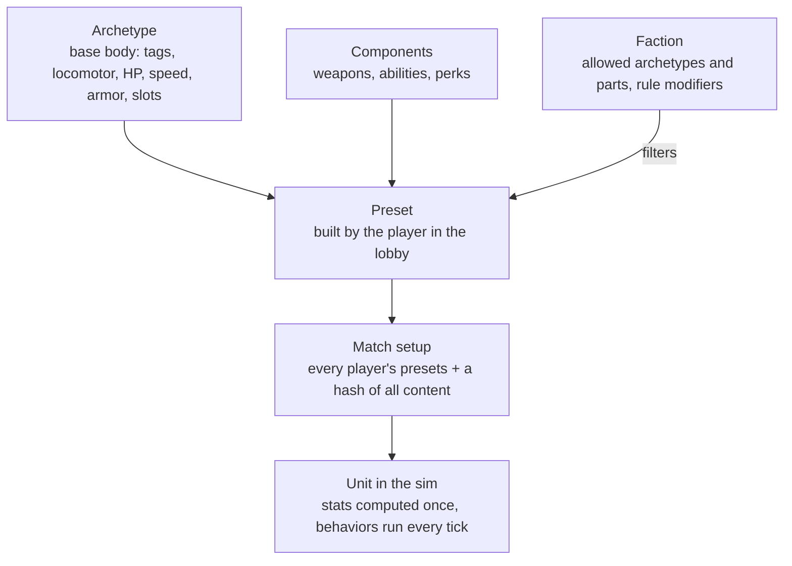
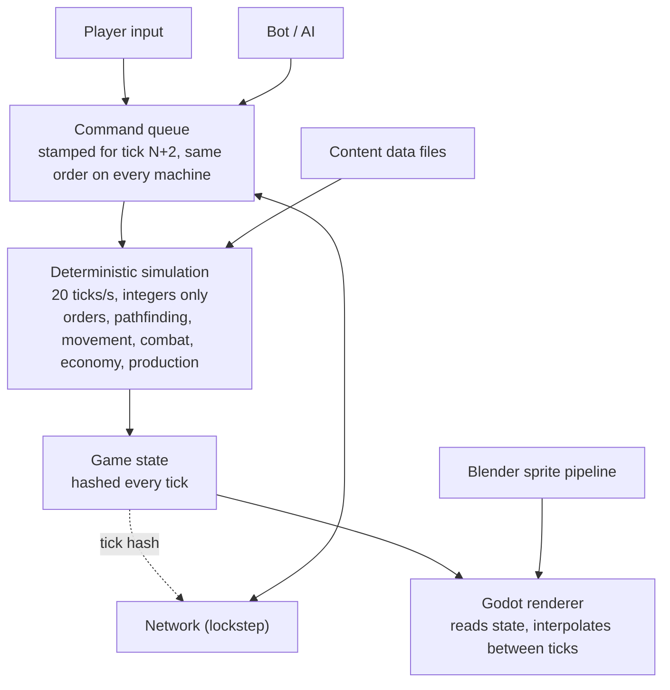

# RTS Game Design System

Updated October 16, 2026

The first playable game is a Resistance-vs-Resistance 1v1 skirmish on one 96×96 map against a tunable test bot. It runs on a deterministic simulation that the engine only draws, with art made as 3D models rendered to sprites. Every decision here was agreed step by step in the illustrated [Resistance MVP walkthrough](resistance-mvp.html) (download and open it in a browser to see the illustrations). Setting: the real world today, with fictional countries, groups and leaders.

## Visual spec

Every asset follows one camera, one light and one scale, so units from different artists or scripts look like the same game.

| Rule | Value | Why |
| --- | --- | --- |
| Projection | Orthographic, camera tilted 50° down from horizontal | Classic 3/4 RTS view; no perspective so sprites tile and stack cleanly |
| Grid cell | 32 × 32 px at 1×, assets authored at 2× (64 px) | Crisp on HiDPI; 1× is the gameplay unit for all sizes and ranges |
| Footprints | Infantry 0.4 cell, light vehicle 1 cell, heavy vehicle 1.5 cells, buildings 2×2 to 4×3 cells | Keeps pathing on a cell grid; buildings snap to cells |
| Vehicle facings | 32 body + 32 turret (separate layer) | Smooth turning; turret aims independently of hull |
| Infantry facings | 8 | Small on screen; 8 is enough and cuts frames 4× |
| Building states | Build-up animation, idle, active, damaged (< 50% HP), destroyed | Player reads health and activity at a glance |
| Animation rate | 15 fps, tied to sim ticks | Animations stay in sync with gameplay and replays |
| Key light | Single sun from top-left (azimuth 315°, elevation 45°) + soft fill | Shadows fall bottom-right on every asset |
| Shadows | Rendered as a separate layer, drawn as 50% black under all units | Blends with any terrain; no baked ground |
| Team color | Separate mask pass, tinted by a shader at runtime; 8 player colors | One render serves every player |

**Color hierarchy.** Terrain is desaturated and earthy. Unit bodies are mid-saturation neutrals. Team color is the most saturated element on a unit. Effects (muzzle flash, explosions, tracers) are the brightest thing on screen.

**Silhouette rule.** Each role must be identifiable from its silhouette alone at 32 px: tanks low and wide, artillery a long barrel, anti-air vertical barrels, harvesters a big box, infantry upright. If two units can be confused when shown as black shapes, redesign one.

## Art pipeline

A unit is modeled once in Blender, and one script renders every frame, layer and facing, so adding a unit takes hours, not weeks.

1. **Model** a low-poly mesh (500–3,000 triangles) at real-world scale, 1 Blender unit = 1 grid cell. Hull and turret are separate objects; the turret pivot sits on its rotation axis.
2. **Materials** use a shared library: base paint, metal, rubber, glass, and one `TEAM` material marking where player color goes.
3. **Render setup** comes from one shared template scene: orthographic camera at 50°, sun at 315°/45°, transparent background, EEVEE, 256 px per frame.
4. **The render script** rotates the model through 32 facings (11.25° steps) and outputs four passes per frame: color, team mask, shadow, and turret (if any).
5. **Downscale** 256 px frames to 64 px (2× asset) with a sharpening pass, so detail survives at game size.
6. **Pack** frames into a PNG atlas per unit, plus a JSON sidecar with frame rectangles, pivot point, turret anchor and muzzle positions per facing.
7. **Import**: the engine reads the JSON; no manual slicing.

File naming: `units/<unit_id>/<unit_id>_<layer>.png` and `<unit_id>.json`, where layer is `body`, `turret`, `mask`, `shadow`.

Infantry use the same script with a stock rigged character and Mixamo animations (idle, walk, shoot, three deaths) rendered from 8 facings.

## MVP: map, economy and base

One hand-made 96×96 map, bases in opposite corners, won by destroying every enemy structure and defense.

| Topic | Decision |
| --- | --- |
| Map | 96×96 cells, fog of war (unexplored dark, explored-but-unseen grey), one central oil field |
| Gold mines | 2 visible per base + 4 hidden; the map marks possible spots and the match seed picks which hold gold |
| Gold | Workers mine and carry each load back to the HQ; mines slowly run dry |
| Oil | A derrick on an oil spot plus a refinery within range of it; slower and costlier than gold, pays more over time |
| Starting cash | A grant at match start |
| Builders | Only workers build structures, for now |
| Power | None |
| Starting defenses | Pre-placed anti-infantry and anti-armor emplacements at each base; exact set to be decided |
| Win | Destroy every enemy structure and defense, starting defenses included |

| Structure | Does | Requires |
| --- | --- | --- |
| HQ | Trains workers, receives gold | Start |
| Barracks | Trains the four infantry classes | HQ |
| Vehicle yard | Builds the six vehicles | Barracks |
| Supply depot | Rearms launchers, ammo trucks and drone kits; faster reload nearby | HQ |
| Tunnel entrance | A node in the tunnel network | Barracks |
| Derrick + refinery | Oil income | Supply depot |

## Combat rules

Damage dealt = weapon damage × the warhead-vs-armor multiplier below, so every unit has a clear counter. "—" means the weapon can't target that kind of unit. No heavy armor in the mirror match.

| Warhead ↓ / Armor → | Infantry | Light vehicle | Building | Drone |
| --- | --- | --- | --- | --- |
| Bullet | 100% | 40% | 10% | 15% |
| Sniper round | 150% | 20% | 5% | 15% |
| Rocket (AT missile, launchers) | 40% | 120% | 80% | — |
| Explosive (traps, FPV drones) | 100% | 100% | 60% | — |
| AA missile | — | — | — | 100% |

- Rockets and explosives deal splash; launcher rockets fly with travel time and scatter, so they can miss moving targets.
- Booby traps are hidden from the enemy, fire once when an enemy ground unit comes close, and ignore drones. Enemy snipers and engineers reveal traps near them; once revealed, any unit can shoot them.
- All values are integers in the sim (percent as 0–100), never floats. Starting values for tuning; traps per soldier is set in playtests.

## Resistance faction

The Resistance wins on numbers, cheap drones, fast light vehicles, a rocket fleet that has to be resupplied, and tunnels. It has no planes. It is the only faction until the MVP is done; a faction is a set of art and preset rules on the same engine, so the second faction comes later as data.

**Infantry.** Trained one soldier at a time. Each soldier carries two things at once, a primary and a secondary. Before the match a player saves up to 3 presets per class; each preset is a pair of picks from that class's list.

| Class | Role | Loadout (MVP) |
| --- | --- | --- |
| Assault | Light frontline | Primary: rifle, SMG or LMG; secondary to be decided |
| Engineer | Utility | Kit: booby traps, FPV drones (2) or repair; no anti-armor role for now |
| Anti-armor | Kills vehicles and drones | Pairs such as AT missile + booby trap, or AA missile + short-range rifle |
| Sniper | Long range, sees far, reveals traps | Sniper rifle + short-range gun |
| Worker | Builds everything, mines gold | No loadout |

Skills such as medic, spotter and heavy anti-tank come with later archetypes.

**Vehicles and crew.** Vehicles leave the yard empty. Any of your soldiers can drive one, every driver is equal, and without a driver a vehicle can't move or fire. When a vehicle is destroyed, the driver survives by a chance drawn from the match seed. No capturing enemy vehicles.

| Vehicle | Role |
| --- | --- |
| Dirt bike | Fastest scout and raider, light weapon |
| Technical | Armed pickup with a heavy MG |
| Light rocket truck | Short-range salvos, \~6 cells |
| Medium rocket launcher | Medium-range salvos, \~12 cells |
| Heavy rocket launcher | Long-range bombardment, \~20+ cells, slow, needs a spotter |
| Ammo truck | Rearms launchers and drone kits in the field |

**Rocket fleet and supply.** Launchers carry a few salvos (count set in playtests) and go quiet when empty. Ammo trucks and supply depots refill them; ammo trucks carry limited stock and restock at a depot. Units in a supply radius reload faster. Launchers need someone to see the target.

**Drones.** An engineer kit, not a built unit: 2 FPV drones per engineer. Pick a target and the drone flies there on its own and explodes. It can be shot down in flight: the AA missile is the hard counter, and rifles and MGs hit drones only weakly. Spent drones restock from an ammo truck or depot.

**Tunnels.** Workers build entrances. Each entrance links to every other entrance within \~15 cells, and units travel along links with travel time. There is no root: any linked group works on its own. An entrance left with no links collapses instantly, and units travelling through it pop out, damaged, at the nearest working entrance.

**Guardrails.** Hidden things such as traps are hidden only on screen: in lockstep every machine simulates them, so a hacked client could reveal them, as in every lockstep RTS.

## Content model

Every unit, from infantry to planes, workers and buildings, is assembled from parts instead of written as its own class. Adding content means adding data; adding a new mechanic means one new behavior.



### Building blocks

| Block | What it is | Defined by |
| --- | --- | --- |
| Archetype | A base body: tags, locomotor, HP, speed, armor, slots | Data file |
| Component | A part that plugs into a slot: weapon, ability or perk, with a cost and requirements | Data file |
| Preset | An archetype plus chosen components, named by the player | Lobby, saved with the match |
| Faction | Allowed archetypes and components, plus rule modifiers | Data file |
| Behavior | The code that makes one kind of component work each tick | C# system |

An archetype, a base body:

```json
{ "id": "anti_armor", "tags": ["infantry"], "locomotor": "foot",
  "hp": 55, "speed": 9, "armor": "infantry",
  "slots": { "primary": 1, "secondary": 1 } }
```

A component that plugs into a slot:

```json
{ "id": "aa_missile", "slot": "primary",
  "requires": { "tags": ["infantry"] },
  "effects": [{ "type": "weapon", "warhead": "aa_missile",
                "range": 70, "reloadTicks": 80, "targets": ["air"] }] }
```

A player's preset, built in the lobby:

```json
{ "name": "Drone hunter", "archetype": "anti_armor",
  "components": ["aa_missile", "short_rifle"] }
```

### Behaviors

New content is data only. A brand-new mechanic is one new behavior plus data.

| Behavior | Covers |
| --- | --- |
| Weapon | Guns, rockets, anti-air; which layers it can hit is data (`targets: ["air"]`) |
| Aura | Heal, repair, speed and armor buffs |
| Placer | Booby traps, mines, sensors: spawns a hidden entity |
| Trigger | A trap firing when an enemy comes in range |
| Builder | Workers raising construction sites |
| BuildAssist | Engineers speeding up construction and unlocking better building variants |
| Repair | Fixing vehicles and buildings |
| Locomotor | Foot, wheeled, tracked, hover, flying; flyers skip ground pathfinding |

### Rules that keep it deterministic

- **Stats are computed, never stored ad hoc:** base stats, then modifiers from preset, faction, auras and upgrades, in a fixed order, as integer percents.
- **Definitions load once at match start,** sorted by ID into indexed arrays; no dictionaries inside the tick.
- **The content set and every player's presets are hashed into the match setup.** Machines with different data refuse to start instead of desyncing later; mods come for free.
- **Tags and requirements, not type checks:** code asks "has tag infantry?", never "is this an Assault?".
- **Systems run in a fixed order:** commands, orders, abilities and placement, movement per layer, combat, construction, auras and effects, cleanup.

## Architecture



Players, the AI and the network all reach the sim through one command queue, so replays and multiplayer reuse the same path. The renderer only reads state, so drawing can never cause a desync.

## Build order

Units first: Phase 1 gets you looking at real units and playing a battle against a simple, tunable bot before any base or economy exists. The deterministic sim core is already done: the golden replay passes on Linux, macOS and Windows.

**Phase 1: units you can see and play.** Two armies spawn; no base, no economy; win by wiping out the other army.

1. **Content model for units.** Classes, two-slot loadouts, vehicles and kits as data; redo the sample content for this roster.
   - Done when: the Resistance units run from data files and the golden replay passes on every OS.
2. **Art pipeline and Godot shell.** The Assault soldier modeled in Blender, animated and rendered in 8 directions, drawn by Godot from the sim.
   - Done when: you watch soldiers walk and shoot with real sprites.
3. **Controls and group movement.** Select, move, attack, control groups; units stop overlapping.
   - Done when: you command a squad through a gap without jamming.
4. **The full unit roster.** Four classes and loadouts, vehicles with crew, light, medium and heavy launchers, ammo trucks, drones, traps.
   - Done when: every MVP unit works in a battle.
5. **Tunable test bot.** A simple bot that fights you, plus headless bot-vs-bot battles with every tuning value in data files.
   - Done when: you play a battle against it, change a number, and see the result change.

**Phase 2: base and economy.**

6. **Structures and workers.** The six structures, training queues, starting defenses, win condition.
   - Done when: you build a full base from the HQ and win by razing the enemy's.
7. **Gold and oil.** Mining, carrying, depletion, derricks and refineries, supply radius.
   - Done when: a match runs on its own economy.

**Phase 3: map systems.**

8. **Fog of war.** Vision, hidden mines, trap detection.
   - Done when: a hidden mine appears only after a unit sees it.
9. **Tunnels.** Network, travel time, collapse.
   - Done when: killing a central entrance collapses the isolated ones.
10. **Balance runs.** Test bots with fixed strategies, 100-match batches.
    - Done when: win rates per strategy are reported. This is the MVP; LAN 1v1 comes next.

**Not in the MVP:** second faction with planes and heavy armor, scout drones and drone vehicles, medic/spotter/heavy AT skills, hidden supply caches, buildable defenses and upgrades, gunner seats and vehicle capture, ammo through tunnels, LAN (first milestone after the MVP) and online play, an opponent AI with difficulty levels, campaign, more maps and 2v2. Scavenging is dropped.

## Open questions

Decided: Godot 4 with a C# sim library; simcore is open source (MIT) and the game's art stays in a private repo; online play is not a launch goal before LAN works.

- [ ] Exact starting defense set per base
- [ ] Secondary slot choices for Assault and Engineer
- [ ] Salvos and rockets per launcher (playtests)
- [ ] Traps per soldier (playtests)
- [ ] Working title, and the second faction's name and identity
- [ ] Team size and who owns art vs code
